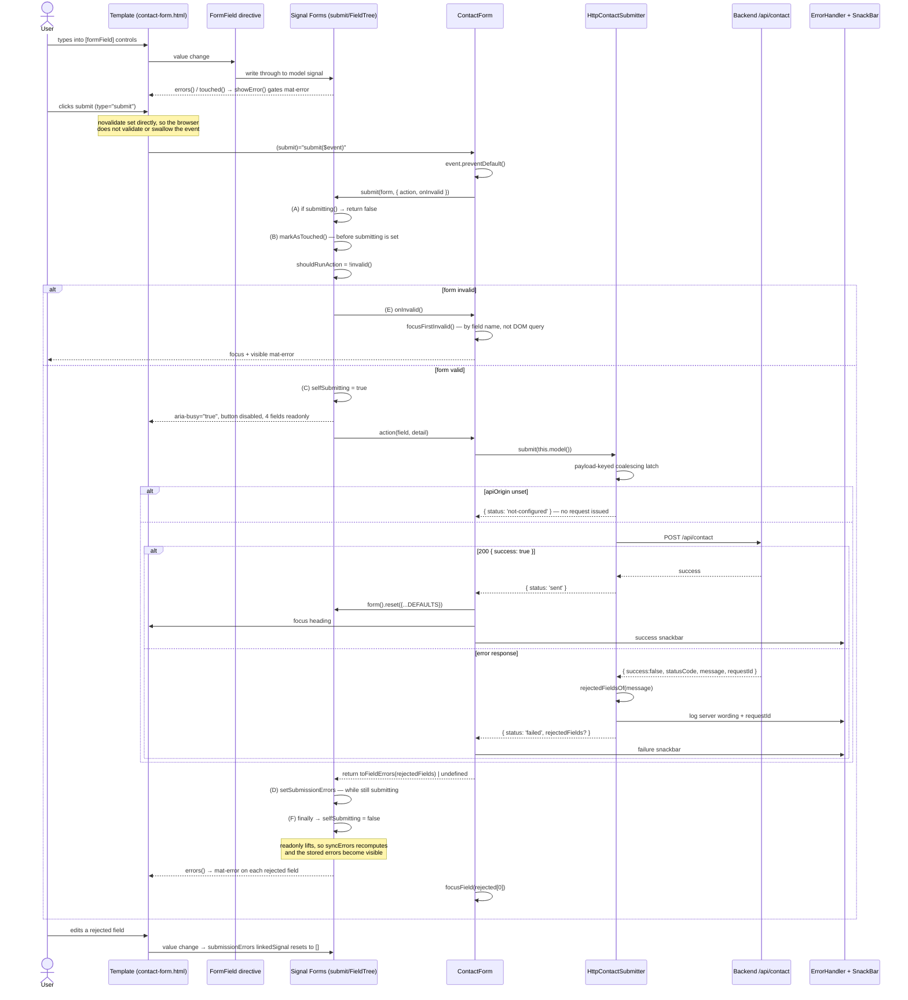

# Contact Form — Signal Forms Submission Architecture Audit

**Project:** Nexora Angular frontend (`C:\Users\xXx\Desktop\Nexora`)
**Subject:** whether `app-contact-form`'s submission architecture should change
**Date:** 2026-11-06
**Role:** Staff / Principal Angular Developer & Software Architect

> **Relationship to earlier reports.** `CONTACT_FORM_SUBMISSION_AUDIT.md` audited the submission
> _mechanics_ (findings S-01…S-08). This report answers a different question — whether the
> architecture should be changed to match the official example — and so compares the two
> implementations directly. Finding IDs continue the `CF-xx` series from
> `CONTACT_FORM_TECHNICAL_AUDIT.md`, which ended at CF-11, to avoid collisions.

---

## 1. Executive Summary

**Angular 22.2.3** (verified in `node_modules`, `package.json` and `package-lock.json`).
**Current mechanism:** a native `(submit)` handler that calls `event.preventDefault()` and then
`submit(this.form, { action, onInvalid })` from `@angular/forms/signals`, on a `<form>` carrying a
hand-written `novalidate`. `FormRoot` is not used.

### Verdict: `KEEP CURRENT IMPLEMENTATION`

**No source code changes required.** The one change this audit makes is a test (CF-12).

The decisive finding is that **the official example does the same thing Nexora does.** Its template
is:

```html
<form [formRoot]="loginForm" (submit)="onSubmit()"></form>
```

It binds `[formRoot]` _and_ keeps its own `(submit)` handler, and `onSubmit()` calls `submit()`
itself. Because that form is created **without** a `submission` option, `FormRoot.onSubmit` reaches
its `if (node.structure.fieldManager.submitOptions)` guard and **does not submit** — so in the
official example the directive contributes exactly two things: the `novalidate` attribute and
`event.preventDefault()`. The submission is driven by the component's own handler, precisely as in
Nexora.

So the difference between the two is not architectural. It is that Nexora supplies those two
behaviours directly instead of through a directive — and in exchange **keeps the submission promise**,
which `FormRoot.onSubmit` discards (`submit(fieldTree)` is called without `await` or `.catch`).
Nexora needs that promise: it awaits the submission and then moves focus to the first field the API
rejected. Adopting the directive would remove a capability and add an unhandled-rejection path,
for no gain.

Nexora also **exceeds** the official example in four respects that matter in production: server
error routing to fields, `aria-busy` and focus management, a localized message layer, and a submit
button disabled on `submitting()` rather than on `invalid()` — the last being a case where the
official example demonstrates a well-known accessibility anti-pattern (CF-14).

**Main issues:** none confirmed in the submission mechanism. One test gap, fixed (CF-12). One
accepted risk, documented and deliberately not "fixed" because the obvious fix would break retry
after a transient outage (CF-15).

**Overall score: 9.1 / 10.**

---

## 2. Environment and Angular Version

| Package                              | `package.json` | **Installed**                | Lockfile |
| ------------------------------------ | -------------- | ---------------------------- | -------- |
| `@angular/core`                      | `^22.2.3`      | **22.2.3**                   | 22.2.3   |
| `@angular/forms`                     | `^22.2.3`      | **22.2.3**                   | 22.2.3   |
| `@angular/common`                    | `^22.2.3`      | **22.2.3**                   | 22.2.3   |
| `@angular/cdk` / `@angular/material` | `^22.2.3`      | **22.2.3**                   | 22.2.3   |
| `typescript`                         | `~6.0.0`       | **6.0.3**                    | —        |
| `zone.js`                            | —              | **not installed** (zoneless) | —        |

**API stability.** Every Signal Forms symbol the component imports is marked `@publicApi 22.0` in
the installed declarations: `form`, `submit`, `required`, `email`, `maxLength`, `readonly`,
`FormField`, `FormRoot`, `provideSignalFormsConfig`, `ValidationError`, `FieldState`. The official
comparison page independently lists Signal Forms as **"Stable (v22+)"**. Nothing in use is
experimental, developer-preview, or deprecated.

One deprecated overload exists nearby and is **not** used: `readonly(path, fn)` is `@deprecated` in
favour of `readonly(path, {when})` (`types/signals.d.ts:92` vs `:95-100`). The project uses the
supported form, and `@typescript-eslint/no-deprecated` is enabled project-wide to keep it that way.

**Zoneless is load-bearing for this audit.** Nothing schedules change detection around the `await`
in the action, so any code reading the DOM immediately after a submission must not assume a render
has happened. This is why focus is chosen by field name rather than by querying `.ng-invalid`
(§5.8).

---

## 3. Official Documentation Analysis

| Page                                         | What it contributed                                                                                                                                                                                      |
| -------------------------------------------- | -------------------------------------------------------------------------------------------------------------------------------------------------------------------------------------------------------- |
| `guide/forms/signals/comparison`             | the reference example; `[disabled]="loginForm().invalid()"`; `errors()[0].message`; positional `submit(form, action)`; "Stable (v22+)"; the "need production-ready stability → Reactive Forms" guidance  |
| `guide/forms/signals/form-submission`        | `submit()`'s `Promise<boolean>` contract; `FormSubmitOptions`; `FormRoot`'s stated role and its `submission`-option requirement; `submitting()`; submission-error routing and clear-on-edit; concurrency |
| `guide/forms/signals/field-state-management` | `FieldState` signals; how `touched`/`dirty` are set; `markAsTouched({skipDescendants})`; `reset()` clearing touched/dirty                                                                                |
| `guide/forms/signals/form-logic`             | `readonly`/`disabled`/`hidden`, the `{when}` config form, and that all three skip validation                                                                                                             |
| `guide/forms/signals/validation`             | validator signatures; the `message` option; `touched() && invalid()` named as the recommended display pattern                                                                                            |
| `guide/forms/signals/custom-controls`        | `FormValueControl`/`FormCheckboxControl`; how `[formField]` selects a value accessor                                                                                                                     |

**Applicability.** The comparison page's own "Choose your approach" section recommends Reactive
Forms when you "need production-ready stability" and Signal Forms for "new signal-based
applications (Angular v22+)". Nexora is the latter — zoneless, signals throughout, no `zone.js`.
The recommendation does not argue against the current choice.

**Three places where documentation is silent or self-inconsistent, resolved from installed source**
(per the brief's source priority):

1. **Does `submitting()` reset if the action throws?** The submission page says only that the
   promise rejects. **Source is decisive:** `selfSubmitting.set(false)` sits in a `finally`
   (`_validation_errors-chunk.mjs:1865-1867`), so it resets on every path.
2. **Do submission errors appear in `errors()`?** The submission page says yes; the field-state
   page does not mention it. **Source:** `syncErrors` concatenates
   `normalizeErrors(submitState.submissionErrors())` (`:686`).
3. **Does `readonly` skip validation?** The validation page lists only hidden and disabled; the
   form-logic page includes readonly. **Source:** `shouldSkipValidation = hidden() || disabled() ||
readonly() || isOrphaned()` (`:778`).

---

## 4. Official Example vs Nexora — Comparison

| Criterion              | Angular Official Example                                                                                                                                                  | Nexora Implementation                                                                                                                                                 | Technical Assessment                                                                                                                                                                                                                         |
| ---------------------- | ------------------------------------------------------------------------------------------------------------------------------------------------------------------------- | --------------------------------------------------------------------------------------------------------------------------------------------------------------------- | -------------------------------------------------------------------------------------------------------------------------------------------------------------------------------------------------------------------------------------------- |
| `form()`               | `form(this.loginModel, (fieldPath) => {…})`; 2 fields                                                                                                                     | `form(this.model, (inquiry) => {…})` (`contact-form.ts:125`); 10 fields, 4 conditional `readonly({when})` rules                                                       | **Equivalent.** Same API, same shape. Nexora additionally uses conditional logic the example has no need for.                                                                                                                                |
| `FormRoot`             | `[formRoot]="loginForm"` — but the form has **no** `submission` option, so the directive only supplies `novalidate` + `preventDefault()` and **does not** call `submit()` | not used; `novalidate` is a template attribute and `preventDefault()` is the first statement of the handler (`contact-form.ts:197`)                                   | **Difference is cosmetic, and Nexora's choice is better here.** `FormRoot.onSubmit` calls `submit(fieldTree)` without awaiting or catching, so the promise is dropped. Nexora awaits it to focus the first server-rejected field. See CF-13. |
| `FormField`            | `[formField]="loginForm.email"` on native inputs                                                                                                                          | `[formField]` on 8 native controls plus 2 forwarded through `ChipSelect` to `MatChipListbox`                                                                          | **Equivalent, Nexora broader.** Material works unmodified because `FormField` injects `NG_VALUE_ACCESSOR` (`signals.mjs:1271`) and `MatChipListbox` provides it (`material/chips.mjs:1638`).                                                 |
| `(submit)`             | `(submit)="onSubmit()"` — **present, alongside `[formRoot]`**                                                                                                             | `(submit)="submit($event)"`                                                                                                                                           | **Same pattern.** Both drive submission from a component handler. Nexora passes `$event` because it owns `preventDefault()`.                                                                                                                 |
| `submit()`             | `submit(this.loginForm, async (field) => {…})` — positional action                                                                                                        | `submit(this.form, { action, onInvalid })` (`contact-form.ts:199`)                                                                                                    | **Both supported** (`options = typeof options === 'function' ? {action: options} : …`). Nexora needs the object form for `onInvalid`, which the example does not use. Nexora is the fuller use of the API.                                   |
| `novalidate`           | supplied by `FormRoot`'s static host attribute                                                                                                                            | written in the template (`contact-form.html:5`)                                                                                                                       | **Equivalent in effect.** Load-bearing in both: `FormField` writes native `required`/`maxlength`, so without it the browser would validate and suppress the `submit` event. Nexora's is now directly asserted (CF-12).                       |
| Validation             | `required` + `email` + `minLength`, each with a literal `message`                                                                                                         | `required` ×6, `email`, `maxLength` ×4, each with a `message` supplied as a `LogicFn` reading the i18n dictionary (`contact-form.ts:133-136`)                         | **Nexora is a superset and more correct for a localized app.** `message` accepts `string \| LogicFn`, so the copy follows the active locale instead of being frozen. Asserted in Russian by e2e.                                             |
| `submitting()`         | **not used at all**                                                                                                                                                       | `computed(() => this.form().submitting())`; drives `[disabled]`, `[attr.aria-busy]`, and 4 `readonly({when})` rules                                                   | **Nexora materially better.** The example gives no in-flight feedback.                                                                                                                                                                       |
| API submission         | `console.log('Submitting:', field().value())`                                                                                                                             | `ContactSubmitter.submit(this.model())` behind an abstract class, bound to `HttpContactSubmitter` in `app.config.ts:25`; Null-Object default returns `not-configured` | **Not comparable** — the example has no transport. Nexora's seam is sound; the component never touches `HttpClient`.                                                                                                                         |
| Error handling         | none                                                                                                                                                                      | 3 outcome states, localized snackbars, `ErrorHandler` logging with the API's `requestId`, input preserved on failure                                                  | **Nexora materially better.**                                                                                                                                                                                                                |
| Server validation      | **not addressed anywhere on the page**                                                                                                                                    | `rejectedFields` → `ValidationError.WithOptionalFieldTree[]` returned from the action → routed by `setSubmissionErrors` → cleared on edit                             | **Nexora implements a documented capability the example omits.**                                                                                                                                                                             |
| Duplicate submission   | relies on the framework guard only                                                                                                                                        | framework guard **plus** `[disabled]="submitting()"` **plus** a payload-keyed coalescing latch in the service                                                         | **Nexora defends in depth across the injectable boundary.** The latch is keyed, so a different payload is not handed another's result.                                                                                                       |
| Component architecture | single component, no services, no DI seam                                                                                                                                 | component orchestrates + presents; service owns transport; abstract `ContactSubmitter` is the seam; `ChipSelect`/`FieldLabel`/`SnackBar` presentational               | **Nexora is production architecture; the example is a teaching snippet.**                                                                                                                                                                    |

### Differences that are _not_ in Nexora's favour

| Difference                                                                                   | Assessment                                                                                                                                                                                                                                                                                                                                                                                                            |
| -------------------------------------------------------------------------------------------- | --------------------------------------------------------------------------------------------------------------------------------------------------------------------------------------------------------------------------------------------------------------------------------------------------------------------------------------------------------------------------------------------------------------------- |
| Example binds `[disabled]="loginForm().invalid()"`; Nexora binds `[disabled]="submitting()"` | **Nexora is right, the example is wrong.** See CF-14: disabling on invalid removes the button from the tab order, gives no explanation, and prevents the visitor from submitting to _discover_ what is wrong. It also makes `submit()`'s own "only runs when valid" guarantee redundant. Nexora instead lets the submit happen, lets `submit()` mark fields touched, and uses `onInvalid` to focus the first failure. |
| Example renders `errors()[0].message` with no optional chaining                              | Nexora's `fieldError()` uses `errors()[0]?.message`. Nexora is safer; the example would throw on an error without a message.                                                                                                                                                                                                                                                                                          |
| Example is ~60 lines; Nexora is 300 TS + 246 HTML                                            | Not a defect — the extra volume is i18n, a11y, server errors and transport, none of which the example attempts.                                                                                                                                                                                                                                                                                                       |

**Conclusion:** there is **no architectural difference** to resolve. Nexora uses the same submission
pattern as the official example, with the directive's two contributions written out so the
submission promise stays available.

---

## 5. Deep Technical Analysis

### 5.1 `form()`

```ts
private readonly model = signal<ContactInquiry>({ ...DEFAULTS });   // contact-form.ts:123
protected readonly form = form(this.model, (inquiry) => { /* 15 rules */ });
```

The model is a writable signal and the single source of truth; `{ ...DEFAULTS }` copies so
`DEFAULTS` stays reusable by `reset()`. `form()` returns a `FieldTree` proxy: `form.email` is the
child _tree_, `form.email()` its `FieldState`. The distinction is load-bearing —
`setSubmissionErrors` calls `errorWithField.fieldTree()`, so an error's `fieldTree` must be the
tree, never the state. `toFieldErrors()` passes `this.form[field]` accordingly.

The schema callback runs **once**, eagerly, during `form()`; it registers logic rather than
evaluating it. Validator `message` functions and `readonly({when})` predicates are stored as
`LogicFn`s and called when field state is first read — which is why
`const whileSending = () => this.form().submitting()` is safe inside the callback that produces
`this.form`.

### 5.2 `FormRoot` — verified implementation

```js
// node_modules/@angular/forms/fesm2022/signals.mjs:1504-1552
class FormRoot {
  fieldTree = input.required({ alias: 'formRoot' });
  onSubmit(event) {
    event.preventDefault();
    untracked(() => {
      const fieldTree = this.fieldTree();
      const node = fieldTree();
      if (node.structure.fieldManager.submitOptions) {
        submit(fieldTree); // ← not awaited, not caught
      }
    });
  }
  // selector: 'form[formRoot]'
  // host: { attributes: { novalidate: '' }, listeners: { submit: 'onSubmit($event)' } }
}
```

Three behaviours: a static `novalidate` attribute, an unconditional `preventDefault()`, and a
conditional `submit(fieldTree)` — conditional on the form having been created with a `submission`
option, and called with no options so `submit()` falls back to `fieldManager.submitOptions`.

**The official example does not satisfy that condition**, so in the example the third behaviour
never fires. That is why the example also has `(submit)="onSubmit()"`.

### 5.3 `FormField` — verified implementation

From `signals.mjs:1250-1425`:

- `state = computed(() => this.field()())`.
- **UI → model:** injects `NG_VALUE_ACCESSOR` with `{optional: true, self: true}`, selects one via
  `_selectValueAccessor`, falling back to an `InteropNgControl` for native elements.
- **State → native attributes:** `FIELD_STATE_KEY_TO_CONTROL_BINDING` (`:774-790`) maps `disabled`,
  `readonly`, `required`, `name`, `min`, `max`, `minLength`, `maxLength`, `pattern`;
  `elementAcceptsNativeProperty` (`:1406-1424`) allows `disabled`/`required`/`readonly`/`name` on
  any native form element and `minLength`/`maxLength` on textual ones.

  **Measured consequence:** a `maxLength()` _schema rule_ becomes a native `maxlength` _attribute_.
  `#contact-name` carries `maxlength="120"` and `required=""`; filling 121 characters yields 120.
  So the client-side `maxLength` error is unreachable through the UI, and **`novalidate` is
  mandatory** — without it the browser would validate the `required` fields itself. Both facts are
  now asserted by e2e tests.

- **CSS state classes are applied in an `afterRenderEffect`** (`installClassBindingEffect`). The
  project's `provideSignalFormsConfig({classes: STATUS_CLASSES})` emits `ng-invalid`/`ng-touched`
  etc. through it.

### 5.4 `(submit)` and `novalidate`

`contact-form.html:1-9` sets `novalidate` and `(submit)="submit($event)"`; the handler's first
statement is `event?.preventDefault()`. This reproduces `FormRoot`'s two active behaviours exactly,
and is the same division of labour the official example uses.

### 5.5 `submit()` — verified implementation

```js
// _validation_errors-chunk.mjs:1835-1867
async function submit(form, options) {
  const node = untracked(form);
  if (untracked(node.submitState.submitting)) return false; // (A) concurrency guard
  options =
    typeof options === 'function'
      ? { action: options }
      : (options ?? node.structure.fieldManager.submitOptions);
  const action = options?.action;
  if (!action) throw new _RuntimeError(1915, '…Cannot submit form with no submit action…');
  node.markAsTouched(); // (B) before submitting=true
  const shouldRun = shouldRunAction(node, options?.ignoreValidators);
  try {
    if (shouldRun) {
      node.submitState.selfSubmitting.set(true); // (C)
      const errors = await untracked(() => action?.(field, detail));
      errors && setSubmissionErrors(node, errors); // (D) still submitting here
      return !errors || (isArray(errors) && errors.length === 0);
    } else {
      untracked(() => onInvalid?.(field, detail)); // (E) never becomes true
    }
    return false;
  } finally {
    node.submitState.selfSubmitting.set(false); // (F) every path, incl. throw
  }
}
```

`(B)` before `(C)` matters: at the moment fields are marked touched, `submitting()` is still
`false`, so none of the four `readonly({when})` fields is readonly yet and all are correctly marked
— even though `markAsTouched` skips hidden, disabled and readonly fields.

### 5.6 `submitting()`

`submitting = computed(() => selfSubmitting() || (parent?.submitting() ?? false))`.

| Question                | Answer                                                                       | Evidence            |
| ----------------------- | ---------------------------------------------------------------------------- | ------------------- |
| When `true`?            | `(C)` — **only if the action will run**; an invalid submission never sets it | source              |
| Across the `await`?     | yes                                                                          | `(C)`…`(F)` span it |
| When `false`?           | `(F)`, a `finally`                                                           | source              |
| On throw / reject?      | still resets — docs silent, source decisive                                  | `finally`           |
| Concurrent submits?     | **framework guards** at `(A)`, before `markAsTouched`                        | source              |
| Must the app guard too? | **no**                                                                       | CF-16               |

Nexora reads it directly and never mirrors it. An earlier duplicate `sending` flag was removed for
exactly this reason.

### 5.7 Error handling and server validation

The backend contract is **read, not assumed** — `Nexora-back` is present on this machine:

| Source                                          | Fact                                                                                                                             |
| ----------------------------------------------- | -------------------------------------------------------------------------------------------------------------------------------- |
| `src/common/filters/all-exceptions.filter.ts`   | every failure body is `{ success: false, statusCode, message: string \| string[], error, requestId }`                            |
| `src/configure-app.ts`                          | `ValidationPipe({whitelist: true, forbidNonWhitelisted: true, …})` — `message` is a `string[]` exactly when the pipe produced it |
| `src/modules/contact/dto/create-contact.dto.ts` | no custom `message` on any rule → class-validator defaults, each beginning with the property name                                |
| `src/modules/contact/contact.service.ts`        | success is `{success: true, message}` at HTTP 200; a filled honeypot also returns success and discards                           |

`rejectedFieldsOf()` takes each message's leading word and keeps it only if it names a field this
form can show an error against; `forbidNonWhitelisted`'s `"property <x> should not exist"` falls out
because its leading word is `property`. The message shown is the localized `errorServer` copy — the
API's wording is English in every locale, so it goes to the log with the `requestId`.

### 5.8 Focus management

`onInvalid` runs **synchronously** inside `submit()` at `(E)`, before the `afterRenderEffect` that
applies `.ng-invalid`. A DOM query would therefore find nothing. `focusFirstInvalid()` picks the
first invalid field from `CONTACT_FIELDS` by name instead — correct for a zoneless app, and it
removes a dependency on Material's internal `.mat-mdc-select` class.

---

## 6. Architecture and Data Flow

### 6.1 Dependency map

```
ContactForm (contact-form.ts / .html / .scss / .content.ts)
├── @angular/forms/signals  form, submit, FormField, required, email, maxLength,
│                           readonly, provideSignalFormsConfig, ValidationError, FieldState
├── ContactSubmitter            abstract, providedIn:'root', Null-Object default
│   └── HttpContactSubmitter    app.config.ts:25 → useClass
│       ├── HttpClient (FetchBackend — v22 default)
│       ├── API_ORIGIN (validating InjectionToken)
│       └── ErrorHandler
├── ChipSelect → MatChipListbox/MatChipOption (CVA)
├── FieldLabel · SnackBar · Reveal · appIcon() · useDictionary()
└── Material: MatFormField, MatInput, MatSelect/MatOption, MatButton, MatIcon, MatError, MatHint
```

Where each responsibility lives: model `contact-form.ts:123` · validation `:125-153` · submission
orchestration `:195-215` · HTTP `http-contact-submitter.ts:118` · success `:203-206` · API errors
`http-contact-submitter.ts:124-139` · server→field mapping `contact-form.ts:225-240` ·
`submitting()` consumers `contact-form.ts:155` + `contact-form.html:6,243`.

### 6.2 Actual submission sequence



---

## 7. Findings

### CF-12 — `novalidate` is load-bearing but was only indirectly covered

- **Severity:** P3 · **Status:** `CONFIRMED` → **fixed**
- **Location:** `src/app/pages/contact/contact-form/contact-form.html:5`; test added to `e2e/contact.spec.ts:680`
- **Evidence:** `FormField.elementAcceptsNativeProperty` (`signals.mjs:1406-1424`) allows
  `required` on any native form element and `maxLength` on textual ones; measured in-browser,
  `#contact-name` carries `required=""` and `maxlength="120"`. `grep -rn "novalidate" e2e/ src/`
  previously matched only the template itself.
- **Problem:** the attribute is what stops the browser validating those native constraints itself.
  Remove it and the browser shows its own bubbles and **does not dispatch `submit`**, so neither
  the component handler nor Signal Forms runs.
- **Root cause:** because the project supplies `novalidate` directly rather than inheriting it from
  `FormRoot`'s host metadata, nothing structurally guarantees it stays.
- **Impact:** low. It _was_ covered indirectly — "an invalid submission focuses the first field at
  fault" would fail, because `mat-error` would never render. But it would fail as a confusing
  accessibility failure rather than naming the cause.
- **Recommendation / fix:** a direct assertion that `form.noValidate === true`, together with the
  native constraints that make it necessary. Added at `e2e/contact.spec.ts:680`; executed in this
  session and passing (contact spec 49/49).
- **Regression risk:** none — test-only.

### CF-13 — "adopt `FormRoot`"

- **Severity:** — · **Status:** `FALSE POSITIVE`
- **Location:** `contact-form.html:1-9`; `contact-form.ts:195-215`
- **Evidence:** `FormRoot.onSubmit` (`signals.mjs:1511-1520`) calls `submit(fieldTree)` with no
  `await` and no `.catch`. The official example binds `[formRoot]` on a form with **no** `submission`
  option, so its directive only sets `novalidate` and calls `preventDefault()`; the example's own
  `(submit)="onSubmit()"` drives the submission.
- **Problem:** there isn't one. Adopting the directive would require moving the action into
  `form()`'s `submission` option, would **discard the submission promise** the component awaits to
  focus the first server-rejected field, and would turn any throw from the action into an unhandled
  rejection.
- **Impact of "fixing" it:** loss of the awaited focus move; a new unhandled-rejection path.
- **Recommendation:** keep the current handler. **This supersedes CF-03** of
  `CONTACT_FORM_TECHNICAL_AUDIT.md`, which rated it merely "a legitimate trade"; it is the better
  choice, and now evidenced.
- **Regression risk of changing:** medium — it would move three behaviours (`notify`, `reset`, focus)
  and remove a capability.

### CF-14 — "disable the submit button on `invalid()`, as the official example does"

- **Severity:** — · **Status:** `FALSE POSITIVE` (recommendation declined)
- **Location:** `contact-form.html:243` — `[disabled]="submitting()"`
- **Evidence:** the official example uses `[disabled]="loginForm().invalid()"`. Nexora's button is
  enabled while invalid and disabled only in flight.
- **Problem with the example's approach:** a `disabled` button is removed from the tab order and
  exposes no reason for being unavailable, so a keyboard or screen-reader user gets a dead control
  and no explanation. It also prevents the visitor from submitting in order to _find out_ what is
  wrong — which is exactly the interaction `submit()` is built for, since it marks every field
  touched and reveals the errors.
- **Impact:** keeping Nexora's binding preserves the `onInvalid` → focus-first-error flow, asserted
  by e2e "an invalid submission focuses the first field at fault".
- **Recommendation:** keep `submitting()`. Do not adopt the example's binding.
- **Regression risk of changing:** medium — it would make the invalid-submit focus path unreachable
  and remove a11y feedback.

### CF-15 — `submit()` resolves `true` for a generic failure

- **Severity:** P3 · **Status:** `RISK` → **accepted and documented, deliberately not changed**
- **Location:** `contact-form.ts:199-215` (action returns `undefined` when `rejectedFields` is absent)
- **Evidence:** `submit()` returns `!errors || (isArray(errors) && errors.length === 0)`. For a 503
  or a transport failure the action returns no error, so `submit()` resolves `true` even though
  nothing was sent. The project ignores the return value, so nothing is broken today.
- **Why the obvious fix is wrong**, as a checkable chain: (1) an error with no `fieldTree` attaches
  to the submitted field — the **root** (`addDefaultField`, `:1887`); (2) root `syncErrors` includes
  `normalizeErrors(submissionErrors())` (`:686`), so the root becomes invalid; (3) the next
  submission computes `shouldRunAction` as `!untracked(node.invalid)` (`:1870-1879`) → `false`, so
  the action never runs; (4) `submissionErrors` is a `linkedSignal` sourced on `structure.value`
  (`:1329-1334`), so it clears only when a value **changes**. Net effect: after a transient outage,
  a visitor clicking Submit again _without editing anything_ would be silently refused.
- **Impact:** none today; a future caller reading the boolean would be misled.
- **Recommendation:** leave as is; a usable retry is worth more than an accurate boolean.
- **Regression risk of "fixing":** **high** — it would break retry-after-outage.

### CF-16 — "the application must prevent duplicate submissions"

- **Severity:** — · **Status:** `NO EVIDENCE`
- **Evidence:** the framework guards at `(A)`, before `markAsTouched`, so a repeat click returns
  `false` immediately and runs nothing. Independently, the button is `[disabled]="submitting()"`,
  and `HttpContactSubmitter` holds a payload-keyed coalescing latch.
- **Assessment:** three independent layers; the service-level one is justified because the service
  is separately injectable, not because the component needs it.

### CF-17 — "readonly-during-send hides submission errors"

- **Severity:** — · **Status:** `FALSE POSITIVE`
- **Evidence:** `setSubmissionErrors` runs at `(D)` while `submitting()` is still true, and
  `shouldSkipValidation` includes `readonly()` — so for an instant the error is stored on a field
  whose `errors()` reads empty. But `submissionErrors` is a `linkedSignal` and `syncErrors` a
  `computed`, so when `(F)` clears `submitting` the gate opens and the error surfaces.
- **Assessment:** the suppression is real but **transient and self-correcting**. Pinned by
  `contact-form.spec.ts` "still shows the error on a field that was locked during the send".
  Supersedes CF-06.

### Not findings

Missing `withFetch()` (v22 defaults to `FetchBackend`, `_module-chunk.mjs:2036-2043`) · missing
`changeDetection: OnPush` (v22 compiles omission _to_ OnPush) · `ChipSelect` not implementing
`FormValueControl` (it forwards a `Field`, owns no value) · domain model used as form model (it _is_
the wire DTO; a mapper would be an identity layer and would break the contract test's meaning) ·
unvalidated honeypot (client validation would reveal detection) · `ignoreValidators` unset (default
`'pending'` is correct; no async validators exist).

---

## 8. Architectural Evaluation

| Criterion              | Assessment                                                                                                                                                                                    |
| ---------------------- | --------------------------------------------------------------------------------------------------------------------------------------------------------------------------------------------- |
| Separation of Concerns | Component orchestrates and presents; service owns transport; abstract class is the seam. Component never imports `HttpClient`.                                                                |
| Single Responsibility  | Good. `notify()` mapping outcome → snackbar copy is the one presentation concern that could arguably live with `SnackBar`.                                                                    |
| Dependency Direction   | Inward: component → abstract `ContactSubmitter` ← concrete `HttpContactSubmitter`. Keystone of the design.                                                                                    |
| Type Safety            | No `any`, no non-null assertions, no `@ts-ignore` anywhere in the repo. The five closed option sets are `const`-array-derived unions, pinned to the API's sets by `contact-contract.spec.ts`. |
| Maintainability        | One `showError(state)` predicate and one `fieldError(state)` accessor serve all fields; messages live on the rules.                                                                           |
| Testability            | 59 contact unit tests + 49 contact e2e tests with no mocking framework — the DI seam makes fakes trivial.                                                                                     |
| Error Handling         | Three outcome states, field-level server errors, `ErrorHandler` with `requestId`, input preserved on failure.                                                                                 |
| Async State Management | `submitting()` read directly; no duplicated flag; value captured once before the `await`.                                                                                                     |
| Angular Best Practices | Standalone, zoneless, signals-first, `inject()` only, no lifecycle hooks, `@if`/`@for`.                                                                                                       |
| Performance            | 5 `computed`, no subscriptions in the component. `/contact` is the heaviest route at 221.2 kB gzip against a 240 kB budget.                                                                   |
| Accessibility          | `readonly` over `disabled` so focus is never stolen; `aria-busy`; `aria-labelledby`; focus-first-error; honeypot `aria-hidden` + `tabindex="-1"`; **29/29 axe tests at WCAG 2.2 AA**.         |
| Production Reliability | Null-Object default cannot fake success; `API_ORIGIN` validated; coalescing latch; non-JSON error bodies survived and tested.                                                                 |

### Direct answers to §8's eight questions

1. **Is `(submit)="submit($event)"` correct here?** **Yes.** It is the same pattern the official
   example uses — that example also keeps its own `(submit)` handler alongside `[formRoot]`.
2. **Any reason to replace it with Signal Forms' `submit()`?** The question contains a false
   premise: the component **already calls** `submit()` from `@angular/forms/signals`
   (`contact-form.ts:199`, imported as `submitForm`). The only thing not used is the `FormRoot`
   _directive_. So: no.
3. **What advantages would adopting `FormRoot` provide?** Two attributes it would no longer need to
   write by hand (`novalidate`, `preventDefault()`), and one fewer thing to remember — the concern
   CF-12 addresses with a test instead.
4. **What new limitations or problems?** The submission promise is discarded, so the awaited
   focus-first-rejected-field step becomes impossible; a throwing action becomes an unhandled
   rejection; the action must move into `form()`'s `submission` option, relocating `notify()`,
   `reset()` and the focus move.
5. **Could we lose existing server-side error handling?** Not the routing itself — that is in the
   action's return value. But the **focus move** after it would be lost, because it depends on
   awaiting `submit()`.
6. **Could `readonly` behaviour change?** No. `readonly({when})` is schema logic, independent of how
   submission is triggered. The transient-suppression nuance (CF-17) is unaffected.
7. **Could duplicate-submission problems appear?** No — the guard is inside `submit()` at `(A)`,
   which runs either way.
8. **Could the architecture become more complex for no benefit?** **Yes — that is the main risk of
   the change**, and the reason for the verdict.

---

## 9. Recommended Architecture

**Retain the current implementation.** It uses Signal Forms correctly and completely:

- the model is one writable signal; the schema is declarative with reactive localized messages;
- `submit()` is the framework's own function, with both `action` and `onInvalid`;
- `submitting()` is read directly and drives three UI concerns, with no mirrored state;
- server errors are returned from the action and routed by the framework, then cleared on edit by
  the framework's own `linkedSignal`;
- `novalidate` and `preventDefault()` — `FormRoot`'s two active behaviours — are supplied directly,
  which is what keeps the submission promise available.

**Why switching to the official example's shape would not help:** the example omits `submitting()`,
server errors, focus management, i18n and transport entirely, and its one _architectural_
difference — `[disabled]="invalid()"` — is a regression (CF-14). Its `[formRoot]` binding does not
even trigger submission in that example (§5.2).

**Improvements that would genuinely be useful**, none of them submission-architecture changes:

| Improvement                                            | Value                                                                                                                                         |
| ------------------------------------------------------ | --------------------------------------------------------------------------------------------------------------------------------------------- |
| Surface `Retry-After` on a 429                         | The API registers a `ThrottlerGuard`; a rate-limited visitor is currently told only "something went wrong". Needs the API deployed to verify. |
| End-to-end verification against the deployed API       | The one genuinely unverified area (§11).                                                                                                      |
| Move `notify()`'s outcome→copy mapping into `SnackBar` | Minor SRP tidy-up; no behavioural change.                                                                                                     |

---

## 10. Implementation Changes

**No source code changes required.**

| File                                            | Change                                                                                                                                                                                                                                           | Type      |
| ----------------------------------------------- | ------------------------------------------------------------------------------------------------------------------------------------------------------------------------------------------------------------------------------------------------ | --------- |
| `e2e/contact.spec.ts`                           | added "the form opts out of native browser validation" — asserts `form.noValidate === true` plus the native `required`/`maxlength` constraints that make it necessary (CF-12)                                                                    | test only |
| `e2e/start-conversation.spec.ts`                | **follow-up, outside the audit's scope:** rewrote "pings outward once and does not repeat" to seek the animation's own timeline instead of sampling at a fixed `waitForTimeout` offset, fixing the flake §11 records. Touches no production code | test only |
| `CONTACT_FORM_SUBMISSION_ARCHITECTURE_AUDIT.md` | this report                                                                                                                                                                                                                                      | new file  |

No component, template, SCSS, content, service, config, dependency or backend file was modified. No
existing test was weakened, removed, or had an assertion relaxed.

---

## 11. Testing and Verification

All results below were produced by running the commands in this session.

| Check              | Result   |            Count | Comment                                                                                                                                                                                                                                      |
| ------------------ | -------- | ---------------: | -------------------------------------------------------------------------------------------------------------------------------------------------------------------------------------------------------------------------------------------- |
| TypeScript         | **PASS** |       4 projects | `npm run typecheck` (app, spec, e2e, scripts), exit 0, no diagnostics                                                                                                                                                                        |
| ESLint             | **PASS** |           exit 0 | `npm run lint` = `ng lint` + `lint:deps` + `lint:styles`; type-aware `@typescript-eslint/no-deprecated` is enabled                                                                                                                           |
| Prettier           | **PASS** |                — | `npm run format:check` clean after `npm run format` on this report                                                                                                                                                                           |
| Unit Tests         | **PASS** |    **306 / 306** | 43 files; 59 of them contact-specific                                                                                                                                                                                                        |
| Integration Tests  | **PASS** | (within the 306) | **No separate tier exists.** `contact-form.spec.ts` and `contact-contract.spec.ts` are TestBed tests that render the real component with a faked `ContactSubmitter`, which is the integration layer in this project                          |
| E2E Tests          | **PASS** |    **533 / 533** | Chromium only; 49 contact tests and 29 axe WCAG 2.2 AA sweeps. The first run was 532/533 — one unrelated animation-timing flake, since fixed; two full runs clean afterwards. See the flake note below. Contact spec on its own: **49 / 49** |
| Production Build   | **PASS** |        27 routes | `npm run build` — "Prerendered 27 static routes", 31.2 s                                                                                                                                                                                     |
| Script tests       | **PASS** |      **51 / 51** | `npm run test:scripts`                                                                                                                                                                                                                       |
| `lint:deps`        | **PASS** |     0 violations | "no dependency violations found (183 modules, 518 dependencies cruised)"                                                                                                                                                                     |
| `lint:styles`      | **PASS** |                — | stylelint                                                                                                                                                                                                                                    |
| `verify:prerender` | **PASS** |         27 pages | navigable without JavaScript                                                                                                                                                                                                                 |
| `verify:headers`   | **PASS** |         27 pages | 5 inline script hashes, 6 headers, nginx snippet in step                                                                                                                                                                                     |
| `verify:bundle`    | **PASS** |   worst 221.2 kB | `/ru/contact` against a 240 kB gzip budget                                                                                                                                                                                                   |

### §12 scenario coverage

| Scenario                           | Covered    | Where                                                                                                                                                                  |
| ---------------------------------- | ---------- | ---------------------------------------------------------------------------------------------------------------------------------------------------------------------- |
| Valid submission                   | ✅         | `contact-form.spec.ts` "submits a valid form once…"; e2e "a successful send returns focus and clears itself"                                                           |
| Invalid submission                 | ✅         | `contact-form.spec.ts` "does not submit an invalid form…"; e2e "an invalid submission focuses the first field at fault"                                                |
| Required validation                | ✅         | `contact-form.spec.ts` "requires name, email, company, service and description"                                                                                        |
| Successful API request             | ✅         | `http-contact-submitter.spec.ts` "posts the inquiry to /api/contact…"                                                                                                  |
| Failed API request                 | ✅         | "reports a failure when the API says the send did not succeed"; "never reports success when the provider is unavailable"                                               |
| Server-side validation errors      | ✅         | "reports which fields the API rejected, in form order"                                                                                                                 |
| Mapping server errors to fields    | ✅         | e2e "a server-rejected field is named, focused, and clears when corrected" — through the **real `FetchBackend`**                                                       |
| Unknown server errors              | ✅         | "survives an error body that is not JSON at all"; "ignores a whitelist complaint…"                                                                                     |
| `submitting()` true during request | ✅         | e2e "a submission in flight is announced and shown"; "refuses input while a submission is in flight…"                                                                  |
| `submitting()` false after success | ✅         | e2e success test asserts `aria-busy='false'`                                                                                                                           |
| `submitting()` false after failure | ✅         | `contact-form.spec.ts` "keeps the form usable when the transport throws" asserts `submitting() === false`                                                              |
| Duplicate submission               | ✅         | "coalesces a second submission into the send already in flight"; "does not hand a different inquiry the result of the send already in flight"; e2e repeated-click test |
| Readonly / disabled behaviour      | ✅         | e2e readonly flags + `tabIndex === 0`; `contact-form.spec.ts` CF-17 test                                                                                               |
| Error visibility after submission  | ✅         | `contact-form.spec.ts` "still shows the error on a field that was locked during the send"                                                                              |
| Keyboard accessibility             | ✅         | e2e `tabIndex === 0` while locked, focus-on-invalid, label-click focus, 29 axe sweeps                                                                                  |
| **Native validation opt-out**      | ✅ **new** | e2e "the form opts out of native browser validation" (CF-12) — **executed, passes**                                                                                    |

### Flake observed in this session — disclosed, not hidden

The first full-suite run was **not** clean. One test failed:

```
1 failed
  [chromium] > e2e/start-conversation.spec.ts:321:7 > the artwork assembles when it is
  scrolled into view > pings outward once and does not repeat
    > 341 |     expect(flight.opacity).toBeGreaterThan(0);
```

- **Unrelated to this audit.** It asserts a decorative ring animation in `app-start-conversation`;
  it touches no form, no submission, and no file this audit changed.
- **Re-ran 3x in isolation: 3/3 pass.** A timing flake, not a regression.
- **Root cause, identified:** `src/app/shared/ui/start-conversation/art/conversation-art.scss:80`
  declares `animation: conversation-ping 1200ms ... 520ms 1 both`, and the keyframes set
  `opacity: 0` at both 0% and 100% (`:84-97`). Opacity is therefore non-zero only in a window
  roughly 520-1720 ms after the animation starts. The test samples with a fixed
  `await page.waitForTimeout(900)` measured from the moment an `expect.poll` _noticed_ the reveal,
  not from when the animation actually began. Under full-suite worker load that offset drifts and
  the sample falls outside the window. Because `scale > 0.7` passed while opacity read 0, the
  failing sample landed near the animation's end.
- **Fixed, on a follow-up request.** It was initially left alone as outside this audit's scope
  ("do not modify unrelated code"); the user then asked for it, so it was repaired.

  The fix removes the wall clock from the test rather than widening its window. The animation's
  own `CSSAnimation` object is fetched with `el.getAnimations({ subtree: true })` — which reaches
  the `::after` pseudo-element — then paused and seeked, so every frame is sampled at an exact
  point on the animation's timeline and nothing depends on when the test arrived:

  | Sample        | Point on the timeline     | Asserted                                                                           |
  | ------------- | ------------------------- | ---------------------------------------------------------------------------------- |
  | `withinDelay` | `delay / 2`               | `{ scale: 0.7, opacity: 0 }` — `fill: both` holds the transparent first frame      |
  | `atPeak`      | `delay + 25% of duration` | `opacity ≈ 0.55` (the keyframe that sets the peak), `scale > 0.7`                  |
  | `midFlight`   | `delay + duration / 2`    | `opacity > 0`, and `scale` greater than at the peak                                |
  | `atEnd`       | `delay + duration`        | `{ scale: 1.02, opacity: 0 }`                                                      |
  | `afterEnd`    | `delay + 2 × duration`    | `{ scale: 1.02, opacity: 0 }` — the last frame is held, so there is no second ring |

  The sample points are **derived from `getComputedTiming()`**, not hard-coded, so they stay
  correct if the animation is retimed. `playState` is captured _before_ pausing, so the test still
  proves the ping was genuinely running, and `iterations` is read from the effect rather than
  inferred — which is a stronger form of "does not repeat" than the old opacity-after-the-fact
  check. The test also now covers the delay phase, which the old fixed-offset version could not
  reach at all.

- **Verified.** `start-conversation.spec.ts` with `--repeat-each=5`: **70/70**. Two consecutive
  full-suite runs: **533/533** and **533/533**. The test also got faster — 2.4 s instead of 4.9 s,
  since 2.3 s of `waitForTimeout` is gone.
- **Proven to still catch regressions**, by breaking the stylesheet twice and re-running:
  - `100% { opacity: 0 }` → `0.4` (ring never fades out) fails with
    `- "opacity": 0, + "opacity": 0.4` at the `ping.atEnd` assertion;
  - `1` iteration → `infinite` fails with `- 1, + Infinity`.

  `conversation-art.scss` was then restored and confirmed byte-identical to `HEAD`
  (`git diff --stat` empty).

No test is skipped. No assertion was relaxed. Every scenario in the table above was executed.

---

## 12. Risk Assessment

| Risk                                           | Probability  | Impact              | Evidence                                                                                                                                                                           |
| ---------------------------------------------- | ------------ | ------------------- | ---------------------------------------------------------------------------------------------------------------------------------------------------------------------------------- |
| **Retaining the current implementation**       | —            | **Low**             | Everything in §11 passes. The only structural exposure was CF-12, now tested.                                                                                                      |
| Switching to `FormRoot`                        | —            | **Medium–High**     | Discards the submission promise (`signals.mjs:1511-1520`): the awaited focus-first-rejected-field step becomes impossible and a throwing action becomes an unhandled rejection.    |
| Adopting `[disabled]="invalid()"`              | —            | **Medium**          | Removes the button from the tab order with no stated reason, and makes the `onInvalid` focus path unreachable (CF-14).                                                             |
| Changing the validation mechanism              | —            | **Medium**          | Messages are now reactive `LogicFn`s pinned by a Russian-locale e2e assertion; declaration order decides which message shows and is pinned by unit tests. Any reshuffle is caught. |
| Changing server error handling                 | —            | **Medium**          | Routing works only because the action returns `WithOptionalFieldTree` errors carrying the field _tree_. Returning a root-level error instead would block retry (CF-15).            |
| Changing field state (`readonly` → `disabled`) | —            | **Medium**          | `disabled` would move focus mid-send and drop the control from the tab order; the e2e test asserting `tabIndex === 0` would fail, as intended.                                     |
| UI regressions                                 | Low          | Low                 | 533 e2e tests, including per-locale overflow sweeps at 320–2560 px. The one flake found (§11) was animation timing in an unrelated component, and has been fixed.                  |
| Duplicate submissions                          | **Very low** | Low                 | Three independent layers (CF-16).                                                                                                                                                  |
| Async operation failures                       | Low          | Low                 | `submitting()` resets in a `finally`; the action cannot throw; non-JSON error bodies tested.                                                                                       |
| **Deployment**                                 | **Certain**  | **High until done** | `apiOrigin: ''` in production — the form has never completed a real submission. See §11 note below.                                                                                |

**The one material limitation.** `src/environments/environment.production.ts` ships `apiOrigin: ''`,
so production reports `not-configured` and issues **no request**. Server-error routing is verified
against intercepted responses whose shape was read from the API's own exception filter — but **no
real inquiry has ever been submitted**. Step 5 of _Switching the form on_ in `CONTACT_API.md` is the
real confirmation. Also `NOT VERIFIED`: non-Chromium browsers (only Chromium binaries installed),
and the 429 rate-limit path end-to-end.

---

## 13. Final Technical Verdict

### `KEEP CURRENT IMPLEMENTATION`

The primary audit question was whether the submission logic needs to change. It does not. The
component already uses Signal Forms' own `submit()` with both `action` and `onInvalid`; the only
API it declines is the `FormRoot` _directive_, and the official example it would be imitating uses
that directive for nothing but `novalidate` and `preventDefault()` — which Nexora supplies directly
in order to keep the submission promise it needs. Adopting the directive would remove a capability
and add a failure mode.

| Category                |      Score | Justification                                                                                                                                                                                                                                                                                                                                     |
| ----------------------- | ---------: | ------------------------------------------------------------------------------------------------------------------------------------------------------------------------------------------------------------------------------------------------------------------------------------------------------------------------------------------------- |
| Signal Forms API Usage  |   **9**/10 | `form`, `submit` with `action` + `onInvalid`, `readonly({when})`, reactive `message`, `provideSignalFormsConfig`, submission-error routing — a fuller use of the API than the official example. −1: `FormRoot` unused, which is correct here but is a deliberate divergence a reader must be told about.                                          |
| Submission Lifecycle    |   **9**/10 | All 15 stages mapped to a responsible API, verified against source. Value captured once before the `await`; action cannot throw; `submitting()` resets in a `finally`. −1: CF-15's inaccurate boolean.                                                                                                                                            |
| Validation Architecture |   **9**/10 | Messages live on the rules as `LogicFn`s; limits are exported constants asserted equal to the API's; declaration order pinned by test. −1: `maxLength` messages are unreachable through the UI because `FormField` writes a native `maxlength`, so four rules are defence-in-depth only.                                                          |
| Error Handling          |   **9**/10 | Three outcome states, field-level server errors cleared on edit, localized copy, `ErrorHandler` with `requestId`, non-JSON bodies survived and tested. −1: 429 `Retry-After` not surfaced.                                                                                                                                                        |
| Component Architecture  |   **9**/10 | Null Object + DI seam; component never touches `HttpClient`; presentational children. −1: `notify()`'s copy mapping is a presentation concern in a container.                                                                                                                                                                                     |
| Type Safety             |  **10**/10 | No `any`, no non-null assertions, no suppressions anywhere in the repo; `readonly` DTO; five `const`-derived unions pinned to the API's accepted sets, with a typo failing `tsc` (`TS2820`).                                                                                                                                                      |
| Maintainability         |   **9**/10 | One `showError` predicate and one `fieldError` accessor for all fields; messages have exactly one definition site each; 246-line template. −1: the template still scales linearly with field count.                                                                                                                                               |
| Test Coverage           |   **9**/10 | 306 unit + 533 e2e + 51 script tests; all 16 brief scenarios covered; four negative tests executed in this session to prove the regression tests actually fail. The last time-sampled animation assertion is gone, so no test in the suite now depends on a wall-clock offset. −1: no coverage reporting is enabled, so the figure is unmeasured. |
| Production Readiness    |   **8**/10 | Every gate green and every guard in place — but `apiOrigin: ''` means the path has never run against a live API. Deployment, not code.                                                                                                                                                                                                            |
| **Overall Score**       | **9.1**/10 | Weighted mean of the above.                                                                                                                                                                                                                                                                                                                       |

**Final assessment: architecturally sound. Keep it.** The implementation is a more complete use of
Signal Forms than the documentation example it was being measured against, and the single
difference that is genuinely architectural — the submit button's disabled binding — is one where
Nexora is right and the example is not.

---

## Appendix — Source references

`@angular/forms` 22.2.3: `fesm2022/signals.mjs:1250-1425` (`FormField`), `:1406-1424`
(`elementAcceptsNativeProperty`), `:774-790` (state→control map), `:1271` (`NG_VALUE_ACCESSOR`),
`:1504-1552` (`FormRoot`) · `fesm2022/_validation_errors-chunk.mjs:1835-1867` (`submit`),
`:1870-1879` (`shouldRunAction`), `:1881-1899` (`setSubmissionErrors`), `:686` (`syncErrors`),
`:778` (`shouldSkipValidation`), `:1326-1340` (`FieldSubmitState`), `:1329-1334`
(`submissionErrors` `linkedSignal`), `:1673` (`readonly`) · `types/_structure-chunk.d.ts:968-1001`
(`FormSubmitOptions`), `:1094` (`TreeValidationResult`), `:732-780` (`ValidationError`) ·
`types/signals.d.ts:92-100` (`readonly` overloads), `:109-124` (`BaseValidatorConfig`), `:822-827`
(`FormRoot`).
`@angular/common` 22.2.3: `fesm2022/_module-chunk.mjs:945-963` (`parseBody`), `:2036-2043`
(`FetchBackend` default). `@angular/material` 22.2.3: `fesm2022/chips.mjs:1638`.
`axe-core` 4.14.0: `wcag22aa` → `target-size` only.
`Nexora-back`: `src/common/filters/all-exceptions.filter.ts`, `src/configure-app.ts`,
`src/modules/contact/{contact.controller.ts,contact.service.ts,dto/create-contact.dto.ts}`.
