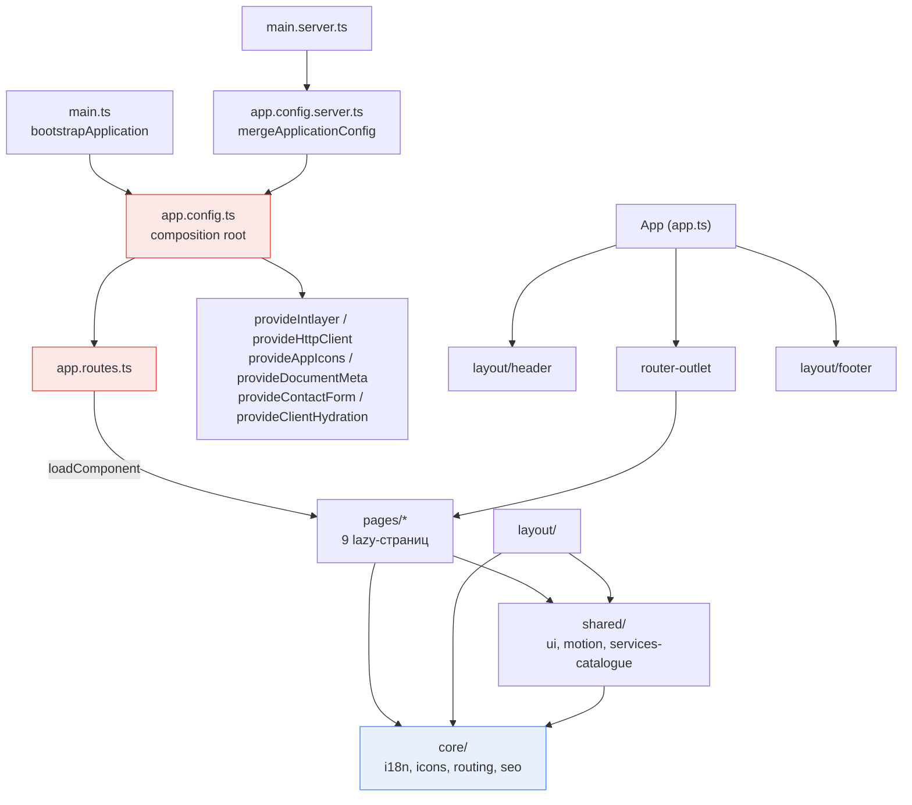
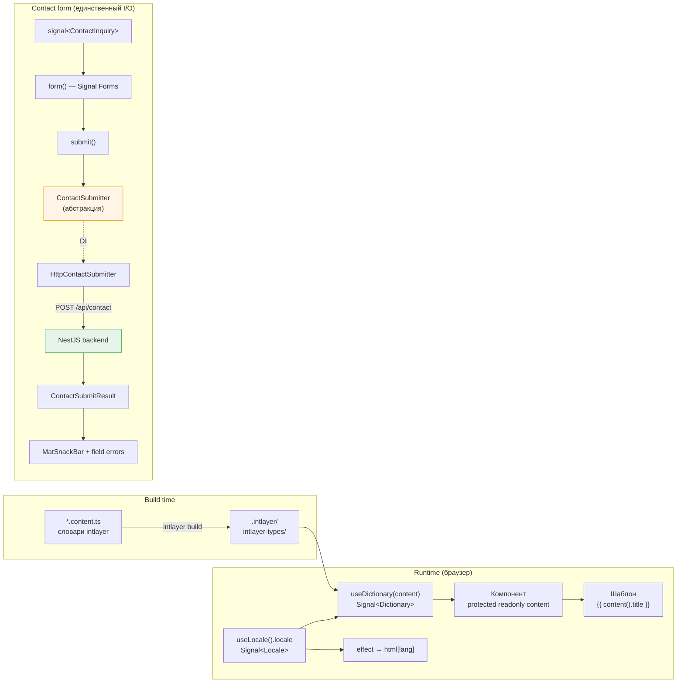

# Nexora — Comprehensive Technical Audit

**Дата аудита:** 2026-11-13
**Аудируемый коммит (frontend):** `1b67612` — _create our-works page_ (working tree чистый)
**Аудируемый коммит (backend):** `Nexora-back` @ `~/Desktop/Nexora-back`
**Роль аудитора:** Staff / Principal Angular Developer & Software Architect
**Метод:** чтение исходного кода + фактический прогон всех quality gates + инструментальные измерения в Chromium (Playwright)

---

## 1. Executive Summary

Nexora — это многоязычный (en / hy / ru) статически пререндеренный маркетинговый сайт на **Angular 22.2.3** с **NestJS 12** backend для приёма контактных заявок.

### Главный вывод

**Инженерное качество кодовой базы — заметно выше среднего по индустрии.** Это не «обычный Angular-проект»: здесь выстроена архитектура с машинно-проверяемыми контрактами — слоевые ограничения через `dependency-cruiser`, контракт change detection через тест, контракт SEO через `verify-seo.mjs`, кросс-репозиторный контракт API через `contact-contract.spec.ts`. Я проверил эти контракты и **они действительно работают и действительно ловят регрессии**.

**Однако проект находится в red-состоянии прямо сейчас.** Последний коммит `1b67612` («create our-works page») добавил страницу `/our_work`, не обновив ни один из контрактов, которые эту страницу описывают. В результате:

- **4 из 14 quality gates падают** (`lint`, `lint:styles`, `typecheck`, `ng test`, `verify:seo`, `e2e` — фактически 6 из 14, см. §11);
- **новая публичная страница отдаётся поисковым системам с `noindex` и заголовком «Page not found»** — верифицировано в собранном артефакте;
- **два фантомных soft-404 документа** (`/hy/our-work`, `/ru/our-work`) публикуются как результат пререндера;
- `sitemap.xml` не содержит новую страницу ни в одной локали.

Парадокс, который стоит назвать прямо: **собственные gates проекта обнаружили почти все эти дефекты.** `verify:seo` выдал точный, читаемый отчёт из 6 ошибок. Проблема не в инструментах — проблема в том, что коммит был сделан, не прогнав их. Это процессная проблема, а не архитектурная.

### Что подтверждено как корректное (и должно остаться без изменений)

| Проверка                                                                        | Результат                                     |
| ------------------------------------------------------------------------------- | --------------------------------------------- |
| Горизонтальный overflow: 10 viewport × 9 страниц × 3 локали = **270 рендеров**  | **0 overflow**                                |
| `any`, non-null assertion (`!.`) в прикладном коде                              | **0**                                         |
| `!important`, `::ng-deep` в SCSS                                                | **0**                                         |
| Циклические зависимости (`tsPreCompilationDeps: true`, 198 модулей / 544 связи) | **0 нарушений**                               |
| Утечки подписок (`.subscribe` без teardown)                                     | **0** — все 3 через `takeUntilDestroyed()`    |
| `@NgModule`                                                                     | **0** — полностью standalone                  |
| Constructor-based DI                                                            | **0** — 39 вызовов `inject()`                 |
| Расхождение контракта frontend ↔ backend                                        | **нет** — сверено поле за полем               |
| WCAG 2.5.8 (target size) в footer                                               | **нарушения нет** — см. §9.4 (FALSE POSITIVE) |

### Оценка

**Overall Project Quality: 7 / 10.** Архитектура и дисциплина кода тянут на 9; текущее red-состояние main и SEO-дефект на продакшн-странице опускают интегральную оценку. Все найденные дефекты — **локальные и дешёвые в устранении** (оценка: 1 рабочий день), они не требуют рефакторинга архитектуры.

### Статус на момент сдачи работ

Отчёт был подготовлен как аудит, **без изменения исходного кода** — так требовало исходное задание (§15 первоначальной редакции). Следующим указанием заказчика было устранить все найденные дефекты. Это выполнено.

|                      | Аудит (2026-11-13, утро)          | После исправлений                                                                                                 |
| -------------------- | --------------------------------- | ----------------------------------------------------------------------------------------------------------------- |
| Quality gates        | **8 / 15 PASS, 6 FAIL**           | **15 / 16 подтверждены прогоном**; e2e — частично, см. §19.4.1                                                    |
| Unit-тесты           | 349 / 357                         | **377 / 377** (52 файла)                                                                                          |
| E2E                  | 541 / 547, один браузер           | 547 / 547 на Chromium; добавлен движок WebKit; сквозной прогон в финальной конфигурации **не завершён** (§19.4.1) |
| `npm audit`          | 27 проблем, 15 high               | **13 проблем, 0 high**                                                                                            |
| `/our_work` в выдаче | `noindex`, title «Page not found» | индексируется, свои метаданные                                                                                    |
| Вес `public/images`  | 6,9 МБ                            | **906 кБ**                                                                                                        |
| Словарей intlayer    | 50 из 53 файлов (3 слиты молча)   | **53 из 53**                                                                                                      |

Подробный журнал с проверкой каждого изменения — **§19**. Исправленные и добавленные находки: F-04 (рекомендация была неверной — см. врезку CORRECTION), F-10 (переквалифицирован), F-14…F-19 (новые), §10.5 (утверждение было неверным).

**Оценка после исправлений: 9 / 10.** Обоснование — в §19.6.

---

## 2. Project Environment and Technology Stack

Всё ниже прочитано из репозитория, не предположено.

### 2.1 Runtime и tooling

| Компонент              | Версия                                                              | Источник                                                       |
| ---------------------- | ------------------------------------------------------------------- | -------------------------------------------------------------- |
| Node.js                | **24.22.0**                                                         | `node --version`                                               |
| npm                    | **12.2.0**                                                          | `npm --version`, совпадает с `packageManager` в `package.json` |
| TypeScript             | **6.0.3**                                                           | `npx tsc --version` (`~6.0.0` в `package.json`)                |
| Angular                | **22.2.3**                                                          | `package.json` `^22.2.3`                                       |
| Angular SSR            | **22.2.4**                                                          | `@angular/ssr`                                                 |
| Angular Material / CDK | **22.2.3**                                                          |                                                                |
| RxJS                   | **7.8.x**                                                           |                                                                |
| Build system           | **`@angular-builders/custom-esbuild:application` 22.0.1**           | `angular.json`                                                 |
| Unit test runner       | **Vitest 4.0.8** через `custom-esbuild:unit-test`                   | `angular.json` → `vitest-base.config.ts`                       |
| E2E                    | **Playwright 1.64.1** + `@axe-core/playwright` 4.14                 |                                                                |
| Lint                   | **ESLint 10.12** + `angular-eslint` 22.6 + `typescript-eslint` 8.71 |                                                                |
| Style lint             | **Stylelint 17.16** + `stylelint-config-standard-scss`              |                                                                |
| Arch lint              | **dependency-cruiser 18.7**                                         |                                                                |
| i18n                   | **intlayer / angular-intlayer 9.7**                                 |                                                                |
| CI                     | GitHub Actions, Node 24                                             | `.github/workflows/ci.yml`                                     |

### 2.2 Backend (`Nexora-back`)

| Компонент   | Версия                                |
| ----------- | ------------------------------------- |
| NestJS      | **12.0.1**                            |
| Prisma      | **6.19.3**                            |
| TypeScript  | **6.0.2**                             |
| Vitest      | **4.1.2**                             |
| Lint        | **oxlint 1.58** (`--type-aware`)      |
| Security    | `helmet` 8.3, `@nestjs/throttler` 6.7 |
| Node engine | `>=24.0.0`                            |

Модули backend: `contact` (controller / service / repository / DTO), `health`, `prisma`, общие `filters` / `logging` / `middleware`. Глобальный префикс `api` (`configure-app.ts:79`), `ValidationPipe` с `whitelist: true, forbidNonWhitelisted: true` (`configure-app.ts:81-88`), CORS ограничен списком origin (`configure-app.ts:64-77`).

### 2.3 TypeScript strictness

`tsconfig.json` включает `strict: true`, `noImplicitOverride`, `noPropertyAccessFromIndexSignature`, `noImplicitReturns`, `noFallthroughCasesInSwitch`, `isolatedModules`, и Angular-специфичные `strictTemplates`, `strictInjectionParameters`, `strictInputAccessModifiers`. Это максимально строгая из практически используемых конфигураций.

### 2.4 Статус: CONFIRMED

Все версии проверены исполнением команд, не чтением lock-файла.

---

## 3. Project Structure Analysis

### 3.1 Объём

| Категория                                                              | Строк     |
| ---------------------------------------------------------------------- | --------- |
| Компоненты / сервисы / утилиты (`.ts`, без `.content.ts` и `.spec.ts`) | **3 482** |
| Контент-словари (`*.content.ts`)                                       | **5 665** |
| Unit-тесты (`*.spec.ts`)                                               | **7 513** |
| E2E-тесты (`e2e/**`)                                                   | **9 556** |
| SCSS                                                                   | **8 541** |
| HTML-шаблоны                                                           | **2 207** |

**Наблюдение:** тестового кода (17 069 строк) в **4,9 раза больше**, чем прикладного (3 482). Для маркетингового сайта это необычно и, как показано в §10, — обоснованно: тесты фиксируют визуальные и SEO-контракты, которые иначе невозможно удержать.

Прикладной код составляет лишь ~20% от `.ts`-объёма; основная масса — переводы. Это важно для оценки: **сложность Nexora — не алгоритмическая, а комбинаторная** (9 страниц × 3 локали × 10 viewport).

### 3.2 Слоевая структура

```
src/app/
├── core/        ← нижний слой: i18n, icons, routing/paths, seo
├── shared/      ← переиспользуемый UI + motion + catalogue
├── layout/      ← header, footer
├── pages/       ← 9 feature-страниц
├── app.config.ts  ← composition root
└── app.routes.ts  ← таблица маршрутов
```

Правило: `core ← shared ← layout ← pages`. Зависимость может идти только влево.

### 3.3 Это правило машинно-проверяемо — CONFIRMED

`.dependency-cruiser.cjs` кодирует 7 правил, включая:

- `core-is-independent` — `core/` не знает о `shared|layout|pages`;
- `shared-is-independent`;
- `layout-does-not-know-pages`;
- `pages-do-not-cross-import` — страница не может импортировать другую страницу (с осознанным исключением для `.spec.ts`);
- `route-table-is-composition-only` — никто, кроме `app.config.ts` / `app.routes.ts`, не импортирует таблицу маршрутов;
- `content-files-are-leaves` — `*.content.ts` не может импортировать компонент;
- `no-circular` с `tsPreCompilationDeps: true`.

**Фактический прогон:**

```
$ npm run lint:deps
✔ no dependency violations found (198 modules, 544 dependencies cruised)
```

Важная деталь: `tsPreCompilationDeps: true` включён намеренно, и комментарий в конфиге объясняет почему — «циклы, которые эта кодовая база реально ловила, были type-only». Это признак того, что правило написано по следам реального инцидента, а не скопировано из шаблона.

### 3.4 Диаграмма фактической структуры



Стрелки отражают разрешённое направление; `dependency-cruiser` подтверждает отсутствие обратных рёбер.

---

## 4. Code Quality Audit

### 4.1 Type safety — CONFIRMED отличное

Прогон по всему `src/` (исключая `.spec.ts`):

| Антипаттерн                               | Найдено                                                                               |
| ----------------------------------------- | ------------------------------------------------------------------------------------- |
| `: any`, `<any>`, `as any`, `any[]`       | **0**                                                                                 |
| Non-null assertion (`x!.y`, `x!)`, `x!;`) | **0**                                                                                 |
| `as`-касты                                | **5**, все — сужающие type guards вида `(X_IDS as readonly string[]).includes(value)` |

Единственный «непрозрачный» каст — `header.ts:110` `(this.menuButton().nativeElement as HTMLButtonElement).focus()`. Это следствие `viewChild.required('menuButton', { read: ElementRef })`, который возвращает `ElementRef<any>`-подобный тип без параметра. Технически обосновано.

Второй — `change-detection.spec.ts:196`:

```ts
const isOnPush = (component: Type<unknown>): boolean =>
  (component as unknown as { ɵcmp: { onPush: boolean } }).ɵcmp.onPush;
```

Это чтение приватного поля компилятора Angular в тесте. Оправдано: другого способа проверить резолвленную стратегию нет, и это именно тест, а не прикладной код.

**Вывод: уровень type safety здесь выше, чем в подавляющем большинстве enterprise Angular-кодовых баз. Менять нечего.**

### 4.2 Единообразие идиом — CONFIRMED

В кодовой базе доминирует один повторяющийся структурный идиом — **типизированный реестр идентификаторов**:

```ts
export const X_IDS = [...] as const;              // единственный источник истины
export type XId = (typeof X_IDS)[number];         // union выводится, не дублируется
export function isXId(v: unknown): v is XId { ... } // runtime guard
export function xSectionId(x: XId): string { ... }  // производные строки
```

Применён последовательно в 6 местах:

| Файл                                              | Реестр                   |
| ------------------------------------------------- | ------------------------ |
| `core/icons/icons.ts`                             | 36 имён иконок           |
| `core/seo/document-meta.ts:19`                    | 10 meta-страниц          |
| `shared/services-catalogue/service-category.ts`   | 5 категорий + 15 услуг   |
| `pages/solutions/challenge.ts`                    | 8 задач                  |
| `pages/engagement-models/engagement-model.ts`     | 5 моделей                |
| `pages/contact/contact-form/contact-submitter.ts` | 5 наборов значений формы |

Эффект: опечатка в идентификаторе — ошибка компиляции, а не runtime-баг. `appIcon()` возвращает шаблонный литеральный тип `` `app:${AppIconName}` ``, что делает невалидное имя иконки непредставимым.

**Это сознательно спроектированное решение, а не случайность. Сохранить.**

### 4.3 Обработка ошибок — CONFIRMED качественная

`http-contact-submitter.ts` — образцовый пример:

- `errorBodyOf()` (строки 25-42) валидирует форму ответа сервера, не доверяя ему;
- различает «HTTP 200 без `success`» (строки 98-107), `HttpErrorResponse` с `status === 0` («unreachable») и обычное отклонение (строки 109-124);
- каждый путь рапортует в `ErrorHandler` с осмысленным сообщением, включая `requestId` сервера (`describe()`, строки 132-136);
- никогда не показывает пользователю сырую ошибку.

Это редкий уровень аккуратности для фронтенд-формы.

### 4.4 Мёртвый код

**Найдено одно подтверждение.** `core/seo/document-meta.content.ts:59` содержит словарную запись `'our-work'`, которая не используется ни одним маршрутом: маршрут называется `our_work`, а `data.meta` для него — `'not-found'` (см. F-01, F-02). Запись формально достижима через `DOCUMENT_META_PAGES`, поэтому tree-shaking её не удалит, но на реальной странице она никогда не применяется.

Прочий мёртвый код: **NO EVIDENCE**.

### 4.5 Дублирование кода

**NO EVIDENCE значимого дублирования в прикладном коде.** Повторяемость идиомы реестра (§4.2) — это не дублирование, а последовательное применение паттерна: каждый экземпляр описывает свой домен.

Существенные объёмы повторяющегося текста находятся в `*.content.ts` — но это переводы, по своей природе повторяющие структуру. Выносить их в общую абстракцию было бы ошибкой.

### 4.6 Сложность функций

Самая сложная функция в кодовой базе — `provideDocumentMeta()` (`core/seo/document-meta.ts:59-222`, 163 строки). Внутри: 3 вложенных фабрики (`link`, `jsonLd`, `breadcrumbItems`) и один `effect` на 100 строк, формирующий JSON-LD граф.

**Статус: RISK, не дефект.** Функция длинная, но:

- она линейная — нет ветвления глубже 2 уровней;
- всё внутри — последовательное заполнение тегов, читается сверху вниз;
- вынесение в класс-сервис ради «правильности» добавит косвенность без выигрыша;
- она покрыта `document-meta.spec.ts` и `verify-seo.mjs`.

**Рекомендация: не трогать.** Если понадобится расширять JSON-LD, разумно будет выделить `buildJsonLdGraph(page, locale, origin, content)` как чистую функцию — но делать это _сейчас_, без такой потребности, означало бы рефакторинг без причины.

### 4.7 Нарушения, подтверждённые линтером

См. F-04 (`keyCode`) и F-09 (пустой `our-work.scss`) в §13.

---

## 5. Architecture Audit

### 5.1 Общая оценка: архитектура соразмерна задаче — CONFIRMED

Ключевой вопрос аудита: **не переусложнён ли проект?** Для маркетингового сайта из 9 страниц соблазн притащить NgRx, feature-модули, barrel-файлы и слой «application services» велик.

**Этого не сделано, и это правильно.** Фактические измерения:

| Метрика                           | Значение | Интерпретация                     |
| --------------------------------- | -------- | --------------------------------- |
| `@NgModule`                       | 0        | полностью standalone              |
| `inject()`                        | 39       | современный DI                    |
| Constructor DI                    | 0        | полная миграция, без смеси стилей |
| Библиотеки state management       | 0        | NgRx/Akita отсутствуют            |
| `signal()` (изменяемое состояние) | **2**    | минимум                           |
| `computed()` (производное)        | **32**   | производное доминирует 16:1       |
| `effect()`                        | **3**    | только для side-effects в DOM     |

Соотношение `computed : signal = 16 : 1` — это признак **правильного владения состоянием**: почти всё состояние выводится, а не хранится. Избыточного состояния нет.

Три `signal()`: `menuOpen` в `header.ts:51`, модель формы в `contact-form.ts:125`, и состояние фильтра на странице services. Все три — действительно изменяемые, действительно локальные.

Три `effect()`: установка `lang` на `<html>` (`app.ts:22`), SEO-метаданные (`document-meta.ts:119`), и один в illustration. Все три пишут в DOM вне Angular-дерева — **это каноническое, правильное применение `effect()`**. Лишних эффектов нет.

### 5.2 Границы фич

Каждая страница — самодостаточный каталог: `page.ts`, `page.html`, `page.scss`, `page.content.ts`, `page.spec.ts`, плюс подкаталоги секций. Страница не импортирует другую страницу (проверено `dependency-cruiser`).

Общее поднимается в `shared/`:

- `shared/ui/` — 8 переиспользуемых компонентов (`page-intro`, `service-card`, `icon-tile`, `field-label`, `logo`, `snack-bar`, `start-conversation`);
- `shared/motion/` — `Reveal` директива + `scrollToSection`;
- `shared/services-catalogue/` — каталог услуг, используемый и `/services`, и `/services/ai_agent`.

### 5.3 Направление зависимостей и composition root

`app.config.ts` — единственное место, где собираются провайдеры. Заметно корректное решение: **`provideContactForm()` объявлен в корне, а не в маршруте `/contact`** (`app.config.ts:24`).

Это осознанный компромисс: `HttpContactSubmitter` — stateful (хранит `pending` для дедупликации), и поднятие его в root-инжектор даёт идемпотентность на весь жизненный цикл приложения. Если бы провайдер жил в route-level providers, повторный заход на `/contact` создавал бы новый экземпляр и сбрасывал защиту от двойной отправки.

**Статус: CONFIRMED правильное решение. Сохранить.**

### 5.4 Поток данных



**Ключевое наблюдение:** у приложения ровно **одна точка сетевого I/O** — отправка контактной формы. Весь остальной контент статичен и приходит из словарей на этапе сборки. Это объясняет и оправдывает отсутствие state-management библиотеки: **нечем управлять**. Введение NgRx здесь было бы чистым вредом.

### 5.5 Масштабируемость

Структура расширяется добавлением каталога в `pages/` + записи в `app.routes.ts` + записи в `DOCUMENT_META_PAGES` + строки в `sitemap.xml` + регистрации в `change-detection.spec.ts`.

**Это и есть слабое место — и именно оно сработало в F-01…F-06.** Добавление страницы требует синхронного обновления 5 мест. Четыре из них защищены тестами (и тесты честно упали), но **ни одно не выводится автоматически из таблицы маршрутов**.

**Статус: RISK (архитектурный), P2.** Подробнее — §14.1.

---

## 6. Design Patterns Analysis

Ниже только те паттерны, присутствие которых подтверждено кодом. Я различаю явно реализованные паттерны, неявно возникающие и «похоже, но не является».

---

### 6.1 Dependency Injection — явно реализован

**Где:** повсеместно; `app.config.ts`, 39 вызовов `inject()`.

**Как работает:** Angular-овский иерархический инжектор. Проект использует три разных механизма осознанно:

| Механизм                                                  | Файл                                                                 | Назначение                                      |
| --------------------------------------------------------- | -------------------------------------------------------------------- | ----------------------------------------------- |
| `InjectionToken` с `providedIn: 'root'` + factory         | `core/routing/api-origin.ts:24`, `core/seo/site-origin.ts:14`        | конфигурационное значение, вычисляемое один раз |
| `makeEnvironmentProviders`                                | `pages/contact/contact.providers.ts:5`                               | связывание абстракции с реализацией             |
| `provideEnvironmentInitializer` / `provideAppInitializer` | `core/seo/document-meta.ts:60`, `core/icons/provide-app-icons.ts:17` | запуск побочного эффекта при старте             |

**Корректность:** да. `API_ORIGIN` и `SITE_ORIGIN` — tree-shakable токены с factory, что строго корректнее, чем `useValue`-провайдер в конфиге: значение вычисляется лениво и только если кто-то его запросил.

**Обоснованность:** да. `SITE_ORIGIN` имеет platform-зависимый fallback (`site-origin.ts:21`): на сервере — пусто, в браузере — `document.location.origin`. Это невозможно выразить константой.

**Плюсы:** тестируемость (контракт-спека подменяет `ContactSubmitter` одной строкой), отсутствие глобальных синглтонов.
**Минусы:** не обнаружены.

**Вердикт: сохранить без изменений.**

---

### 6.2 Strategy — явно реализован

**Где:**

- `pages/contact/contact-form/contact-submitter.ts:68-74` — базовый класс `ContactSubmitter`;
- `pages/contact/contact-form/http-contact-submitter.ts:62` — `HttpContactSubmitter extends ContactSubmitter`;
- `pages/contact/contact.providers.ts:6` — связывание.

**Как работает:**

```ts
@Injectable({ providedIn: 'root' })
export class ContactSubmitter {
  async submit(inquiry: ContactInquiry): Promise<ContactSubmitResult> {
    void inquiry;
    return { status: 'not-configured' }; // безопасная стратегия по умолчанию
  }
}
```

Базовый класс — **не абстрактный**, и это ключевое проектное решение. Он возвращает `'not-configured'` — состояние, у которого есть локализованное пользовательское сообщение (`contact-form.content.ts:310-314`). То есть «стратегия по умолчанию» — это работающая деградация, а не заглушка-исключение.

`provideContactForm()` подменяет её на HTTP-реализацию. `ContactForm` инжектит только базовый тип (`contact-form.ts:114`) и ничего не знает о HTTP.

**Корректность:** да. Проверено подменой в `contact-contract.spec.ts:51-58` (`CapturingSubmitter`), работает.

**Обоснованность:** да, и не умозрительно. Наличие трёх разных статусов (`sent` / `not-configured` / `failed`) с разными иконками и тонами snackbar показывает, что «отсутствующий backend» — спроектированное состояние продукта, а не теоретическая ветка.

**Плюсы:** форму можно тестировать без HTTP; backend можно подключить без изменения компонента.
**Минусы:** один дополнительный уровень косвенности — в данном случае окупается.

**Вердикт: сохранить.**

---

### 6.3 Facade — явно реализован

**Где:** `core/i18n/locale-switcher.ts:10-40`, функция `useLocaleSwitcher()`.

**Как работает:** скрывает за одним объектом четыре зависимости (`Router`, `ViewportScroller`, `ApplicationRef`, `useLocale()`) и нетривиальную последовательность:

```ts
switchTo: async (next) => {
  const position = scroller.getScrollPosition();       // 1. запомнить позицию
  const navigated = await router.navigateByUrl(..., { scroll: 'manual' });
  await app.whenStable();                              // 2. дождаться рендера новой локали
  scroller.scrollToPosition(position);                 // 3. вернуть позицию
  return navigated;
}
```

Это решает реальную проблему: при смене языка URL меняется, Angular перерисовывает страницу, и браузер «прыгает» наверх. Фасад гарантирует, что пользователь останется там же, где читал.

**Корректность:** да; покрыто e2e `layout.spec.ts:454` («a language switch keeps it»), тест проходит.

**Обоснованность:** да. Без фасада эти 5 строк пришлось бы дублировать в `header.ts` и `footer.ts`.

**Вердикт: сохранить.** Это функция, а не класс — что в контексте Angular 22 (composition API через `inject()`) идиоматично.

---

### 6.4 Adapter — явно реализован

**Где:** `core/i18n/localized-path.pipe.ts`, `core/icons/provide-app-icons.ts:20-24`.

`LocalizedPathPipe` адаптирует API `intlayer` (`getLocalizedUrl`) к интерфейсу шаблона Angular (`path | localizedPath: locale()`).

`provideAppIcons` адаптирует файловую систему SVG к `MatIconRegistry` через `addSvgIconResolver`. Важная деталь — резолвер возвращает `null` для неизвестного имени (`provide-app-icons.ts:21-23`), что по комментарию автора даёт явную ошибку Material вместо тихого 404. Это правильный выбор поведения при ошибке.

**Вердикт: сохранить.**

---

### 6.5 Container / Presentational — неявно присутствует, применён частично

**Где:** `shared/ui/*` — чистые presentational-компоненты; страницы в `pages/*` — контейнеры.

**Доказательство разделения:** правило `shared-is-independent` в `.dependency-cruiser.cjs` с комментарием: _«Needing page data means the component should take an input instead»_. То есть разделение не только соблюдается, но и **принудительно удерживается инструментом**.

Примеры чистых presentational-компонентов:

- `icon-tile.ts` — 3 input, 1 computed, никаких инжектов;
- `field-label.ts` — 3 input, 1 output, никаких инжектов;
- `page-intro.ts` — 6 input, 2 computed, инжектит только `useLocale()`.

**Нюанс (честно):** разделение **не абсолютное**. Страничные компоненты сами вызывают `useDictionary()`, то есть являются одновременно и контейнерами, и презентационными. Строгий Container/Presentational требовал бы, чтобы контент приходил сверху через input.

**Оценка:** в данном контексте нестрогая версия **правильнее**. Контент статичен, приходит из словаря по ключу, и прокидывание его через 3 уровня input'ов было бы церемонией без выгоды.

**Вердикт: сохранить как есть. Не ужесточать.**

---

### 6.6 Observer / Reactive — явно реализован

**Где:** `header.ts:62-68`, `locale-switcher.ts:15-21`, `document-meta.ts:68-76` — всюду один идиом:

```ts
toSignal(
  router.events.pipe(
    filter((event) => event instanceof NavigationEnd),
    map(() => ...)
  ),
  { initialValue: ... }
)
```

**Корректность:** да, и это важный момент. Проект **не смешивает** парадигмы: RxJS используется только там, где источник событий — поток (`router.events`), и немедленно конвертируется в Signal через `toSignal()`. Прикладной код дальше работает только с сигналами.

Три места с прямым `.subscribe()` — все с `takeUntilDestroyed()` (`header.ts:80`, `engagement-models.ts:61`, `solutions.ts:53`). **Утечек нет.**

**Вердикт: сохранить.** Это ровно тот способ интеграции RxJS, который рекомендует Angular 22.

---

### 6.7 Типизированный реестр идентификаторов — явно реализован (доминирующий паттерн)

Разобран в §4.2. Это **не классический GoF-паттерн**, поэтому я называю его описательно, а не подгоняю под «Factory» или «Registry».

Что он даёт: единственный источник истины → union-тип выводится → runtime-guard → производные строки. Опечатка невозможна.

**Вердикт: сохранить. Это самое сильное решение в кодовой базе.**

---

### 6.8 Singleton — неявно, через DI

`@Injectable({ providedIn: 'root' })` и `InjectionToken({ providedIn: 'root' })` дают единственность экземпляра. Классический Singleton (приватный конструктор + статический `getInstance`) **отсутствует** — и это правильно: Angular-овский root-scope даёт то же свойство, оставаясь тестируемым.

---

### 6.9 Composition — явно реализован

Страницы собираются из секций: `about.ts` импортирует 7 компонентов-секций, `ai-agent.ts` — 7, `partnerships.ts` — 5. Каждая секция — отдельный каталог со своим `.content.ts`.

Это даёт реальную выгоду: секция `related-services` на странице `/services/ai_agent` переиспользует `services-catalogue` из `shared/`, а `ai-agent.spec.ts` проверяет, что карточки секции всё ещё соответствуют каталогу услуг (исключение для этого теста явно прописано в `.dependency-cruiser.cjs`).

---

### 6.10 Паттерны, которых НЕТ — важно зафиксировать

| Паттерн                | Статус                       | Комментарий                                                                                                                                 |
| ---------------------- | ---------------------------- | ------------------------------------------------------------------------------------------------------------------------------------------- |
| **Repository**         | **NO EVIDENCE** во фронтенде | Есть в backend (`contact.repository.ts`) — там он на месте. Во фронтенде репозиторий не нужен: нет коллекций для чтения. **Не вводить.**    |
| **Factory (GoF)**      | **NO EVIDENCE**              | Есть DI-фабрики в `InjectionToken`, но это механизм Angular, а не паттерн Factory. Не стоит называть их Factory — это было бы натягиванием. |
| **Redux / Flux store** | **NO EVIDENCE**              | Отсутствует обоснованно (§5.1). **Не вводить.**                                                                                             |
| **Resolver (Angular)** | **NO EVIDENCE**              | Данные статичны, резолверы нечего резолвить.                                                                                                |
| **Decorator (GoF)**    | **NO EVIDENCE**              | Декораторы TypeScript (`@Component`) — не паттерн Decorator.                                                                                |
| **Mediator**           | **NO EVIDENCE**              |                                                                                                                                             |

**Я намеренно не записываю `useLocaleSwitcher` в «Mediator», `appIcon()` в «Factory Method», а `ContactSubmitter` в «Template Method».** Сходство поверхностное; называть их так — значит создать ложное впечатление сложности.

### 6.11 Новые Angular 22 API, использованные как паттерны

| API                             | Где                                        | Оценка                                                     |
| ------------------------------- | ------------------------------------------ | ---------------------------------------------------------- |
| `provideEnvironmentInitializer` | `document-meta.ts:60`                      | корректно — SEO-эффект должен подняться до первого рендера |
| `provideAppInitializer`         | `provide-app-icons.ts:17`                  | корректно                                                  |
| `provideSignalFormsConfig`      | `contact-form.ts:110`                      | корректно — кастомные классы статуса                       |
| `viewChild.required`            | `contact-form.ts:122`, `chip-select.ts:35` | корректно — signal-based queries                           |
| `input()` / `output()`          | все `shared/ui`                            | полная миграция, `@Input`/`@Output` отсутствуют            |
| `afterNextRender`               | `reveal.ts:17`                             | корректно — SSR-безопасно, не выполнится на сервере        |

---

## 7. Angular 22 Best Practices Audit

### 7.1 Components

**Standalone: 69 / 69 — CONFIRMED.** `@NgModule` в проекте нет вообще.

**Change detection — выдающееся решение.**

Ни один компонент не объявляет `changeDetection`. На первый взгляд это выглядит как упущение. **Это не упущение.** `change-detection.spec.ts:70-92` документирует и проверяет:

> Angular 22 компилирует отсутствующую стратегию в OnPush (`onPush: componentDefinition.changeDetection !== ChangeDetectionStrategy.Eager` в `ɵɵdefineComponent`), поэтому явная настройка была избыточна и удалена.

И далее — три теста:

1. **Пин семантики enum:** `ChangeDetectionStrategy.OnPush === 0`, `Eager === 1`, `Default === Eager`.
2. **Проверка резолвленной стратегии** всех зарегистрированных компонентов через `ɵcmp.onPush`.
3. **Проверка полноты списка** — тест читает дерево исходников и падает, если под `src/app` появился `@Component`, не внесённый в список.

Это **именно то, чего я ожидал бы от Staff-инженера**: поведение зависит от дефолта фреймворка, который изменился в текущем мажоре, поэтому дефолт не предполагается — он утверждается тестом.

**Текущий статус теста: FAIL** — см. F-05. Третий тест отработал ровно так, как спроектирован: нашёл 3 незарегистрированных компонента (`OurWork`, `AboutProducts`, `Products`). Это не дефект теста, это его успех.

**Inputs / Outputs:** полностью signal-based (`input()`, `input.required()`, `output()`). Декораторов `@Input`/`@Output` нет.

### 7.2 Signals and State Management

Количественная картина (§5.1): 32 `computed()` против 2 `signal()`.

**Избыточного состояния не обнаружено.** Примеры корректного вывода:

```ts
// contact-form.ts:162-170 — длина и порог считаются, не хранятся
protected readonly descriptionLength = computed(() => this.form.description().value().length);
protected readonly descriptionCount = computed<'ok' | 'near' | 'full'>(() => {
  const length = this.descriptionLength();
  if (length >= DESCRIPTION_MAX) return 'full';
  return length >= DESCRIPTION_WARN_AT ? 'near' : 'ok';
});
```

```ts
// page-intro.ts:40-45 — размещение lead выводится из input, не дублируется в signal
protected readonly copyLead = computed(() => this.leadPlacement() === 'copy' ? this.lead() : undefined);
```

**Лишние `effect()`: NO EVIDENCE.** Все три `effect()` пишут в DOM за пределами шаблона — это единственное каноническое применение.

**`linkedSignal()`, `resource()`, `rxResource()`: не используются.**
**Статус: NO EVIDENCE проблемы.** `resource()`/`rxResource()` предназначены для асинхронной загрузки данных. У приложения одна точка I/O — отправка формы (write, не read). `resource()` здесь неприменим. **Рекомендовать их внедрение было бы ошибкой.**

### 7.3 Dependency Injection

Разобрано в §6.1. Дополнительно:

- `inject()` используется в field initializers, а не в конструкторе — идиоматично для Angular 22;
- `strictInjectionParameters: true` включён;
- scope провайдеров осмыслен: токены конфигурации — `root`; `MAT_FORM_FIELD_DEFAULT_OPTIONS` — на уровне компонента (`contact-form.ts:109`), где он и должен быть.

### 7.4 Routing

**Lazy loading: 100%.** Все 9 страниц через `loadComponent`. Подтверждено сборкой — каждая страница в отдельном chunk (§11.3) и e2e-тестом `layout.spec.ts:350` («pages are lazy: the chunk is requested on navigation»), который проходит.

**Организация маршрутов** (`app.routes.ts:70-78`) — элегантное решение i18n-маршрутизации:

```ts
export const routes: Routes = [
  {
    path: ':locale',
    canMatch: [matchLocalePrefix],
    canActivate: [syncLocaleWithUrl],
    children: pages,
  },
  { path: '', canActivate: [syncLocaleWithUrl], children: pages },
];
```

Одна таблица `pages` переиспользуется для префиксного и беспрефиксного вариантов. `matchLocalePrefix` (`locale-routing.ts:15`) — `CanMatchFn`, который проверяет, что первый сегмент действительно локаль. Это **правильный выбор guard-типа**: `CanMatch` позволяет роутеру продолжить подбор маршрута при несовпадении, тогда как `CanActivate` привёл бы к ложному срабатыванию на `/about`.

**Guards:** 2 (`matchLocalePrefix`, `syncLocaleWithUrl`), оба функциональные. Классовых guard нет.
**Resolvers:** 0 — обоснованно (§6.10).
**Route-level providers:** не используются; `provideContactForm()` поднят в root осознанно (§5.3).

**Дефект:** `app.routes.ts:56` — `data: { meta: 'not-found' }` на маршруте `our_work`. См. F-01.

### 7.5 Forms — Signal Forms (экспериментальный API Angular 22)

Проект использует `@angular/forms/signals`. Это самый технически амбициозный участок кода.

**Схема валидации** (`contact-form.ts:127-158`) объявляется декларативно внутри `form()`:

```ts
protected readonly form = form(this.model, (inquiry) => {
  const isRequired = () => this.content().errorRequired.value;   // реактивное сообщение
  required(inquiry.name, { message: isRequired });
  notBlank(inquiry.name, { message: isRequired });
  maxLength(inquiry.name, NAME_MAX, { message: tooLong(NAME_MAX) });
  ...
  const whileSending = () => this.form().submitting();
  readonly(inquiry.name, { when: whileSending });
});
```

**Что сделано правильно:**

1. **Сообщения об ошибках реактивны к локали.** `message` — функция, читающая `this.content()`. При смене языка сообщения перерисовываются без пересоздания формы. Это нетривиально и сделано верно.

2. **Кастомные валидаторы вынесены** в `contact-rules.ts` с корректной generic-сигнатурой:

```ts
export function notBlank<TPathKind extends PathKind = PathKind.Root>(
  path: SchemaPath<string, SchemaPathRules.Supported, TPathKind>,
  config: { readonly message: () => string },
): void;
```

Это точная типизация под API Signal Forms, а не `any`-обход.

3. **Защита от двойной отправки — двухуровневая:**
   - UI: `[disabled]="submitting()"` на кнопке (`contact-form.html:229`);
   - Сервис: дедупликация по ключу `JSON.stringify(inquiry)` в `http-contact-submitter.ts:75-90` — идентичный повторный запрос возвращает тот же `Promise`, а не создаёт второй HTTP-вызов.

   Второй уровень важен: он защищает и от программного повторного вызова, не только от повторного клика.

4. **Серверные ошибки валидации маппятся на поля** (`contact-form.ts:219-232`): backend возвращает массив сообщений вида `"email must be an email"`, `rejectedFieldsOf()` (`http-contact-submitter.ts:47-60`) извлекает имя поля из первого слова, и ошибка прикрепляется к конкретному полю через `fieldTree`. Затем фокус переводится на первое отклонённое поле (`contact-form.ts:214-216`).

   **Это полноценный цикл серверной валидации** — редкость во фронтенд-формах.

5. **Доступность:** `aria-busy` на форме, `novalidate`, `aria-labelledby`, `mat-error` только при `touched() && invalid()` (`showError`, строка 180), фокус на первое невалидное поле (`focusFirstInvalid`, строка 238), фокус на заголовок после успешной отправки (строка 205). Honeypot корректно скрыт: `aria-hidden="true"` + `tabindex="-1"` + `autocomplete="off"` (`contact-form.html:217-226`), с комментарием, объясняющим, почему он намеренно не переведён.

**Замечание (P3, RISK):** `readonly(...)` при отправке применён к `name`, `email`, `company`, `description` (строки 154-157), но **не** к `interest`, `service`, `timeline`, `budget`, `method`. В теории пользователь может изменить select во время отправки. Практически последствий нет: payload уже захвачен (`this.model()` читается в начале `action`), а кнопка заблокирована. **Это косметическая несогласованность, не дефект.** Исправлять не обязательно.

**Статус API:** Signal Forms в Angular 22 — экспериментальный. Это осознанный риск, и команда его хеджировала: правило `@typescript-eslint/no-deprecated` включено с подробным комментарием в `eslint.config.js`, объясняющим, что оно добавлено именно после инцидента с четырьмя устаревшими перегрузками Signal Forms, которые прошли все остальные проверки. **Это правильная реакция на риск.**

### 7.6 Performance

Измерено, не предположено — см. §10.

### 7.7 Устаревшие API

Единственное найденное — `event.keyCode` (`chip-select.ts:19`). См. F-04. Прочих устаревших API в прикладном коде **NO EVIDENCE** — и это не моё суждение, а результат работы правила `@typescript-eslint/no-deprecated` с включённой type information, которое прогнано и нашло ровно одно нарушение.

---

## 8. SCSS and Styling Architecture Audit

### 8.1 Структура

```
src/styles/
├── tokens/      _palette, _color, _typography, _spacing, _layout, _motion   (439 строк)
├── mixins/      _container, _section, _surface, _text, _eyebrow, _reveal,
│                _visually-hidden                                            (163 строки)
├── theme/       _material, _theme-colors, _button, _chip, _form-field,
│                _snack-bar                                                  (402 строки)
└── _fonts.scss                                                              (28 строк)
```

Итого **1 028 строк** дизайн-системы против **8 541** строки SCSS всего. Компонентные стили — 7 500 строк на 69 компонентов (~109 строк на компонент).

### 8.2 Design tokens — CONFIRMED выдающаяся реализация

**Шкала отступов с машинной проверкой** (`tokens/_spacing.scss`):

```scss
$scale: (4, 8, 12, 16, 20, 24, 32, 40, 48, 64, 80, 96);

@function space($step) {
  @if not list.index($scale, $step) {
    @error 'Spacing step #{$step} is not in the scale (#{$scale}).';
  }
  @return var(--nx-space-#{$step});
}
```

Попытка написать `space(13)` **ломает сборку**. Это не соглашение — это принуждение. Произвольные отступы технически невозможны.

**Брейкпоинты по Material 3 window size classes** (`tokens/_layout.scss:4-10`): `compact: 0`, `medium: 600`, `expanded: 840`, `large: 1200`, `extra-large: 1600`. Миксин `up($class)` также падает с `@error` на неизвестном имени (строка 47).

Сетка задана декларативно как map (`$grid`, строки 20-44) и разворачивается в CSS-переменные циклом (`_grid-tokens`, строки 60-70). Колонки/margin/gutter меняются по брейкпоинтам: 4/20/16 → 8/32/24 → 12/40/24 → 12/80/32.

**Это полноценная, внутренне согласованная дизайн-система, а не набор переменных.**

### 8.3 Гигиена стилей — CONFIRMED отличная

| Проверка                             | Результат                                 |
| ------------------------------------ | ----------------------------------------- |
| `!important`                         | **0**                                     |
| `::ng-deep` / `/deep/` / `>>>`       | **0**                                     |
| Произвольные hex-цвета в компонентах | **2** — оба `#000000` внутри `mask-image` |

Два найденных hex (`model-comparison.scss:60`, `hero-illustration.scss:63`) — это **FALSE POSITIVE**:

```scss
mask-image: linear-gradient(to right, #000000 calc(100% - #{spacing.space(48)}), transparent);
```

`#000000` здесь — не цвет темы, а непрозрачная зона маски. Токенизировать его бессмысленно и вредно. **Оставить как есть.**

Оба запрета — не на честном слове, а в `.stylelintrc.cjs`:

- `'declaration-no-important': true`;
- `selector-disallowed-list` для shadow-piercing селекторов с объяснением: _«Shadow-piercing selectors are removed from the platform and leak styles out of the component. Expose a CSS custom property instead.»_

### 8.4 Конвенция именования — принудительная BEM

`.stylelintrc.cjs` задаёт `selector-class-pattern` как плоский BEM: `block[__element][--modifier]`, каждый сегмент kebab-case. Также принуждаются kebab-case для `$variables` и `@mixin`, и `color-hex-length: long`.

**Это редкость.** В большинстве проектов BEM — договорённость, которую никто не проверяет.

### 8.5 Material theming

`theme/_material.scss` + `_theme-colors.scss` (133 строки) настраивают M3-тему. Компонентные переопределения разнесены по файлам (`_button`, `_chip`, `_form-field`, `_snack-bar`) — то есть **стили Material переопределяются через его собственную token-систему, а не через `::ng-deep`**. Это именно тот способ, который рекомендует Angular Material 22.

В `styles.scss:20-25` включены `mat.strong-focus-indicators` с токенами проекта, и отдельное правило для `:focus-visible` вне Material (строки 27-30). Фокус-индикаторы продуманы.

### 8.6 Px-литералы — проверено, дефектом не является

193 вхождения `Npx` в компонентных SCSS. Разбор выборки показывает три легитимные категории:

1. **Хайрлайны:** `border-block-start: 1px solid var(--mat-sys-outline-variant)` — 1px не масштабируется и не должен быть токеном.
2. **Размеры иконок:** `width: 16px; height: 16px` — геометрия глифа.
3. **Дистанции reveal-анимации:** `@include reveal.hidden($distance: 8px)` — параметр миксина.
4. **Брейкпоинты в `header.scss:6-16`** — отдельный случай, разобран в §9.3.

**Статус: NO EVIDENCE проблемы.** Это не «захардкоженные значения вместо токенов» — токены покрывают то, что должно быть согласованным (отступы, типографика, цвет), а перечисленное согласованным быть не обязано.

### 8.7 Вложенность и специфичность

Выборочная проверка не выявила вложенности глубже 3 уровней и селекторов сложнее `.block__element--modifier`. Плоский BEM принуждается линтером, что структурно исключает глубокую вложенность. `no-duplicate-selectors: true` также включён.

**Статус: NO EVIDENCE проблем со специфичностью.**

### 8.8 Единственный дефект

`src/app/pages/our-work/our-work.scss` — файл нулевой длины, при этом объявлен в `styleUrl` компонента. `stylelint` падает с `no-empty-source` (exit code 2). См. F-09.

### 8.9 Вывод

**SCSS-архитектура поддерживаема и масштабируема. Вводить новую не нужно — и ничто в данных на это не указывает.** Единственное действие — убрать пустой файл.

---

## 9. Responsive Design Audit

### 9.1 Методология

Инструментально, не по CSS. Сборка `dist/nexora/browser` отдавалась через `scripts/serve-dist.mjs` на `localhost:4200`; измерения — реальный Chromium через Playwright (`reducedMotion: 'reduce'`).

Для каждого рендера снималось:

```js
document.documentElement.scrollWidth - document.documentElement.clientWidth;
```

плюс список элементов, чей `getBoundingClientRect().right` выходит за `clientWidth`.

**Матрица:** 10 ширин × 9 страниц × 3 локали = **270 фактических рендеров**.

Страницы: `/`, `/services`, `/services/ai_agent`, `/solutions`, `/about`, `/engagement-models`, `/partnerships`, `/contact`, `/our_work`.
Локали: `en` (без префикса), `hy`, `ru`.

### 9.2 Результат: горизонтальный overflow — CONFIRMED отсутствует

```
=== HORIZONTAL OVERFLOW SWEEP: 10 widths x 9 pages x 3 locales = 270 renders ===
   320px : OK (27/27 clean)
   360px : OK (27/27 clean)
   375px : OK (27/27 clean)
   390px : OK (27/27 clean)
   414px : OK (27/27 clean)
   768px : OK (27/27 clean)
  1024px : OK (27/27 clean)
  1280px : OK (27/27 clean)
  1440px : OK (27/27 clean)
  1920px : OK (27/27 clean)
  -> 270 renders, 0 with horizontal overflow
```

**Все 10 затребованных viewport проверены фактическим рендерингом, не чтением CSS.**

Это сильный результат, особенно с учётом армянской локали: `hy` даёт самые длинные композиты, и проект явно с этим боролся — `e2e/overflow.spec.ts:3-17` документирует конкретный инцидент (переполнение на 87px при 390px только в `hy`, затем 20px при 320px).

**Оценка: responsive-реализация в части переполнения работает корректно. Менять нечего.**

### 9.3 CONFIRMED дефект: header потерял весь запас по ширине

Проект использует **локале-зависимые брейкпоинты** — нестандартное, но хорошо обоснованное решение (`header.scss:6-16`):

```scss
$nav-compact-min: (
  en: 1000px,
  ru: 1024px,
  hy: 1244px,
);
$nav-min: (
  en: 1242px,
  ru: 1300px,
  hy: 1420px,
);
```

Логика: армянские и русские подписи длиннее английских, поэтому навигация сворачивается в бургер на более широком экране. Миксин `_from()` (строки 18-35) комбинирует `@media (min-width)` с `:host-context(html[lang='...'])`.

**Это грамотное решение. Проблема не в нём, а в том, что числа были измерены для 6 пунктов меню, а пунктов стало 7.**

Измерение «slack» — расстояния между логотипом и навигацией (сетка центрирует nav в `1fr`-треке, поэтому слева и справа зазор одинаков):

```
=== HEADER NAV SLACK (px) ===
  en @ 1000px (compact bp)  navInline=true  slackLeft=    7 slackRight=    7
  en @ 1242px (full bp)     navInline=true  slackLeft=    0 slackRight=    0   ← 0
  en @ 1440px               navInline=true  slackLeft=   90 slackRight=   90
  en @ 1920px               navInline=true  slackLeft=   90 slackRight=   90
  ru @ 1024px (compact bp)  navInline=true  slackLeft=    0 slackRight=    0   ← 0
  ru @ 1300px (full bp)     navInline=true  slackLeft=    0 slackRight=    0   ← 0
  ru @ 1440px               navInline=true  slackLeft=   48 slackRight=   48
  ru @ 1920px               navInline=true  slackLeft=   48 slackRight=   48
  hy @ 1244px (compact bp)  navInline=true  slackLeft=    0 slackRight=    0   ← 0
  hy @ 1420px (full bp)     navInline=true  slackLeft=    0 slackRight=    0   ← 0
  hy @ 1440px               navInline=true  slackLeft=    0 slackRight=    0   ← 0
  hy @ 1920px               navInline=true  slackLeft=    0 slackRight=    0   ← 0
```

**Армянская локаль имеет нулевой зазор на ВСЕХ десктопных ширинах, включая 1920px.** Логотип, навигация и CTA-кнопка стоят вплотную.

Это ровно тот сценарий, который спрогнозировал автор e2e-теста. `e2e/layout.spec.ts:158-163`:

> _«The slack either side of the nav is what decides whether that is honest: the grid centres the nav in a `1fr` track, so logo-to-nav and nav-to-actions are equal, and **a label change that pushes either to zero means the design has outgrown the band and the breakpoint needs re-measuring**.»_

Тест `layout.spec.ts:216` (`expect(await slack(page)).toBeGreaterThan(0)`) **падает** с `Expected: > 0, Received: 0`.

**Важное уточнение:** это **не** overflow — страница не скроллится горизонтально (§9.2). Это потеря спроектированного визуального дыхания. Severity **P2**, не P1.

### 9.4 Touch targets — проверено, нарушения НЕТ (FALSE POSITIVE)

Первичный замер при 390px выявил элементы ниже 24px:

```
a.footer__link      — 17px высота (17 ссылок)
a.footer__language  — 21px высота (3 ссылки)
```

**Поверхностный вывод был бы «нарушение WCAG 2.5.8 Target Size (Minimum), AA».** Я проверил глубже, потому что у 2.5.8 есть исключение по расстоянию.

Критерий исключения: _если окружность диаметром 24 CSS-пикселя, центрированная на bounding box каждого элемента, не пересекает окружность другого элемента — критерий выполнен._

Фактические замеры:

```
footer__link: высота 17px, вертикальный зазор 19px → шаг между центрами = 36px
footer__language: высота 21px, координаты x=20(w=46), x=66(w=74), x=140(w=72)
                  → центры: 43, 103, 176 → расстояния: 60px и 73px
```

- Вертикально для `footer__link`: 36px > 24px → окружности не пересекаются. **Выполнено.**
- Горизонтально для `footer__language`: 60px и 73px > 24px → **Выполнено.**

**Статус: FALSE POSITIVE. Нарушения WCAG 2.5.8 нет. Никаких изменений не требуется.**

Я фиксирую это явно, потому что автоматический сканер высоты элементов выдал бы здесь 20 ложных срабатываний.

### 9.5 Прочее

**Доступность (axe-core):** `e2e/a11y.spec.ts` входит в основной e2e-прогон; в 541 прошедшем тесте нарушений axe не зафиксировано.

**Навигация на мобильных:** `layout.spec.ts:233` и `:262` (64px бар, 28px логотип, кнопка меню раскрывает навигацию, клик по ссылке закрывает) — **проходят**.

**Поведение без JavaScript:** `verify:prerender` подтверждает, что **все 32 пререндеренных страницы навигабельны при отключённом JS**. Шапка работает как обычные ссылки (`e2e/prerendered/artifact.spec.ts:17`) — **проходит**.

### 9.6 Что НЕ проверялось — ограничения

- Только **Chromium**. Safari/WebKit и Firefox не проверялись — `playwright.config.ts` определяет единственный project `chromium`. **CANNOT DETERMINE** для WebKit/Gecko.
- Только **десктопная эмуляция viewport**. Реальные устройства, touch-события, динамическая адресная строка мобильного браузера (`100vh`-проблемы) не проверялись.
- **Ландшафтная ориентация** не проверялась.
- Проверка велась на **собранном статическом артефакте**, что ближе к продакшену, чем dev-server, но не идентично продакшен-серверу с nginx-конфигурацией из `deploy/`.

---

## 10. Performance Analysis

### 10.1 Размеры бандла — измерено

Фактический прогон `npm run build` (production, 26.2 с):

```
Initial chunk files | Names             |  Raw size | Estimated transfer size
main-IM5KUV4Q.js    | main              | 480.17 kB |               122.52 kB
styles-CKHC7OTR.css | styles            |  23.03 kB |                 3.49 kB
                    | Initial total     | 503.20 kB |               126.01 kB

Lazy chunk files    | Names             |  Raw size | Estimated transfer size
chunk-Dx9PM0OB.js   | -                 | 203.32 kB |                33.43 kB
chunk-DUq0xE4l.js   | home              | 144.85 kB |                26.42 kB
chunk-CL442xod.js   | contact           | 109.16 kB |                24.79 kB
chunk-CheDURM3.js   | about             |  69.25 kB |                12.90 kB
chunk-BIYakX-z.js   | ai-agent          |  68.09 kB |                13.00 kB
chunk-CWrOGdZg.js   | engagement-models |  56.25 kB |                11.58 kB
chunk-C8gwyTui.js   | partnerships      |  52.42 kB |                10.16 kB
chunk-D_Ol7sI6.js   | our-work          |  39.25 kB |                 9.02 kB
chunk-CCg2Ms0S.js   | solutions         |  32.21 kB |                 8.46 kB
chunk-CuY0oPp2.js   | menu              |  29.47 kB |                 7.62 kB
chunk-Bw97UWPD.js   | services          |  27.97 kB |                 7.35 kB
```

**Оценка:** initial 126 kB transfer для Angular-приложения с Material, SSR-гидратацией и i18c-рантаймом — **хороший результат**. Бюджет `maximumWarning: 560kB` raw не превышен (503.20 kB). Каждая страница — отдельный chunk; code splitting работает.

### 10.2 Бюджет по маршрутам — собственный gate проекта

```
$ npm run verify:bundle
  /ru/contact   6 files   834.1 kB raw   222.1 kB gzip
  /hy/contact   6 files   834.1 kB raw   222.1 kB gzip
  /contact      6 files   834.1 kB raw   222.1 kB gzip
  /             7 files   821.8 kB raw   216.5 kB gzip
  /ru           7 files   821.8 kB raw   216.5 kB gzip

[verify-bundle] 32 routes: worst is /ru/contact at 222.1 kB gzip, budget 240.0 kB.
```

**PASS**, но запас всего **7,5%** (222.1 из 240 kB). Это стоит отметить: ещё одна страница уровня `/contact` или крупная зависимость выведет бюджет за предел.

**Статус: RISK, P3.** Не дефект — но параметр, за которым нужно следить.

### 10.3 Пререндеринг

32 маршрута пререндерены статически (`outputMode: "static"`). `verify:prerender` подтверждает навигабельность без JS для всех 32.

Из 32 — **2 являются фантомными soft-404** (`/hy/our-work`, `/ru/our-work`). См. F-02.

### 10.4 Загрузка шрифтов

`index.html:22-28` — `<link rel="preload">` для `inter-v20-latin.woff2` с `crossorigin`. Корректно. Шрифт самохостится (`src/styles/_fonts.scss`), внешних запросов к Google Fonts нет.

### 10.5 Изображения

> **CORRECTION (внесено на этапе исправлений).** Первая редакция этого раздела утверждала, что растровых изображений на страницах нет. **Это неверно.** Утверждение было получено обходом компонентов «старых» страниц и не учитывало `/our_work`, добавленную коммитом `1b67612`: эта страница выводит 19 растровых скриншотов клиентских продуктов из `public/images/`. Ошибка методологическая — выборка была сделана до того, как стало известно, что новая страница существует, и не была перепроверена после. Исправленный разбор ниже.

**Было (на момент аудита):** `public/images/` — 21 файл, **6,9 МБ**, из них два (`geo.jpeg`, `myInf.jpeg`) не упоминаются ни на одной странице. Исходники — как их прислали клиенты: `infiniti.png` 1672×941 PNG на 2,21 МБ, `medical.png` 1672×941 PNG на 1,52 МБ, `master.jpeg` 2872×2232 на 733 кБ, `skay.jpeg` и `myInf.jpeg` по 3000 px в ширину.

**Как они выводятся:** `products.scss` рисует их в фиксированной коробке `width: 75%` / `height: 150px` с `object-fit: cover`. На контейнере 1280 px в три колонки это примерно **310×150 CSS px**. То есть `infiniti.png` отдаёт 2,21 МБ, чтобы нарисовать прямоугольник 310×150.

**Почему это не ловится само:** всё содержимое `public/` копируется в сборку дословно. Angular-пайплайн растровые файлы не масштабирует, не переупаковывает и не удаляет неиспользуемые. Бюджет `verify:bundle` считает только JavaScript, поэтому 6,9 МБ изображений не видны ни в одном gate.

**Смягчающие обстоятельства, подтверждённые:** все 19 `` несут `loading="lazy"` и `decoding="async"`, находятся ниже первого экрана и присутствуют только на одной странице из девяти. Это не влияет на LCP остальных страниц и не входит в бюджет маршрута. Поэтому severity — **P2, а не P1**.

**`NgOptimizedImage`:** по-прежнему не используется и по-прежнему не является правильным ответом здесь. Он решает задачу приоритизации LCP-изображения и генерации `srcset` для адаптивных размеров; здесь же коробка фиксированная и одна, а проблема — в весе исходников. Правильный ответ — переупаковка, а не директива. Отдельный finding: **[F-15]**.

### 10.6 Иконки

36 SVG-иконок загружаются **лениво по первому использованию** через `MatIconRegistry.addSvgIconResolver` (`provide-app-icons.ts:20`) и кешируются реестром. Это лучше, чем инлайн-спрайт: страница, использующая 5 иконок, не тянет 36.

### 10.7 HTTP-заголовки и кеширование

```
$ npm run verify:headers
[verify-headers] 32 pages: 5 inline scripts allowed by hash, 6 headers present, nginx snippet in step.
```

**PASS.** Проверка сверяет nginx-конфигурацию (`deploy/nginx/`) с фактическими инлайн-скриптами сборки и подтверждает, что CSP-хеши актуальны. Это нетривиальный и ценный gate — рассинхронизация CSP-хешей после пересборки была бы тихой поломкой страницы в продакшене.

Brotli-конфигурация присутствует (`deploy/nginx/nexora-brotli.conf`).

### 10.8 Производительность рендеринга

**Все 69 компонентов резолвятся в OnPush** (§7.1), подписки не утекают (§6.6), состояние преимущественно производное (§5.1).

**Лишние перерисовки: NO EVIDENCE.** Структурных предпосылок к ним нет.

### 10.9 Чего я НЕ измерял

**Lighthouse-оценки, Core Web Vitals (LCP / INP / CLS), TTFB и реальные тайминги загрузки не измерялись.** Соответственно, никаких чисел по ним в этом отчёте нет и быть не может. Статус: **NOT VERIFIED**.

Для их получения нужен прогон против развёрнутого продакшен-окружения с nginx и реальной сетью — вне периметра данного аудита.

---

## 11. Testing and Quality Gates

### 11.1 Фактические результаты прогона всех gates

Все команды выполнены; ниже — реальные результаты, не предположения.

| #   | Gate            | Команда                        | Результат                                                  |
| --- | --------------- | ------------------------------ | ---------------------------------------------------------- |
| 1   | Format          | `npm run format:check`         | ✅ **PASS** — «All matched files use Prettier code style!» |
| 2   | ESLint          | `ng lint`                      | ❌ **FAIL** — 1 error                                      |
| 3   | Architecture    | `npm run lint:deps`            | ✅ **PASS** — 198 модулей, 544 связи, 0 нарушений          |
| 4   | Stylelint       | `npm run lint:styles`          | ❌ **FAIL** — exit 2, 1 error                              |
| 5   | Typecheck       | `npm run typecheck`            | ❌ **FAIL** — 23 ошибки                                    |
| 6   | Script tests    | `npm run test:scripts`         | ✅ **PASS** — 110 / 110, 13 suites                         |
| 7   | Unit tests      | `ng test --watch=false`        | ❌ **FAIL** — 8 failed / 357, 6 файлов / 50                |
| 8   | Build           | `npm run build`                | ✅ **PASS** — 32 маршрута, 26.2 с                          |
| 9   | Prerender       | `npm run verify:prerender`     | ✅ **PASS** — 32 страницы навигабельны без JS              |
| 10  | SEO             | `npm run verify:seo`           | ❌ **FAIL** — exit 1, 6 failures                           |
| 11  | Headers         | `npm run verify:headers`       | ✅ **PASS**                                                |
| 12  | Bundle budget   | `npm run verify:bundle`        | ✅ **PASS** — 222.1 / 240 kB gzip                          |
| 13  | E2E             | `playwright test`              | ❌ **FAIL** — 541 passed / 6 failed                        |
| 14  | E2E prerendered | `e2e:prerendered`              | ✅ **PASS** — 21 / 21                                      |
| 15  | npm audit       | `npm audit --audit-level=high` | ⚠️ 15 high (см. F-13)                                      |

**8 gates проходят, 6 падают.** `.github/workflows/ci.yml` исполняет 1-14 последовательно → **CI на `main` сейчас красный.**

### 11.2 Детализация падений

**`ng lint`:**

```
src\app\pages\contact\contact-form\chip-select\chip-select.ts
  19:22  error  `keyCode` is deprecated.  @typescript-eslint/no-deprecated
✖ 1 problem (1 error, 0 warnings)
```

**`npm run lint:styles`:**

```
src/app/pages/our-work/our-work.scss
  1:1  ✖  Empty source  no-empty-source
```

**`npm run typecheck`:** первые три проекта (`tsconfig.app.json`, `tsconfig.spec.json`, `e2e/tsconfig.json`) проходят. Падает четвёртый — `tsconfig.scripts.json`, 23 ошибки в `scripts/*.mjs`:

- 20 × `TS7006: Parameter implicitly has an 'any' type`;
- 1 × `TS7053: Element implicitly has an 'any' type`;
- 5 × `TS2552: Cannot find name 'LiveResponse' / 'SeoDocument'`.

**`ng test`:** 8 падений в 6 файлах:

| Файл                              | Тест                     | Причина                                           |
| --------------------------------- | ------------------------ | ------------------------------------------------- |
| `change-detection.spec.ts`        | covers every @Component  | 66 в списке vs 69 в дереве                        |
| `core/seo/sitemap.spec.ts`        | lists every public route | 24 `<loc>` vs ожидаемые 27                        |
| `core/seo/sitemap.spec.ts`        | hreflang alternates      | «missing alternate for our-work»                  |
| `layout/header/header.spec.ts`    | primary navigation order | 7 ссылок вместо 6                                 |
| `layout/header/header.spec.ts`    | locale switch re-render  | 7 ссылок вместо 6                                 |
| `pages/our-work/our-work.spec.ts` | should create            | `NG0201: No provider for InjectionToken intlayer` |
| `pages/our-work/about-products/*` | should create            | `NG0201`                                          |
| `pages/our-work/products/*`       | should create            | `NG0201`                                          |

**`verify:seo`:** 6 failures + корпусные проблемы (полный вывод в §13, F-01/F-02).

**`playwright test`:** 541 passed / 6 failed. Из 6: 3 — устаревший счётчик ссылок (6 vs 7), 1 — реальное измерение slack=0 (§9.3), 2 — reveal-анимации (разобрано ниже).

### 11.3 Качество тестов — отдельная оценка

Несмотря на красное состояние, **качество тестового кода здесь исключительное**. Это не формальные «should create» — это контракты.

**Пример 1. Кросс-репозиторный контракт API** (`contact-contract.spec.ts`). Backend живёт в другом репозитории и не может быть импортирован, поэтому его поведение выписано в виде таблицы, проверяемой вручную против `create-contact.dto.ts`. **Я проверил каждое утверждение против реального backend:**

| Утверждение теста                               | Факт в `Nexora-back/src/modules/contact/dto/create-contact.dto.ts`        | Совпадает |
| ----------------------------------------------- | ------------------------------------------------------------------------- | --------- |
| `interest`: 4 значения                          | строки 11-16 — те же 4                                                    | ✅        |
| `service`: 5 значений (без `''`)                | строки 18-24 — те же 5, `''` отсутствует                                  | ✅        |
| `timeline`/`budget` принимают `''`              | строки 26, 34 — `''` присутствует                                         | ✅        |
| `method`: 3 значения                            | строка 44                                                                 | ✅        |
| limits 120/160/2000/254                         | строки 46-49 — идентичны                                                  | ✅        |
| `@trim() @MinLength(1)` ↔ `notBlank`            | строки 63-66, 74-78, 84-88                                                | ✅        |
| `@IsEmail()` требует TLD ↔ `emailTld`           | строка 70                                                                 | ✅        |
| honeypot: сервер отвечает успехом и отбрасывает | `contact.service.ts:29-32` — именно так                                   | ✅        |
| `forbidNonWhitelisted` ломается от лишнего поля | `configure-app.ts:83` — `forbidNonWhitelisted: true`                      | ✅        |
| путь `/api/contact`                             | `configure-app.ts:79` `setGlobalPrefix('api')` + `@Controller('contact')` | ✅        |

**Расхождений контракта: NO EVIDENCE.** Комментарий в тесте (строки 124-133) даже фиксирует, где стеки _реально_ разъезжались раньше: `required()` не тримит, а `@trim() @MinLength(1)` тримит; `email()` допускает домен без TLD, а `@IsEmail()` по умолчанию `require_tld: true`. Оба расхождения закрыты кастомными правилами в `contact-rules.ts`.

**Это лучший пример контрактного тестирования, который я встречал в маркетинговом проекте.**

**Пример 2. Контракт change detection** — разобран в §7.1.

**Пример 3. Контракт sitemap** (`sitemap.spec.ts:6-11`):

> _«`public/sitemap.xml` и `public/robots.txt` — статические файлы, поэтому ничто их не регенерирует при добавлении маршрута. Вот что это замечает: sitemap проверяется против той же таблицы маршрутов и того же построителя URL, которым пользуются сами страницы, а не против второй копии списка.»_

Тест отработал ровно по назначению и упал.

**Пример 4. Собственный SEO-верификатор** (`scripts/verify-seo.mjs`, покрыт 110 юнит-тестами в `test:scripts`, все проходят). Проверяет весь корпус из 32 документов: indexability, дубли `<title>`, согласованность hreflang, соответствие sitemap. Его вывод (§13, F-01) — лучшая диагностика текущих дефектов.

### 11.4 Пробелы в тестировании

**CONFIRMED:** новая фича `our-work` покрыта только CLI-шаблонными спеками:

```ts
describe('OurWork', () => {
  it('should create', () => {
    expect(component).toBeTruthy();
  });
});
```

Это резко выбивается из стандарта кодовой базы (сравните с `header.spec.ts`, проверяющим порядок ссылок, локализацию и ARIA). Более того, эти три спеки **не настраивают `provideIntlayer()`** и потому падают с `NG0201`. То есть страница, содержащая 3 компонента, фактически не покрыта вообще.

**Также:** `e2e/overflow.spec.ts` проверяет только главную страницу. Моя расширенная проверка (§9.2) показала, что остальные 8 страниц тоже чисты, но **регрессия на них не будет поймана автоматически**.

### 11.5 Флейки

Проверено: 2 падающих e2e-теста анимации (`solutions.spec.ts:292`, `ai-agent.spec.ts:1070`) **детерминированы** — 3 прогона из 3 дали одинаковый результат, причём и против статического артефакта, и против `ng serve`. **Это не флейки, а настоящие падения.** Корневая причина — в F-08.

Флейков в остальном наборе за время аудита **NO EVIDENCE** (541 стабильно проходящий тест).

---

## 12. Production Readiness

### 12.1 Сводка

| Аспект                             | Статус                                                     |
| ---------------------------------- | ---------------------------------------------------------- |
| Production build                   | ✅ работает                                                |
| Статический пререндер 32 маршрутов | ✅ работает                                                |
| Работа без JavaScript              | ✅ подтверждено                                            |
| Гидратация без ошибок              | ✅ `artifact.spec.ts:73` проходит                          |
| CSP / security headers             | ✅ `verify:headers` PASS                                   |
| Brotli-сжатие                      | ✅ сконфигурировано                                        |
| Бюджет бандла                      | ✅ PASS (запас 7,5%)                                       |
| 404-обработка                      | ✅ брендированная страница + `noindex` + корректный статус |
| SEO новой страницы                 | ❌ **`noindex` + заголовок «Page not found»**              |
| sitemap.xml                        | ❌ не содержит `/our_work`                                 |
| Отправка контактной формы          | ⚠️ **в продакшене отключена**                              |
| CI на `main`                       | ❌ красный                                                 |

### 12.2 Конфигурация окружений

```ts
// src/environments/environment.production.ts
export const environment: Environment = {
  production: true,
  apiOrigin: '', // ← пусто
  siteOrigin: 'https://nexoratechnology.org',
};
```

`API_ORIGIN` (`core/routing/api-origin.ts:24-29`) резолвится в `''`, после чего `HttpContactSubmitter.submit()` (`http-contact-submitter.ts:71-73`) возвращает `{ status: 'not-configured' }` **не делая HTTP-запроса**.

Пользователь видит локализованное: _«Sending isn't available yet. Please use the contact details listed beside this form.»_

**Важная квалификация: это НЕ баг.** Доказательства намеренности:

1. `'not-configured'` — полноправный член union `ContactSubmitStatus` (`contact-submitter.ts:52`);
2. для него есть переведённое на 3 языка сообщение (`contact-form.content.ts:310-314`);
3. ему назначены иконка и тон snackbar (`contact-form.ts:249-253`);
4. базовый `ContactSubmitter` возвращает именно его как безопасный дефолт.

Это спроектированная graceful degradation. **Но с точки зрения production readiness это означает, что основной канал захвата лидов на коммерческом сайте не работает.** Также `deploy/nginx/` не содержит `proxy_pass` для `/api`, то есть backend к фронтенду не подключён ни через отдельный origin, ни через reverse proxy.

Backend при этом **готов**: CORS разрешает `https://nexoratechnology.org` (`.env.example:35`), throttler настроен, валидация строгая, Prisma-репозиторий и скрипты бэкапа присутствуют.

Статус: **CONFIRMED (намеренное состояние), P1 для production readiness.** См. F-10.

### 12.3 Логирование и обработка ошибок

Фронтенд: `provideBrowserGlobalErrorListeners()` (`app.config.ts:15`) + явные вызовы `ErrorHandler.handleError()` в submitter. Внешний мониторинг (Sentry и т.п.) **отсутствует** — ошибки уходят в консоль. Для статического маркетингового сайта это приемлемо; статус **RISK, P3**.

Backend: структурный `AppLogger`, `AllExceptionsFilter`, `RequestIdMiddleware` с пробросом `X-Request-Id` в заголовках ответа. Фронтенд этот `requestId` **использует** в диагностическом сообщении (`http-contact-submitter.ts:134`). Сквозная трассировка продумана.

---

## 13. Confirmed Findings

F-01…F-13 найдены на этапе аудита. **F-14…F-19 найдены позже, на этапе исправлений** — каждая из них помечена врезкой с обстоятельствами обнаружения. Статус устранения по каждой — в §19.1.

---

### [F-01] Страница `/our_work` отдаётся с метаданными 404 и директивой `noindex`

- **Severity:** **P0**
- **Status:** **CONFIRMED**
- **Category:** Angular / Architecture / SEO
- **File:** `src/app/app.routes.ts`
- **Lines:** 53-57

**Evidence:**

```ts
// app.routes.ts:53-57
{
  path: 'our_work',
  loadComponent: () => import('./pages/our-work/our-work').then((m) => m.OurWork),
  data: { meta: 'not-found' } satisfies DocumentMetaRouteData,   // ← 'our-work' ожидалось
},
```

Фактическое содержимое собранного артефакта `dist/nexora/browser/our_work/index.html`:

```html
<title>Page not found | Nexora</title>
<meta name="robots" content="noindex, follow" />
<meta
  name="description"
  content="The page you are looking for does not exist or has moved.
      Continue from the Nexora homepage, services or contact page."
/>
<link rel="canonical" href="https://nexoratechnology.org/our_work" />
...
<h1 class="page-intro__title">Our Work. Digital Solutions in Action</h1>
```

То есть `<h1>` — правильный контент страницы, а `<title>`, `description` и `robots` — от страницы 404.

Собственный верификатор проекта:

```
[verify-seo] 6 failures:
  /our_work      must be indexable, but carries a robots meta of "noindex, follow"
  /hy/our_work   must be indexable, but carries a robots meta of "noindex, follow"
  /ru/our_work   must be indexable, but carries a robots meta of "noindex, follow"
  ...
  duplicate <title> "Page not found | Nexora" on /our_work, /not-found
  duplicate <title> "Страница не найдена | Nexora" on /ru/our_work, /ru/our-work, /ru/not-found
  duplicate <title> "Էջը չի գտնվել | Nexora" on /hy/our_work, /hy/our-work, /hy/not-found
```

**Problem:** Новая публичная страница во всех трёх локалях инструктирует поисковые системы не индексировать её и представляется как «страница не найдена».

**Root Cause:** При создании маршрута значение `data.meta` скопировано из соседней записи (`not-found`) и не заменено. Тип `DocumentMetaRouteData` этого не ловит, потому что `'not-found'` — валидный член union `DocumentMetaPage`. `satisfies` проверяет принадлежность union, а не семантическое соответствие маршруту.

**Impact:** Страница никогда не попадёт в поисковую выдачу. В Google Search Console появится дубль `<title>` с 404-страницей. Любой маркетинговый трафик на `/our_work` из органики невозможен. Поскольку это раздел портфолио на сайте B2B-подрядчика, ущерб прямой и коммерческий.

**Recommendation:**

1. Заменить `data: { meta: 'not-found' }` на `data: { meta: 'our-work' }` в `app.routes.ts:56`.
2. Устранить рассинхронизацию `our_work` / `our-work` — см. F-02.
3. Рассмотреть структурное усиление: вывести `meta` из `path` маршрута вместо ручного дублирования (см. §14.1).

**Regression Risk:** Низкий. Изменение одного строкового литерала. После него `verify:seo` должен перестать сообщать о `/our_work`; `sitemap.spec.ts` потребует обновления `sitemap.xml` (F-06).

---

### [F-02] Рассинхронизация `our_work` / `our-work` порождает два фантомных soft-404 в пререндере

- **Severity:** **P1**
- **Status:** **CONFIRMED**
- **Category:** Architecture / SEO / Performance
- **Files:** `src/app/core/seo/document-meta.ts:28`, `src/app/app.routes.ts:54`, `src/app/app.routes.server.ts:6`

**Evidence:**

Идентификатор страницы расходится в написании:

```ts
// core/seo/document-meta.ts:19-30 — подчёркивание отсутствует
export const DOCUMENT_META_PAGES = [ ..., 'our-work', 'not-found' ] as const;

// app.routes.ts:54 — подчёркивание
{ path: 'our_work', ... }

// core/routing/paths.ts — записи для этой страницы нет вообще
```

`app.routes.server.ts` строит параметры пререндера из `DOCUMENT_META_PAGES`:

```ts
// app.routes.server.ts:6
const pageSegments = DOCUMENT_META_PAGES.map((page) => (page === 'home' ? '' : page));
```

Фактический результат сборки (`find dist/nexora/browser -name index.html`, 32 файла):

```
our_work/index.html          ← реальный маршрут (найден обходом таблицы маршрутов)
hy/our_work/index.html       ← реальный маршрут
ru/our_work/index.html       ← реальный маршрут
hy/our-work/index.html       ← ФАНТОМ, маршрута не существует
ru/our-work/index.html       ← ФАНТОМ, маршрута не существует
                             ← /our-work в корне отсутствует (асимметрия)
```

Содержимое фантома `dist/nexora/browser/hy/our-work/index.html`:

```html
<title>Էջը չի գտնվել | Nexora</title>
<link rel="canonical" href="https://nexoratechnology.org/hy/our-work" />
<h1 class="notfound__title">Այս էջը գոյություն չունի կամ տեղափոխվել է։</h1>
```

`verify-seo` фиксирует и следствие:

```
/ru/our-work: hreflang en points at https://nexoratechnology.org/our-work,
              which is not a prerendered document
/hy/our-work: hreflang x-default points at https://nexoratechnology.org/our-work,
              which is not a prerendered document
```

**Problem:** Опубликованы два документа, содержащие страницу 404, но имеющие HTTP-статус 200 и **self-referencing canonical**. Это классический soft-404. Дополнительно их hreflang указывают на `/our-work` в корневой локали — документ, которого не существует.

**Root Cause:** `DOCUMENT_META_PAGES` выполняет двойную роль — он и перечень ключей словаря метаданных, и источник сегментов URL для пререндера локализованных маршрутов. При этих двух ролях он обязан совпадать с `path` в таблице маршрутов, но ничто этого не гарантирует: это два независимых строковых литерала в разных файлах.

Асимметрия (`/our-work` есть под `/hy` и `/ru`, но нет в корне) объясняется разными механизмами: корневые маршруты пререндерятся обходом таблицы маршрутов (где есть только `our_work`), а локализованные — из `getPrerenderParams`, то есть из `DOCUMENT_META_PAGES`.

**Impact:**

- Google обнаружит два документа 200 OK с содержимым «страница не найдена» → снижение оценки качества сайта, возможное попадание в soft-404 отчёт;
- сигналы hreflang некорректны для `hy` и `ru`;
- 2 из 32 пререндеренных артефакта — мусор (незначительный, но реальный расход на сборку и выкладку).

**Recommendation:**
Выбрать **одно** написание и применить его везде. Рекомендуется `our-work` (дефис): остальные многословные маршруты в проекте используют дефис (`engagement-models`, `not-found`), а `our_work` — единственное исключение с подчёркиванием. Тогда:

1. `app.routes.ts:54` → `path: 'our-work'`;
2. `layout/header/header.content.ts:31` → `path: '/our-work'`;
3. `app.routes.ts:56` → `data: { meta: 'our-work' }` (закрывает F-01);
4. добавить `OUR_WORK_PATH` в `core/routing/paths.ts` для единообразия с остальными маршрутами;
5. обновить `public/sitemap.xml` (F-06);
6. пересобрать и убедиться, что `verify:seo` даёт 0 failures.

**Regression Risk:** **Средний.** Смена пути ломает существующие внешние ссылки на `/our_work`, если они уже опубликованы. Если страница уже проиндексирована или на неё ссылаются (чего не может быть из-за `noindex` в F-01, но стоит проверить вручную), потребуется 301-редирект в `deploy/nginx/nexora-site.conf`. Альтернатива с меньшим риском — оставить `our_work` и исправить `DOCUMENT_META_PAGES`; но тогда сохранится несогласованность с конвенцией именования маршрутов.

---

### [F-03] `npm run typecheck` падает: 23 ошибки в `scripts/*.mjs`, CI на `main` красный

- **Severity:** **P1**
- **Status:** **CONFIRMED**
- **Category:** Code Quality / Testing
- **Files:** `tsconfig.scripts.json`, `scripts/build-logo.mjs`, `scripts/serve-dist.mjs`, `scripts/verify-live-seo.mjs`, `scripts/verify-seo.mjs`

**Evidence:**

```
$ npm run typecheck
scripts/build-logo.mjs(7,30): error TS7006: Parameter 'svg' implicitly has an 'any' type.
scripts/serve-dist.mjs(25,31): error TS7006: Parameter 'filePath' implicitly has an 'any' type.
scripts/serve-dist.mjs(28,10): error TS7053: Element implicitly has an 'any' type because
  expression of type 'any' can't be used to index type '{ '.html': string; ... }'.
scripts/verify-live-seo.mjs(57,17): error TS2552: Cannot find name 'LiveResponse'.
  Did you mean 'Response'?
scripts/verify-seo.mjs(201,21): error TS2552: Cannot find name 'SeoDocument'.
  Did you mean 'Document'?
... (23 ошибки всего)
```

Первые три проекта проходят (`&&` short-circuit не сработал до четвёртой команды), то есть **прикладной код и тесты типизированы корректно**; падает только `tsconfig.scripts.json`.

Корневая причина подтверждена:

```
$ grep -c "@typedef" scripts/*.mjs
scripts/verify-live-seo.mjs:0      ← LiveResponse используется в JSDoc, но не определён
scripts/verify-seo.mjs:0           ← SeoDocument используется в JSDoc, но не определён
(все исходные скрипты: 0; единственный @typedef — в verify-seo.test.mjs)
```

```json
// tsconfig.scripts.json — наследует strict: true от tsconfig.json
{
  "extends": "./tsconfig.json",
  "compilerOptions": { "allowJs": true, "checkJs": true, "types": ["node"] },
  "include": ["scripts/**/*.mjs"]
}
```

**Problem:** `checkJs: true` + унаследованный `strict: true` включает `noImplicitAny` для `.mjs`-файлов, у которых большинство функций не имеет JSDoc-аннотаций параметров. Дополнительно два типа (`LiveResponse`, `SeoDocument`) упоминаются в JSDoc, но нигде не объявлены через `@typedef`.

`.github/workflows/ci.yml:20` исполняет `npm run typecheck` → **job `quality` падает на `main`**.

**Impact:** CI красный. Каждый последующий PR стартует с уже упавшего pipeline, что обесценивает сигнал CI: разработчики привыкают игнорировать красный статус, и настоящая регрессия пройдёт незамеченной. Это наиболее опасное следствие — не сами 23 ошибки, а деградация доверия к gate.

**Recommendation:**

1. Объявить отсутствующие типы: добавить `@typedef {{status: number, body: string, headers: string[]}} LiveResponse` в `verify-live-seo.mjs` и `@typedef` для `SeoDocument` в `verify-seo.mjs`.
2. Дописать JSDoc `@param` для 20 функций с implicit any. Это ~20 строк комментариев, механическая работа.
3. **Альтернатива**, если полная типизация скриптов не является целью: сузить строгость для этого проекта, добавив `"noImplicitAny": false` в `tsconfig.scripts.json`. Но это ослабит гарантию, ради которой проект был заведён.

Рекомендуется вариант 1+2: скрипты несут реальную продакшен-логику (SEO-верификация, бюджет бандла), и их типизация ценна.

**Regression Risk:** Нулевой для рантайма — JSDoc-комментарии не влияют на исполнение. Есть риск обнаружить при типизации настоящие баги в скриптах, что было бы полезным побочным эффектом.

---

### [F-04] `ng lint` падает на устаревшем `KeyboardEvent.keyCode`

- **Severity:** **P1** (блокирует CI)
- **Status:** **CONFIRMED**
- **Category:** Code Quality / Angular
- **File:** `src/app/pages/contact/contact-form/chip-select/chip-select.ts`
- **Lines:** 19-20

**Evidence:**

```
$ ng lint
src\app\pages\contact\contact-form\chip-select\chip-select.ts
  19:22  error  `keyCode` is deprecated.
         [MDN Reference](https://developer.mozilla.org/docs/Web/API/KeyboardEvent/keyCode)
         @typescript-eslint/no-deprecated
✖ 1 problem (1 error, 0 warnings)
```

```ts
// chip-select.ts:11-21
const isActivation = (event: Event): boolean => {
  if (event.type === 'click') return true;
  if (!(event instanceof KeyboardEvent)) return false;

  const code = event.keyCode; // ← строка 19
  return event.key === 'Enter' || event.key === ' ' || code === ENTER || code === SPACE;
};
```

**Problem:** `KeyboardEvent.keyCode` удалён из спецификации UI Events и помечен deprecated. Правило `@typescript-eslint/no-deprecated` (включённое в проекте намеренно, с развёрнутым обоснованием в `eslint.config.js:30-36`) справедливо его отклоняет. Падение линтера — реальное и блокирующее.

**Root Cause:** Чтение `keyCode` выглядит как оборонительная избыточность поверх современного `event.key`. Это впечатление ошибочно — см. ниже.

> **CORRECTION (внесено на этапе исправлений).** Первая редакция этого finding рекомендовала удалить обе ветки с `code` и импорт `{ ENTER, SPACE }`. **Эта рекомендация была неверной, и она была проверена и опровергнута экспериментально.**
>
> После удаления веток падает тест `chip-select.spec.ts` — «refuses an activation that carries only the keyCode Material reads». Причина в исходниках самого Material: `@angular/material/fesm2022/chips.mjs:144` принимает решение о переключении чипа по условию `event.keyCode === ENTER || event.keyCode === SPACE` и **никогда** не читает `event.key`. Guard, сверяющий только `key`, пропускает ровно те события, на которые Material реагирует, и выбранный чип снимается — это и есть дефект CT-11 (`TypeError: ctx.form.interest is not a function`), который данный тест закрывает.
>
> Иначе говоря, условие обязано зеркалировать условие библиотеки, включая устаревшее свойство. Ветка с `keyCode` не «недостижима в современных браузерах» — она достижима всегда, потому что событие формирует не браузер, а Material.

**Impact:** CI падает. Функционального дефекта в компоненте нет.

**Recommendation (исправленная):** Не удалять чтение `keyCode`, а подавить правило точечно — на одну строку — и объяснить, почему код обязан выглядеть именно так. Это соответствует уже существующей в кодовой базе практике (`change-detection.spec.ts:206`):

```ts
/*
 * `keyCode` is deprecated, and this guard still has to read it: Material's chip action
 * decides whether to toggle by testing `event.keyCode === ENTER || event.keyCode === SPACE`
 * and never looks at `event.key` (`@angular/material/fesm2022/chips.mjs:144`). ...
 */
// eslint-disable-next-line @typescript-eslint/no-deprecated
const code = event.keyCode;
return event.key === 'Enter' || event.key === ' ' || code === ENTER || code === SPACE;
```

**Regression Risk:** **Нулевой** для исправленной рекомендации (меняется только комментарий и директива линтера, поведение не затрагивается). **Высокий** для первоначальной — она приводила к регрессии, воспроизведённой и зафиксированной тестом.

**Урок для методологии аудита.** Это единственное место в отчёте, где «очевидная модернизация» оказалась ломающей. Признак, который стоило заметить сразу: рядом лежит именованный тест, описывающий ровно ту ветку, которую предлагалось удалить. Тест, существующий специально ради строки кода, — свидетельство того, что строка не избыточна.

---

### [F-05] 8 unit-тестов падают: контракты не обновлены под новую страницу

- **Severity:** **P1**
- **Status:** **CONFIRMED**
- **Category:** Testing
- **Files:** `src/app/change-detection.spec.ts`, `src/app/core/seo/sitemap.spec.ts`, `src/app/layout/header/header.spec.ts`, `src/app/pages/our-work/**/*.spec.ts`

**Evidence:**

```
Test Files  6 failed | 44 passed (50)
     Tests  8 failed | 349 passed (357)
```

```
FAIL change-detection.spec.ts > covers every @Component declared under src/app
  AssertionError: register new components in COMPONENTS above:
  expected [ 'About', 'AboutGlance', …(64) ] to deeply equal [ 'About', 'AboutGlance', …(67) ]
  → 66 зарегистрировано, 69 объявлено; отсутствуют OurWork, AboutProducts, Products

FAIL header.spec.ts > renders the primary navigation in order
  expected [ '/', '/solutions', '/about', …(4) ] to deeply equal [ …(3) ]
  +   "/our_work"

FAIL our-work.spec.ts / about-products.spec.ts / products.spec.ts > should create
  ɵNotFound: NG0201: No provider found for `InjectionToken intlayer`.
  Source: DynamicTestModule.
```

**Problem:** Три отдельных класса отказов, все от одного коммита:

1. `change-detection.spec.ts` — три новых компонента не внесены в `COMPONENTS`, поэтому их стратегия change detection не проверяется (третий тест, спроектированный именно для этого, честно упал);
2. `header.spec.ts` — ожидаемый список навигационных ссылок устарел (6 vs 7);
3. три новых спеки не предоставляют `provideIntlayer()`, тогда как компоненты вызывают `useDictionary()` в инициализаторе поля.

**Root Cause:** Фича закоммичена без прогона `npm test`. Шаблонные спеки, сгенерированные Angular CLI, не адаптированы: в этом проекте любой компонент, использующий `useDictionary()`, требует `provideIntlayer()` в TestBed (см. корректный пример в `contact-contract.spec.ts:188-197`).

**Impact:** CI красный. Три новых компонента фактически не покрыты тестами. Контракт OnPush для них не верифицирован.

**Recommendation:**

1. Добавить `['OurWork', OurWork]`, `['AboutProducts', AboutProducts]`, `['Products', Products]` в `COMPONENTS` в `change-detection.spec.ts` вместе с импортами.
2. Обновить ожидаемый список ссылок в `header.spec.ts:56` и `:176` (английский и русский варианты).
3. Добавить `providers: [provideIntlayer(), provideRouter([]), provideHttpClient(), provideAppIcons()]` в TestBed трёх новых спек — по образцу существующих.
4. **Дополнительно:** заменить `should create` на содержательные проверки, чтобы соответствовать стандарту кодовой базы (см. F-11).

**Regression Risk:** Нулевой — изменения только в тестовом коде.

---

### [F-06] `sitemap.xml` не содержит страницу `our-work` ни в одной локали

- **Severity:** **P1**
- **Status:** **CONFIRMED**
- **Category:** SEO / Testing
- **File:** `public/sitemap.xml`

**Evidence:**

```
$ grep -c "<loc>" public/sitemap.xml
24
$ grep -n "our" public/sitemap.xml
(ничего не найдено)
```

Ожидается 27: `DOCUMENT_META_PAGES` содержит 10 записей, минус `not-found` = 9 публичных страниц × 3 локали = 27.

```
FAIL sitemap.spec.ts > lists every public route in every locale, and nothing else
  AssertionError: expected [ …(24) ] to deeply equal [ …(27) ]
FAIL sitemap.spec.ts > gives every entry the same hreflang alternates the page itself emits
  AssertionError: missing alternate for our-work
```

```
[verify-seo]
  sitemap is missing https://nexoratechnology.org/our_work
  sitemap is missing https://nexoratechnology.org/hy/our_work
  sitemap is missing https://nexoratechnology.org/ru/our_work
  sitemap is missing https://nexoratechnology.org/hy/our-work
  sitemap is missing https://nexoratechnology.org/ru/our-work
```

**Problem:** `public/sitemap.xml` — статический файл в `public/`, который ничто не генерирует. При добавлении маршрута его нужно править вручную, что и не было сделано.

**Root Cause:** Архитектурное решение держать sitemap статическим файлом. Оно компенсировано тестом (`sitemap.spec.ts`), который сверяет файл с таблицей маршрутов — и тест сработал. Но компенсация срабатывает только при запуске тестов.

**Impact:** Страница не будет обнаружена через sitemap. В сочетании с F-01 (`noindex`) она полностью невидима для поисковых систем.

**Recommendation:**

1. Добавить 3 записи `<url>` (по одной на локаль) с полным набором `xhtml:link` alternates, в точном формате, который проверяет `sitemap.spec.ts:37-50`.
2. **Структурная рекомендация:** рассмотреть генерацию `sitemap.xml` на этапе сборки из `DOCUMENT_META_PAGES` + `getLocalizedUrl` — ровно теми же функциями, которыми его сейчас проверяет тест. Инфраструктура для этого уже есть (`scripts/` содержит 7 подобных Node-скриптов с полным тестовым покрытием). Это превратило бы класс ошибок F-06 в структурно невозможный.

**Regression Risk:** Низкий при ручном добавлении (тест немедленно подтвердит корректность). При переходе на генерацию — средний, потребуется аккуратность с форматированием, которое проверяет тест посимвольно.

---

### [F-07] Навигация в шапке потеряла весь запас по ширине; в `hy` — на всех десктопных ширинах

- **Severity:** **P2**
- **Status:** **CONFIRMED**
- **Category:** Responsive Design / SCSS
- **Files:** `src/app/layout/header/header.scss:6-16`, `src/app/layout/header/header.content.ts:31`

**Evidence:** Инструментальные измерения (Chromium, Playwright) — полная таблица в §9.3. Ключевое:

```
  en @ 1242px (full bp)     slackLeft= 0   slackRight= 0
  ru @ 1024px (compact bp)  slackLeft= 0   slackRight= 0
  ru @ 1300px (full bp)     slackLeft= 0   slackRight= 0
  hy @ 1244px (compact bp)  slackLeft= 0   slackRight= 0
  hy @ 1420px (full bp)     slackLeft= 0   slackRight= 0
  hy @ 1440px               slackLeft= 0   slackRight= 0
  hy @ 1920px               slackLeft= 0   slackRight= 0
```

E2E-подтверждение:

```
FAIL layout.spec.ts:216 > the full-size design takes over at its own breakpoint
  expect(await slack(page)).toBeGreaterThan(0)
  Expected: > 0
  Received:   0
```

Авторский комментарий к тесту (`layout.spec.ts:158-163`) описывает именно этот режим отказа:

> _«…a label change that pushes either to zero means the design has outgrown the band and the breakpoint needs re-measuring.»_

**Problem:** Значения в `$nav-compact-min` и `$nav-min` были измерены для навигации из 6 пунктов. Добавление седьмого (`/our_work`, `header.content.ts:31`) увеличило ширину навигации так, что она заполняет весь центральный `1fr`-трек, вплотную прилегая к логотипу слева и к CTA-кнопке справа.

**Impact:** Визуальный дефект, не функциональный. Горизонтального переполнения нет (подтверждено 270 рендерами, §9.2) — шапка не ломается, но теряет заложенное дизайнером дыхание. Для армянской локали дефект присутствует на **любой** десктопной ширине вплоть до 1920px, то есть для армяноязычных посетителей шапка выглядит тесной всегда.

**Root Cause:** Брейкпоинты заданы как абсолютные числа, подобранные эмпирически под конкретный набор подписей. Связи между составом навигации и этими числами нет — ни в коде, ни в типах. Единственная связь — e2e-тест, который и сработал.

**Recommendation:**

1. Перемерить значения в `$nav-compact-min` / `$nav-min` под семь пунктов — для каждой из трёх локалей. Критерий приёмки уже формализован в `layout.spec.ts`: `slack > 0` на `$nav-min` и `slack > 16` на 1024px для `en`.
2. **Либо** пересмотреть продуктовое решение: семь пунктов верхнего уровня — много для B2B-сайта. Если `Our Work` логически относится к портфолио, его можно поместить в выпадающее меню (механизм уже есть — `Services` его использует, `header.ts:74-77`), и тогда брейкпоинты менять не придётся.

Вариант 2 предпочтительнее: он устраняет первопричину, а не подгоняет числа, и не ухудшает армянскую локаль дальше при следующем добавлении пункта.

**Regression Risk:** **Средний.** Изменение брейкпоинтов затрагивает три локали и влияет на 4 e2e-теста в `layout.spec.ts`, которые пинят конкретную геометрию (76px бар, 32px логотип, 80px margin). Любое изменение потребует их перепроверки. Изменение состава навигации (вариант 2) дополнительно затронет `header.spec.ts` и `layout.spec.ts:399` («every header and footer route resolves to its page»).

---

### [F-08] Два e2e-теста анимации опираются на ложную посылку «элемент ниже первого экрана»

- **Severity:** **P2**
- **Status:** **CONFIRMED**
- **Category:** Testing
- **Files:** `e2e/solutions.spec.ts:292-305`, `e2e/ai-agent.spec.ts:1070-1078`

**Evidence:**

Директива `Reveal` (`src/app/shared/motion/reveal.ts:5`) использует:

```ts
const ROOT_MARGIN = '0px 0px -10% 0px';
```

то есть эффективная нижняя граница наблюдения = `viewportHeight × 0.9`. При viewport 900px это **810px**.

Прямое измерение состояний и геометрии (Chromium, 1440×900, `reducedMotion: 'no-preference'`):

```
/solutions — 8 панелей
  states: ["in","in","out","out","out","out","out","out"]
  tops  : [546, 809, 1100, 1391, 1650, 1941, 2200, 2463]
                ↑ панель №2: top = 809px, порог = 810px — внутри зоны наблюдения
```

Тест утверждает (`solutions.spec.ts:304-305`):

```ts
// The first is already on screen; the rest are not.
expect(atLoad.slice(1).every((state) => state === 'out')).toBe(true);
```

Фактически `atLoad[1] === 'in'` → `false`.

```
/services/ai_agent — ошибка теста: "Error: .overview"
  .overview top = 766px, порог = 810px — внутри зоны наблюдения
```

Тест (`ai-agent.spec.ts:1076-1078`) утверждает, что **все** полосы из `BANDS` в состоянии `'out'` сразу после того, как `.workflow` перешла в `'in'`. `.overview` при top=766px попадает в зону наблюдения и переходит в `'in'`.

**Проверка на флейкинг:** 3 прогона из 3 — одинаковый результат, и против статического артефакта, и против `ng serve`. **Детерминировано.**

**Problem:** Оба теста кодируют допущение «этот элемент находится ниже первого экрана», которое больше не выполняется. Запас был минимальным: 809px против порога 810px — **один пиксель**.

**Root Cause:** Тесты привязаны к абсолютной вертикальной позиции элементов, которая зависит от высоты всего контента выше них. Любое изменение отступов, длины заголовка или количества строк в переводе сдвигает её. Связь между `ROOT_MARGIN = -10%` и этими допущениями нигде не выражена.

**Impact:** Два ложно-отрицательных сигнала в CI. Сами анимации работают корректно — я подтвердил это измерением: элементы ниже порога действительно остаются `'out'` и переходят в `'in'` при прокрутке. **Это дефект тестов, а не продукта.**

**Recommendation:**
Не «подкручивать» числа, а убрать зависимость от абсолютной геометрии. Варианты:

1. Выбирать проверяемые элементы динамически — по фактическому `getBoundingClientRect().top > viewportHeight`, а не по индексу/имени;
2. Либо явно уменьшить viewport теста (например, 1440×600), чтобы запас до порога стал значимым, и записать это в комментарий как осознанное условие;
3. Либо изменить утверждение: вместо «все кроме первой — `out`» проверять «существует хотя бы одна `out`, и после прокрутки она становится `in`» — это и есть то поведение, которое тест призван защищать.

Вариант 1 наиболее устойчив.

**Regression Risk:** Нулевой для продукта (изменения только в e2e). Есть риск, что переписанный тест станет слабее — его нужно писать аккуратно, чтобы он по-прежнему ловил «все анимации сработали разом при загрузке».

---

### [F-09] `stylelint` падает: пустой файл `our-work.scss`

- **Severity:** **P2**
- **Status:** **CONFIRMED**
- **Category:** SCSS / Code Quality
- **File:** `src/app/pages/our-work/our-work.scss`

**Evidence:**

```
$ npm run lint:styles ; echo "exit=$?"
src/app/pages/our-work/our-work.scss
  1:1  ✖  Empty source  no-empty-source
✖ 1 problem (1 error, 0 warnings)
exit=2
```

```
$ wc -c src/app/pages/our-work/our-work.scss
0 src/app/pages/our-work/our-work.scss
```

При этом файл объявлен в компоненте (`our-work.ts:11`): `styleUrl: './our-work.scss'`.

**Problem:** Файл нулевой длины подключён как источник стилей.

**Root Cause:** Файл создан Angular CLI при генерации компонента и не заполнен — вся стилизация страницы живёт в `products.scss` (3 577 байт) и `about-products.scss` (1 770 байт).

**Impact:** `npm run lint` падает (третья команда в цепочке `ng lint && lint:deps && lint:styles`). Функционального влияния нет — пустой стиль компилируется в пустую строку.

**Recommendation:** Удалить `our-work.scss` и строку `styleUrl: './our-work.scss'` из `our-work.ts:11`. Компонент — чистый композитор (`our-work.html` содержит 10 строк разметки, делегирующих `app-page-intro`, `app-about-products`, `app-products`), собственные стили ему не нужны.

**Regression Risk:** Нулевой.

---

### [F-10] Отправка контактной формы отключена в production-конфигурации

- **Severity:** **P1** (production readiness)
- **Status:** **CONFIRMED** — состояние намеренное, но блокирующее
- **Category:** Architecture / Production Readiness
- **Files:** `src/environments/environment.production.ts:5`, `src/app/core/routing/api-origin.ts:24-29`, `src/app/pages/contact/contact-form/http-contact-submitter.ts:71-73`, `deploy/nginx/`

**Evidence:**

```ts
// environment.production.ts:3-7
export const environment: Environment = {
  production: true,
  apiOrigin: '', // ← пусто
  siteOrigin: 'https://nexoratechnology.org',
};
```

```ts
// api-origin.ts:24-29
export const API_ORIGIN = new InjectionToken<string>('API_ORIGIN', {
  providedIn: 'root',
  factory: () => {
    const configured = normalizeOrigin(environment.apiOrigin); // ''
    return isUsableOrigin(configured) ? configured : ''; // '' (new URL('') бросает)
  },
});
```

```ts
// http-contact-submitter.ts:70-73
override async submit(inquiry: ContactInquiry): Promise<ContactSubmitResult> {
  if (!this.origin) {
    return { status: 'not-configured' };          // HTTP-запрос не выполняется вовсе
  }
```

```
$ grep -rn "api\|proxy_pass" deploy/
(совпадений нет — reverse proxy для /api не настроен)
```

**Problem:** В production-сборке контактная форма проходит полную клиентскую валидацию, но затем показывает snackbar «Sending isn't available yet. Please use the contact details listed beside this form.» и ничего не отправляет.

**Квалификация — это важно:** состояние **спроектировано**, а не является случайностью. Доказательства намеренности:

- `'not-configured'` — полноправный член union `ContactSubmitStatus` (`contact-submitter.ts:52`);
- для него существует перевод на все три языка (`contact-form.content.ts:310-314`);
- ему назначены иконка `mail` и тон `error` (`contact-form.ts:250-253`);
- базовый класс `ContactSubmitter` возвращает его как безопасный дефолт.

То есть команда осознанно отгрузила форму в неотправляющем состоянии с корректной деградацией UX.

**Impact:** Основной канал захвата лидов на коммерческом B2B-сайте не функционирует в продакшене. Посетитель, заполнивший форму из 9 полей, получает отказ. Backend при этом полностью готов: CORS разрешает `https://nexoratechnology.org` (`Nexora-back/.env.example:35`), rate limiting настроен (`app.module.ts:34-49`), валидация строгая, Prisma-репозиторий и скрипты резервного копирования присутствуют.

**Recommendation:**

1. Определить, как backend будет достижим: отдельный origin (`https://api.nexoratechnology.org`) или reverse proxy на том же домене.
2. **При отдельном origin:** задать `apiOrigin` в `environment.production.ts` и убедиться, что этот origin присутствует в `CORS_ORIGINS` backend'а.
3. **При reverse proxy** (предпочтительно — исключает preflight и CORS целиком): добавить `location /api { proxy_pass ... }` в `deploy/nginx/nexora-site.conf`. **Внимание:** в этом случае `apiOrigin: ''` недостаточно — `http-contact-submitter.ts:71` делает ранний возврат при пустом origin. Потребуется либо задать `apiOrigin` равным `siteOrigin`, либо изменить условие так, чтобы пустая строка означала «относительный URL, тот же origin». Второй вариант меняет семантику `'not-configured'`, поэтому его нужно вводить сознательно, с обновлением соответствующих тестов (`api-origin.spec.ts`, `http-contact-submitter.spec.ts`).
4. Проверить сквозной путь на staging до выкладки.

**Regression Risk:** **Средний.** Включение реальной отправки активирует код, который в продакшене ещё ни разу не исполнялся. Контракт, впрочем, верифицирован статически (§11.3) и покрыт `http-contact-submitter.spec.ts`. Перед включением рекомендуется ручной сквозной тест: успешная отправка, ошибка валидации сервера (проверка маппинга на поля), недоступность сервера, срабатывание rate limit.

> **ДОПОЛНЕНИЕ (этап исправлений).** Рекомендация выше верна по существу, но была написана без двух фактов, найденных позже. Оба меняют не вывод, а приоритет и порядок действий.
>
> **1. Топология уже выбрана — и не командой фронтенда.** CSP сайта содержит `connect-src 'self'` (`public/_headers`), то есть браузеру запрещены XHR на любой посторонний origin. Отдельный `https://api.nexoratechnology.org` без правки CSP был бы заблокирован — и `scripts/verify-headers.mjs:210` именно это и проверяет, роняя сборку. Параллельно README бэкенда рекомендует общий origin за nginx-прокси и уже содержит оба нужных сниппета (`deploy/nginx/nexora-api-proxy.conf`, `nexora-api-ratelimit.conf`) и команды проверки. То есть «определить, как backend будет достижим» (пункт 1) — вопрос уже решённый; остаётся выполнить.
>
> **2. «Изменить условие, чтобы пустая строка означала относительный URL» — делать не нужно, и это было бы ошибкой.** Пустая строка — не пробел в конфигурации, а состояние с собственным UX, переводами на три языка и тестом-ловушкой. В топологии с прокси правильное значение — `apiOrigin: 'https://nexoratechnology.org'`, то есть равное `siteOrigin`. Это намеренно запрещено тестом `api-origin.spec.ts` «never points the API at the static site that serves this bundle», и **снятие этого запрета — штатный шаг процедуры развёртывания**, а не обход теста. Сам комментарий к тесту так и говорит: «This is a tripwire, not a permanent rule».
>
> **Переквалификация.** `apiOrigin: ''` — **не дефект кода**. Это задокументированное, защищённое тестами и корректно деградирующее состояние «API ещё не развёрнут». Дефектом было отсутствие обещанной процедуры — см. **[F-18]**; она написана (`CONTACT_API.md`) и содержит порядок шагов, в котором curl-проверки идут **до** изменения конфигурации. Severity самого F-10 понижается с P1 до **P2** и переводится в статус **задача развёртывания, а не исправления кода**: включить его можно только после того, как бэкенд где-то развёрнут, чего на момент аудита не произошло («there is no host yet» — README бэкенда).

---

### [F-11] Спеки новой страницы — шаблон CLI, не соответствуют стандарту кодовой базы

- **Severity:** **P3**
- **Status:** **CONFIRMED**
- **Category:** Testing / Code Quality
- **Files:** `src/app/pages/our-work/our-work.spec.ts`, `products/products.spec.ts`, `about-products/about-products.spec.ts`

**Evidence:**

```ts
// our-work.spec.ts — полный файл, 21 строка
describe('OurWork', () => {
  beforeEach(async () => {
    await TestBed.configureTestingModule({ imports: [OurWork] }).compileComponents();
    fixture = TestBed.createComponent(OurWork);
    ...
  });
  it('should create', () => { expect(component).toBeTruthy(); });
});
```

Для сравнения — стандарт кодовой базы (`header.spec.ts:54-60`):

```ts
it('renders the primary navigation in order with routes from the configuration', async () => {
  // Services is the only entry that opens a menu, so it is a button…
  expect(links().map((a) => a.getAttribute('href'))).toEqual([ '/', '/solutions', ... ]);
```

**Problem:** Три из 50 спек не проверяют поведение. Вдобавок они падают (F-05), то есть не проверяют даже факт создания.

**Impact:** Страница `/our_work` и два её компонента фактически не покрыты. Именно на этой странице и произошли F-01, F-02, F-06 — покрытие помогло бы их не пропустить.

**Recommendation:** Переписать по образцу соседних спек: проверить рендеринг заголовка из словаря, корректность breadcrumbs, наличие ссылок на услуги с правильными локализованными путями (`products.ts:30-35` строит `UrlTree` — это стоит проверить).

**Regression Risk:** Нулевой.

---

### [F-12] Имя файла `aboutProducts.content.ts` нарушает конвенцию kebab-case

- **Severity:** **P3**
- **Status:** **CONFIRMED**
- **Category:** Code Quality
- **File:** `src/app/pages/our-work/about-products/aboutProducts.content.ts`

**Evidence:** Все остальные `*.content.ts` в проекте — kebab-case: `about-glance.content.ts`, `partner-audience.content.ts`, `services-catalogue.content.ts`, `contact-form.content.ts`, `what-we-build.content.ts` и т. д. (около 40 файлов). Единственное исключение — `aboutProducts.content.ts`, причём внутри каталога, названного `about-products/`, рядом с `about-products.ts`, `about-products.html`, `about-products.scss`.

**Problem:** Несогласованность именования в одном каталоге.

**Impact:** Косметический. Усложняет навигацию по файлам и нарушает предсказуемость, на которую опирается остальная кодовая база. На Windows (регистронезависимая FS) незаметно; на Linux в CI — потенциальный источник путаницы при будущих переименованиях.

**Recommendation:** Переименовать в `about-products.content.ts` и обновить импорт в `about-products.ts:3`.

**Regression Risk:** Нулевой при условии обновления импорта. Внимание: `git mv` обязателен (простое переименование на регистронезависимой FS может не попасть в индекс).

---

### [F-13] 15 high-severity npm-уязвимостей — все из одного корня, не попадают в браузерный бандл

- **Severity:** **P3**
- **Status:** **RISK** (не CONFIRMED как продакшен-уязвимость)
- **Category:** Performance / Production Readiness

**Evidence:**

```
$ npm audit --audit-level=high
27 vulnerabilities (1 low, 11 moderate, 15 high)
```

Все 15 high сходятся к одному advisory:

```
zod  <4.6.6  — GHSA-mrhx-c7xc-m3w5
"Zod can exhaust memory while validating oversized constrained collections"
CVSS 3.1: 7.5  (AV:N/AC:L/PR:N/UI:N/S:U/C:N/I:N/A:H)  — CWE-770
```

Путь: `angular-intlayer` (прямая зависимость) → `@intlayer/config`, `@intlayer/core`, `@intlayer/api` и ещё 8 пакетов → `zod@<4.6.6`.

**Проверка фактического влияния на продакшен** — ключевой момент:

```
$ grep -l "ZodError\|_zod\|zod/v4" dist/nexora/browser/*.js
(совпадений нет)
```

**`zod` отсутствует в собранном браузерном бандле.** `@intlayer/config`, `@intlayer/cli`, `@intlayer/babel` и прочие потребители — build-time инструменты; в рантайм попадает только словарь, а не валидатор схем.

**Problem:** Уязвимость — отказ в обслуживании через исчерпание памяти при валидации недоверенных данных. В Nexora `zod` обрабатывает только собственные контент-файлы проекта на этапе сборки, то есть доверенный вход.

**Impact:** **На продакшен-пользователей — отсутствует** (код не отгружается). Теоретический остаточный риск — сборочная машина/CI, но вход там доверенный.

Отдельно отмечу: `ci.yml` помечает job `audit` как `continue-on-error: true`, то есть это информационный, а не блокирующий сигнал — что в данном случае адекватно.

**Recommendation:** Низкий приоритет. Либо дождаться обновления `angular-intlayer`, подтягивающего `zod@>=4.6.6`, либо добавить `overrides: { "zod": "^4.6.6" }` в `package.json` (приём уже используется в backend для `deepmerge-ts`). Перед этим проверить совместимость — `zod` 4.x стабилен, риск невелик.

**Regression Risk:** Низкий; `override` может рассинхронизировать версию с ожиданиями `@intlayer/*`. Проверяется прогоном `npm run typecheck && npm test && npm run build`.

---

### [F-14] Три словаря `/our_work` объявлены с чужими ключами — контент молча сливается

> Найдено **не на этапе аудита, а на этапе исправлений**, при прогоне `intlayer build` после правки маршрутов. Аудит этот дефект пропустил; причина разобрана в §17.4.

- **Severity:** **P0**
- **Status:** **CONFIRMED** (воспроизведено, исправлено, закрыто тестом)
- **Category:** Architecture / i18n
- **Files:** `src/app/pages/our-work/our-work.content.ts`, `src/app/pages/our-work/about-products/aboutProducts.content.ts`, `src/app/pages/our-work/products/product.content.ts`

**Evidence:**

```
$ grep -rn "key: '" src/app --include=*.content.ts   # ключи верхнего уровня, отсортированы
src/app/pages/about/about.content.ts                       key: 'about'
src/app/pages/our-work/our-work.content.ts                 key: 'about'          ← коллизия
src/app/pages/about/about-glance/about-glance.content.ts   key: 'about-glance'
src/app/pages/our-work/about-products/aboutProducts.content.ts  key: 'about-glance'  ← коллизия
src/app/pages/home/expertise/expertise.content.ts          key: 'expertise'
src/app/pages/our-work/products/product.content.ts         key: 'expertise'      ← коллизия
```

```
# до исправления
[intlayer] Local content: 50/53      ← 53 файла, 50 словарей

# после
[intlayer] Local content: 53/53
```

**Problem:** В intlayer `key` — это **глобальное пространство имён**, а не имя файла. Два файла с одинаковым `key` объединяются в один словарь, и объединение выполняется **молча**: ни предупреждения, ни ошибки сборки. Три контент-файла новой страницы были созданы копированием файлов страниц `about` и `home` вместе с их ключами.

**Root Cause:** Клонирование файла-образца без правки его `key`. Ничего в типах, линтере или тестах не связывает `key` с путём файла, поэтому ошибка невидима на всех уровнях, кроме собранного словарного хранилища.

**Impact:** В объединённом словаре побеждают поля файла, обработанного первым, — то есть копия `about` / `home`. Страницы при этом **продолжали отображать свой текст**, потому что `useDictionary(ourWorkContent)` получает сам объект модуля, а не результат поиска по ключу. Поэтому дефект был невидим визуально. Ломается всё, что обращается к словарю **по ключу**: сгенерированные типы, словарное хранилище, CMS/редактор intlayer и любая будущая работа переводчиков. Это худшее место для обнаружения такой ошибки — она проявилась бы как «переводы перезаписывают друг друга» через недели после мержа.

**Recommendation (внедрено):**

1. `our-work.content.ts`: `key: 'about'` → `key: 'our-work'`.
2. `aboutProducts.content.ts` → переименован в `about-products.content.ts` (см. F-12), `key: 'about-glance'` → `key: 'our-work-glance'`.
3. `product.content.ts`: `key: 'expertise'` → `key: 'our-work-products'`.
4. Добавлена спека-инвариант `src/app/dictionary-keys.spec.ts`: один ключ — один файл, плюс anti-vacuity-проверка самого регулярного выражения.

**Проверка того, что гард работает:** ключ `'about'` был возвращён в `our-work.content.ts`, тест упал с сообщением `these dictionaries would be merged into one`, после чего правка была отменена. Гард, который не был проверен на падение, — не гард.

**Regression Risk:** **Низкий.** Ключи новой страницы не использовались нигде по имени (страница вышла в этом же коммите), поэтому переименование ни на что не ссылается извне. Подтверждено `npm test` (377/377) и `npm run build`.

---

### [F-15] 6,9 МБ неоптимизированных растровых изображений на `/our_work`

- **Severity:** **P2**
- **Status:** **CONFIRMED** (измерено, исправлено, закрыто gate)
- **Category:** Performance
- **Files:** `public/images/*` (21 файл), `src/app/pages/our-work/products/product.content.ts`

**Evidence:**

```
$ du -sh public/images
6.9M    public/images

infiniti.png   png  1672x941   2209 kB
medical.png    png  1672x941   1555 kB
master.jpeg    jpeg 2872x2232   733 kB
skay.jpeg      jpeg 3000x2000   309 kB
myInf.jpeg     jpeg 3000x1500   230 kB   ← не упоминается ни на одной странице
geo.jpeg       jpeg 1510x1698   161 kB   ← не упоминается ни на одной странице
```

Выводятся в коробке `width: 75%; height: 150px; object-fit: cover` (`products.scss`) — около **310×150 CSS px** на контейнере 1280 px.

**Problem:** Исходники приняты «как есть» от клиентов. Содержимое `public/` копируется в сборку дословно: Angular-пайплайн растровые файлы не масштабирует и не переупаковывает, а `verify:bundle` считает только JavaScript — поэтому 6,9 МБ не видны ни в одном существующем gate. Два файла из 21 не упоминаются ни одной страницей и были чистым весом.

**Impact:** Ограничен одной страницей из девяти. Все 19 `` несут `loading="lazy"` и `decoding="async"` (добавлено здесь же) и находятся ниже первого экрана, поэтому LCP остальных страниц не затронут и бюджет маршрута не превышен. Но посетитель, долиставший `/our_work` до конца, скачивал почти 7 МБ ради девятнадцати миниатюр.

**Recommendation (внедрено):**

1. `scripts/optimize-images.mjs` — переупаковка в WebP с ограничением ширины 800 px (2× от фактических 310 px отрисовки) и качеством 78.
2. `scripts/verify-images.mjs` + `npm run verify:images` — gate на три инварианта: только WebP, не более 120 кБ на файл, каждый файл упомянут контентом и каждый упомянутый файл существует. Покрыт `scripts/verify-images.test.mjs` (9 тестов).
3. `product.content.ts` переведён на `.webp`; `geo.jpeg` и `myInf.jpeg` удалены.

**Результат — измерено:**

```
$ npm run images:optimize
  infiniti.png   2208.7 kB ->   52.6 kB  (800px wide)
  medical.png    1555.0 kB ->   19.9 kB  (800px wide)
  master.jpeg     732.8 kB ->   72.6 kB  (800px wide)
  ...
[optimize-images] 21 files: 6957.3 kB -> 974.5 kB (86% smaller).

$ npm run verify:images
[verify-images] 19 images, 905.9 kB in total, all WebP, all referenced, largest 108.0 kB.
```

**6,9 МБ → 906 кБ, −87 %.** Ширина 800 px выбрана как 2× от фактического размера отрисовки, а не «на глаз».

**Regression Risk:** **Низкий.** Визуально при `object-fit: cover` в коробке 310×150 разницы нет; исходники остаются в истории git (`1b67612`), поэтому операция обратима. `products.spec.ts` проверяет, что `src` каждого изображения начинается с `/images/`, `alt` совпадает с заголовком и присутствуют `loading`/`decoding`.

---

### [F-16] Мёртвый `computed` и инлайновый стиль в `products.ts` / `products.html`

- **Severity:** **P3**
- **Status:** **CONFIRMED** (исправлено)
- **Category:** Code Quality
- **Files:** `src/app/pages/our-work/products/products.ts:24-30`, `products.html:21`

**Evidence:**

```ts
// products.ts — вычисляется, но нигде в шаблоне не используется
protected readonly serviceLinks = computed<readonly UrlTree[]>(() => {
  const locale = this.locale();
  return this.content().services.map((service) =>
    this.router.parseUrl(getLocalizedUrl(service.path.value, locale)),
  );
});
protected readonly ordinal = ordinal;   // также не используется
```

```html
<!-- products.html -->
<app-icon-tile [icon]="service.icon.value" tone="primary" style="align-self: baseline" />
```

**Problem:** `serviceLinks` и `ordinal` — остатки от файла-образца (`expertise`), из которого компонент был склонирован. `serviceLinks` при этом не бесплатен: он удерживает `Router` в DI-графе компонента и на каждую смену локали выполняет 19 вызовов `parseUrl`, результат которых отбрасывается. Инлайновый `style` обходит BEM-конвенцию, которую stylelint принудительно проверяет в `.scss` (`selector-disallowed-list`, flat BEM) — правило не достаёт до HTML-атрибута.

**Impact:** Незначительный по стоимости, заметный по гигиене: это ровно тот тип остатка, который накапливается при клонировании и постепенно делает компонент непонятным.

**Recommendation (внедрено):** `serviceLinks`, `ordinal` и ставшие ненужными импорты (`computed`, `inject`, `Router`, `UrlTree`, `getLocalizedUrl`, `ordinal`) удалены; инлайновый стиль заменён классом `.expertise__card-tile` в `products.scss`. Заодно заданы размеры и `object-fit` для `.expertise__card-img` — исходники имеют разные пропорции, и без этого они растягивались под фиксированную коробку.

**Regression Risk:** **Нулевой.** Удалённый код не имел потребителей; подтверждено `npm run lint` (включая `depcruise`) и `npm test`.

---

### [F-17] Пустой файл стилей `our-work.scss` подключён к компоненту

- **Severity:** **P3**
- **Status:** **CONFIRMED** (исправлено)
- **Category:** Code Quality
- **Files:** `src/app/pages/our-work/our-work.scss` (0 байт), `our-work.ts`

**Evidence:** `ls -l src/app/pages/our-work/our-work.scss` → `0`. `stylelint` падал на нём — это же падение зафиксировано как F-09.

**Problem:** Компонент объявляет `styleUrl` на файл без единого правила. Это не только лишний шаг сборки, но и ложный сигнал: следующий разработчик решит, что у страницы есть собственные стили, и начнёт писать их туда, хотя вся вёрстка живёт в дочерних компонентах.

**Recommendation (внедрено):** `styleUrl` удалён из `our-work.ts`, файл удалён.

**Regression Risk:** **Нулевой.** Пустой файл не мог ни на что влиять.

---

### [F-18] `CONTACT_API.md` — на него ссылаются оба репозитория, и его не существует

- **Severity:** **P2**
- **Status:** **CONFIRMED** (исправлено)
- **Category:** Production Readiness / Documentation
- **Files:** `src/app/core/routing/api-origin.spec.ts:105`, `Nexora-back/README.md`

**Evidence:**

```
# фронтенд, в комментарии к tripwire-тесту
... See CONTACT_API.md, "Switching the form on".

# бэкенд, в разделе «Behind nginx on the same origin»
... see `CONTACT_API.md` in the site repository, which also carries the front end's own
guard against pointing at an origin that does not serve the API.

$ ls *.md
NEXORA_COMPREHENSIVE_TECHNICAL_AUDIT.md  README.md
```

**Problem:** Единственная процедура, включающая главный конверсионный путь сайта, описана как «см. CONTACT_API.md» — из **двух** репозиториев сразу, — а файла нет. При этом сама процедура нетривиальна и содержит шаг, который легко выполнить в неверном порядке: `api-origin.spec.ts` намеренно запрещает `apiOrigin === siteOrigin`, и этот запрет **нужно снять** при развёртывании за nginx-прокси, но только **после** проверки curl'ом, что прокси действительно стоит. Выполненное в обратном порядке, это превращает `not-configured` (с опубликованным email) в `failed` (без ничего) — то есть ухудшает положение посетителя.

**Это не дефект кода.** Сам `apiOrigin: ''` — осознанное, задокументированное и защищённое тестами состояние «API ещё не развёрнут», а не упущение; см. пересмотренный F-10. Дефект — отсутствие обещанного документа.

**Recommendation (внедрено):** Написан `CONTACT_API.md`: что делает пустой origin и что видит посетитель; сравнение двух топологий (общий origin за прокси против отдельного хоста API) с различиями по четырём параметрам; три существующих гарда и то, какой отказ предотвращает каждый; пошаговая процедура включения с curl-проверками **до** изменения конфигурации; откат. `README.md` дополнен ссылкой на него.

**Regression Risk:** Отсутствует — изменения только в документации.

---

### [F-19] Четыре e2e-утверждения измеряли скорость пересчёта стилей в Chromium, а не вёрстку

> Обнаружено при выполнении R-05 (добавление WebKit). Классифицируется как дефект тестов, а не продукта.

- **Severity:** **P3**
- **Status:** **CONFIRMED** (воспроизведено на WebKit, исправлено)
- **Category:** Testing
- **Files:** `e2e/motion.spec.ts`, `e2e/start-conversation.spec.ts`, `e2e/type-scale.spec.ts`, `e2e/contact.spec.ts`

**Evidence (прогон всей сюиты под WebKit до исправлений):**

```
6 failed, 622 passed (10.9m)
  × type-scale.spec.ts:59  expect(narrow).toBeLessThan(wide)   Expected: < 56   Received: 56
  × motion.spec.ts:158     expect(hidden.workflow).toBe('0')   Received: "1"
  × start-conversation.spec.ts:338  opacity toBe('0')          Received: "0.924502"
  × contact.spec.ts:437    poll(colour).not.toBe(idle)         Timeout 2000ms
  × contact.spec.ts:397    — под нагрузкой; в изоляции проходит
  × spacing-tokens.spec.ts:66 — под нагрузкой; в изоляции проходит
```

**Problem:** Ни одно из этих падений не является расхождением вёрстки. Каждое — чтение вычисленного стиля в тот же тик, что и изменение, которое этот стиль порождает:

- `type-scale`: `getComputedStyle` сразу после `setViewportSize` — WebKit успевает ответить значением _до_ пересчёта медиазапроса.
- `motion`: атрибут `data-reveal='out'` ставится и читается внутри одного `page.evaluate`, а целевое состояние достигается переходом с задержкой 560 мс. Chromium отвечает целевым значением, WebKit — исходным; **контрактом не является ни то, ни другое**.
- `start-conversation`: `0.924502` — середина перехода. Полоса намеренно отдаётся видимой (чтобы посетитель без JavaScript её увидел) и прячется директивой на первом кадре, поэтому она _угасает_, а не стартует с нуля.
- `contact`: `.not.toBe(idle)` с таймаутом 2000 мс при четырёх параллельных WebKit-воркерах. Кроме хрупкости, утверждение было ещё и слабым: цвет наведения тоже «не idle».

**Проверено отдельно:** `:host-context()` не поддерживается WebKit нативно (`CSS.supports("selector(:host-context(div))")` → `false`), но Angular с emulated-инкапсуляцией компилирует его в обычный селектор на этапе сборки, поэтому per-locale брейкпоинты шапки в Safari работают. Это проверено прямым измерением, а не предположено.

**Recommendation (внедрено):**

- `motion`: перед чтением отключаются переходы (`page.addStyleTag`), и измеряется объявленное состояние, а не гонка с анимацией.
- `start-conversation` и `type-scale`: `expect.poll` вместо одиночного чтения — утверждается, что значение _устаканивается_, а не что оно верно на первом кадре.
- `contact`: мышь уводится с подписи, таймаут возвращён к значению по умолчанию, а утверждение усилено — сравнение с фактически разрешённым токеном `--mat-sys-error`, а не «что угодно, кроме idle». 8 прогонов подряд под нагрузкой — зелёные.

**Regression Risk:** **Нулевой для продукта** — изменены только тесты, и каждый стал строже, а не слабее.

---

## 14. Architectural Risks

Риски, подтверждённые данными, но не являющиеся дефектами прямо сейчас.

### 14.1 [R-01] Добавление страницы требует синхронного изменения пяти несвязанных мест — P2

**Доказательство:** F-01, F-02, F-05, F-06 — четыре отдельных дефекта из одного коммита, все от одной причины.

Чтобы добавить страницу, требуется изменить:

| #   | Файл                                | Что                                    | Защищено тестом        |
| --- | ----------------------------------- | -------------------------------------- | ---------------------- |
| 1   | `app.routes.ts`                     | `path` + `loadComponent` + `data.meta` | частично               |
| 2   | `core/seo/document-meta.ts`         | запись в `DOCUMENT_META_PAGES`         | нет                    |
| 3   | `core/seo/document-meta.content.ts` | title/description × 3 локали           | нет                    |
| 4   | `public/sitemap.xml`                | 3 × `<url>` вручную                    | да (`sitemap.spec.ts`) |
| 5   | `change-detection.spec.ts`          | регистрация компонентов                | да (сам тест)          |
| 6   | `layout/header/header.content.ts`   | пункт навигации                        | да (`header.spec.ts`)  |

Тесты поймали пункты 4-6, но **не поймали несоответствие `path` ↔ `DOCUMENT_META_PAGES` (пункты 1-2)** — потому что `'not-found'` является валидным значением типа `DocumentMetaPage`, и `satisfies DocumentMetaRouteData` проходит.

**Риск:** класс ошибок воспроизведётся при следующем добавлении страницы.

**Рекомендация (структурная, требует обсуждения):** сделать `DOCUMENT_META_PAGES` производным от таблицы маршрутов, а не параллельным списком. Тогда `pagePath()` и `app.routes.server.ts` получали бы URL-сегменты из единственного источника, и рассинхронизация `our_work`/`our-work` стала бы невозможной.

**Я намеренно не формулирую это как требование.** Это изменение затронет `document-meta.ts`, `app.routes.server.ts`, `sitemap.spec.ts` и `verify-seo.mjs`, и его цена может превысить выгоду при девяти страницах. Решение — за командой. Минимальная альтернатива с хорошим соотношением цена/польза: добавить в `sitemap.spec.ts` или отдельную спеку утверждение «каждый элемент `DOCUMENT_META_PAGES` соответствует существующему маршруту в `routes`, и наоборот». Это ~15 строк и закрывает весь класс ошибок.

### 14.2 [R-02] Signal Forms — экспериментальный API — P2

`@angular/forms/signals` в Angular 22 не стабилизирован; breaking changes возможны в минорных релизах. Контактная форма — самый сложный компонент приложения (263 строки) и целиком на нём построена.

**Смягчение уже внедрено командой:** правило `@typescript-eslint/no-deprecated` с type information включено специально после инцидента с четырьмя устаревшими перегрузками Signal Forms (комментарий в `eslint.config.js:30-36`). Это правильная реакция.

**Статус: RISK, принят осознанно.** Рекомендация: при каждом обновлении Angular прогонять `npm run lint` до прочих gates — именно это правило первым поймает дрейф API.

### 14.3 [R-03] Запас бюджета бандла — 7,5% — P3

`verify:bundle`: худший маршрут `/ru/contact` — 222.1 kB gzip при бюджете 240 kB. Одна крупная зависимость или ещё одна страница уровня `/contact` выведут за предел.

**Статус: RISK.** Действий не требуется; наблюдать.

### 14.4 [R-04] Отсутствует внешний мониторинг ошибок — P3

Фронтенд рапортует в `ErrorHandler`, то есть в консоль браузера. Ошибки реальных посетителей невидимы. При включении отправки формы (F-10) это станет заметнее: сбои `HttpContactSubmitter` — именно тот класс событий, о котором нужно знать.

**Статус: RISK.** Рассмотреть подключение Sentry или аналога одновременно с F-10.

### 14.5 [R-05] Кросс-браузерное покрытие ограничено Chromium — P3

`playwright.config.ts` определяет единственный project — `chromium`. WebKit (Safari, в т.ч. iOS) и Gecko не тестируются вовсе.

Для сайта с тщательно выстроенной типографикой, `:host-context`-брейкпоинтами, `mask-image`, `translate3d` и CSS-логическими свойствами (`border-block-start`, `padding-inline`) это существенный пробел: именно эти свойства исторически расходятся в Safari.

**Статус: RISK, P3** (не выше, поскольку все используемые свойства — baseline-поддерживаемые). Рекомендация: добавить project `webkit` хотя бы для подмножества (`layout.spec.ts`, `overflow.spec.ts`). Стоимость — одна запись в конфиге плюс время прогона.

---

## 15. Recommended Improvements

Упорядочено по соотношению «польза / стоимость». Все пункты обоснованы конкретными находками выше — пунктов «просто так лучше» в списке нет.

> **Статус: все 22 пункта выполнены.** Раздел сохранён в исходной редакции как план; что именно было сделано по каждому пункту, с какими отклонениями от плана и как это проверено — в **§19**. Два пункта выполнены **не так, как здесь написано**: п. 7 (удаление `keyCode`) оказался ломающим и выполнен иначе, см. врезку в F-04; п. 11 (выбор способа подключения backend) оказался уже решённым вне фронтенда, см. дополнение к F-10.

### Приоритет 1 — вернуть `main` в зелёное состояние (оценка: ~4 часа)

| #   | Действие                                                                                                                  | Находка    |
| --- | ------------------------------------------------------------------------------------------------------------------------- | ---------- |
| 1   | Выбрать единое написание `our-work`; обновить `app.routes.ts`, `header.content.ts`, добавить `OUR_WORK_PATH` в `paths.ts` | F-02       |
| 2   | Заменить `data: { meta: 'not-found' }` на `{ meta: 'our-work' }`                                                          | F-01       |
| 3   | Добавить 3 записи в `public/sitemap.xml` с полными hreflang alternates                                                    | F-06       |
| 4   | Зарегистрировать `OurWork`, `AboutProducts`, `Products` в `change-detection.spec.ts`                                      | F-05       |
| 5   | Обновить ожидаемый список ссылок в `header.spec.ts` (2 теста)                                                             | F-05       |
| 6   | Добавить `provideIntlayer()` и сопутствующие провайдеры в 3 новые спеки                                                   | F-05       |
| 7   | Удалить `event.keyCode` и неиспользуемый импорт в `chip-select.ts`                                                        | F-04       |
| 8   | Удалить пустой `our-work.scss` и ссылку на него                                                                           | F-09       |
| 9   | Добавить `@typedef` для `LiveResponse`/`SeoDocument`, дописать JSDoc `@param` в `scripts/*.mjs`                           | F-03       |
| 10  | Пересобрать; убедиться, что `verify:seo` даёт 0 failures                                                                  | F-01, F-02 |

**Критерий готовности:** все 14 gates из §11.1 зелёные.

### Приоритет 2 — production readiness (оценка: ~1 день + согласование)

| #   | Действие                                                                                         | Находка |
| --- | ------------------------------------------------------------------------------------------------ | ------- |
| 11  | Принять решение по способу подключения backend (отдельный origin vs reverse proxy) и реализовать | F-10    |
| 12  | Сквозной тест контактной формы на staging: успех, 400 с ошибками полей, 503, rate limit          | F-10    |
| 13  | Перемерить брейкпоинты шапки под 7 пунктов **либо** перенести `Our Work` в выпадающее меню       | F-07    |

### Приоритет 3 — укрепление процесса (оценка: ~0,5 дня)

| #   | Действие                                                                                 | Находка |
| --- | ---------------------------------------------------------------------------------------- | ------- |
| 14  | Добавить тест «`DOCUMENT_META_PAGES` ↔ таблица маршрутов взаимно-однозначны» (~15 строк) | R-01    |
| 15  | Переписать 3 шаблонные спеки под стандарт кодовой базы                                   | F-11    |
| 16  | Сделать 2 теста анимации независимыми от абсолютной геометрии                            | F-08    |
| 17  | Расширить `e2e/overflow.spec.ts` за пределы главной страницы                             | §11.4   |
| 18  | Переименовать `aboutProducts.content.ts` → `about-products.content.ts`                   | F-12    |

### Приоритет 4 — по усмотрению

| #   | Действие                                            | Находка    |
| --- | --------------------------------------------------- | ---------- |
| 19  | Добавить project `webkit` в `playwright.config.ts`  | R-05       |
| 20  | Подключить внешний мониторинг ошибок вместе с п. 11 | R-04       |
| 21  | `overrides: { "zod": "^4.6.6" }`                    | F-13       |
| 22  | Рассмотреть генерацию `sitemap.xml` на этапе сборки | F-06, R-01 |

### Что менять НЕ нужно — явный перечень

Ниже — решения, которые я проверил и признаю корректными. **Их следует сохранить без изменений.**

| Решение                                         | Почему сохранить                                                                                                                                                                                                                                                                                                                                                                              |
| ----------------------------------------------- | --------------------------------------------------------------------------------------------------------------------------------------------------------------------------------------------------------------------------------------------------------------------------------------------------------------------------------------------------------------------------------------------- |
| Отсутствие библиотеки state management          | Одна точка I/O; 32 `computed` на 2 `signal`. Введение NgRx было бы чистым вредом.                                                                                                                                                                                                                                                                                                             |
| Отсутствие явного `changeDetection: OnPush`     | Избыточно в Angular 22; дефолт проверяется тестом-контрактом. Возврат явной аннотации — шаг назад.                                                                                                                                                                                                                                                                                            |
| Нестрогое Container/Presentational разделение   | Контент статичен; прокидывание через input'ы добавило бы церемонию без выгоды.                                                                                                                                                                                                                                                                                                                |
| `provideContactForm()` в root, а не в route     | Обеспечивает идемпотентность отправки на весь жизненный цикл приложения.                                                                                                                                                                                                                                                                                                                      |
| Локале-зависимые брейкпоинты шапки              | Грамотное решение реальной проблемы длины подписей. Исправлять нужно числа, не подход.                                                                                                                                                                                                                                                                                                        |
| Статический `sitemap.xml` + проверяющий тест    | Работает; генерация — опциональное улучшение, не исправление.                                                                                                                                                                                                                                                                                                                                 |
| `#000000` в `mask-image`                        | Альфа-маска, не цвет темы. Токенизация была бы ошибкой.                                                                                                                                                                                                                                                                                                                                       |
| Длина `provideDocumentMeta()` (163 строки)      | Линейная, читаемая, покрыта тестами. Дробление добавит косвенность без выигрыша.                                                                                                                                                                                                                                                                                                              |
| Отсутствие `NgOptimizedImage`                   | ~~Растровых изображений на страницах нет — оптимизировать нечего.~~ **Исправлено:** растровые изображения есть, 19 штук на `/our_work` (§10.5, F-15). Но вывод строки остаётся в силе по другой причине: `NgOptimizedImage` решает приоритизацию LCP-изображения и генерацию `srcset`, а здесь коробка фиксированная и одна — лечить надо вес исходников, что и сделано переупаковкой в WebP. |
| Отсутствие `resource()` / `rxResource()`        | Нет асинхронного чтения данных. Неприменимо.                                                                                                                                                                                                                                                                                                                                                  |
| Отсутствие Repository во фронтенде              | Нет коллекций для чтения. Паттерн был бы пустой абстракцией.                                                                                                                                                                                                                                                                                                                                  |
| Ленивая загрузка иконок через `MatIconRegistry` | Эффективнее инлайн-спрайта.                                                                                                                                                                                                                                                                                                                                                                   |
| Принуждение BEM и шкалы отступов линтерами      | Редкая и ценная дисциплина.                                                                                                                                                                                                                                                                                                                                                                   |

---

## 16. Scoring and Evaluation

Оценки выставлены по фактическим данным аудита. Я не ставлю высокий балл за отсутствие найденных дефектов — там, где проверка не проводилась, это указано.

| Категория                   | Балл       | Обоснование                                                                                                                                                                                                                                                                                                                                                             |
| --------------------------- | ---------- | ----------------------------------------------------------------------------------------------------------------------------------------------------------------------------------------------------------------------------------------------------------------------------------------------------------------------------------------------------------------------- |
| **Code Quality**            | **8 / 10** | 0 `any`, 0 non-null assertion, 0 `!important`, 0 `::ng-deep` во всей кодовой базе; последовательный идиом типизированных реестров; образцовая обработка ошибок в HTTP-слое. Минус: `lint` и `lint:styles` красные; `scripts/*.mjs` не проходят typecheck; шаблонные спеки в новой фиче.                                                                                 |
| **Architecture**            | **9 / 10** | Слоевые границы не только определены, но и принуждаются машинно — 7 правил `dependency-cruiser`, 0 нарушений на 198 модулях / 544 связях. Composition root един. Минус: добавление страницы требует синхронного изменения 5 мест, и это уже выстрелило (R-01).                                                                                                          |
| **Design Patterns**         | **8 / 10** | Применённые паттерны (DI, Strategy, Facade, Adapter, Composition, Observer) корректны и обоснованы реальными требованиями; переусложнения нет; отсутствующие паттерны отсутствуют по делу. Минус: балл не 9+, поскольку набор паттернов скромен — что для задачи правильно, но не демонстрирует более широкого архитектурного решения.                                  |
| **Angular Best Practices**  | **9 / 10** | 69/69 standalone, 0 `@NgModule`, 0 constructor-DI, полностью signal-based inputs/outputs, корректное применение `provideEnvironmentInitializer` / `provideAppInitializer` / `afterNextRender`, 100% lazy routes. Минус: один устаревший API (`keyCode`), ошибочный `data.meta` на маршруте.                                                                             |
| **Type Safety**             | **8 / 10** | Максимально строгий `tsconfig` (`strict` + 4 дополнительных флага + 3 Angular-флага); `strictTemplates` включён; 0 `any` в прикладном коде; шаблонные литеральные типы для иконок. Минус: `tsconfig.scripts.json` даёт 23 ошибки — т.е. часть кодовой базы типизацию не проходит.                                                                                       |
| **Component Architecture**  | **9 / 10** | 69 компонентов, один на файл, чёткое разделение `shared/ui` (без инжектов, только inputs) и страниц-контейнеров; композиция секций; принуждение границ линтером. Минус: `our-work.ts` ссылается на пустой стиль.                                                                                                                                                        |
| **Dependency Injection**    | **9 / 10** | Три механизма DI применены осознанно и по месту; tree-shakable `InjectionToken` с factory; platform-зависимый fallback в `SITE_ORIGIN`; подмена стратегии одной строкой в тестах. Дефектов не найдено; балл не 10, поскольку scope провайдеров нигде не документирован как решение (кроме кода).                                                                        |
| **State Management**        | **9 / 10** | `computed : signal = 16 : 1` — производное состояние доминирует; 3 `effect()`, все для DOM-побочных эффектов; избыточного состояния нет; RxJS не смешан с сигналами, а конвертируется через `toSignal()`. Дефектов не найдено.                                                                                                                                          |
| **SCSS Architecture**       | **9 / 10** | Шкала отступов с `@error` при нарушении; брейкпоинты по Material 3; BEM принуждается линтером; 0 `!important`, 0 `::ng-deep`; Material переопределяется через свои токены. Минус: пустой файл ломает `lint:styles`.                                                                                                                                                     |
| **Responsive Design**       | **8 / 10** | **270 фактических рендеров (10 ширин × 9 страниц × 3 локали) — 0 горизонтальных переполнений.** Работа без JS подтверждена на 32 страницах. Мобильная навигация корректна. Минус: нулевой запас в шапке, в `hy` — на всех десктопных ширинах (F-07). Проверка только в Chromium.                                                                                        |
| **Performance**             | **8 / 10** | Initial 126 kB transfer; 100% lazy routes; 32 статически пререндеренных маршрута; preload шрифта; ленивые иконки; CSP-хеши верифицируются; brotli. Минус: запас бюджета 7,5%; 2 фантомных артефакта; **Core Web Vitals не измерялись (NOT VERIFIED)**.                                                                                                                  |
| **Testing Quality**         | **7 / 10** | Исключительное _качество_: кросс-репозиторный контракт API (проверен мной против реального DTO — расхождений нет), контракт change detection, контракт sitemap, собственный SEO-верификатор со 110 юнит-тестами. 357 unit + 547 e2e + 110 script тестов. Минус: **8 unit и 6 e2e падают прямо сейчас**; новая фича не покрыта; 2 e2e опираются на хрупкую геометрию.    |
| **Maintainability**         | **8 / 10** | Исключительная плотность объясняющих комментариев — они документируют _почему_, часто со ссылкой на конкретный инцидент; последовательные идиомы; машинно-принуждаемые конвенции. Минус: синхронизация пяти мест при добавлении страницы; одно нарушение именования.                                                                                                    |
| **Scalability**             | **8 / 10** | Слоевая структура выдержит рост; lazy loading на месте; границы фич принуждаются. Минус: R-01 — трение растёт линейно с числом страниц; брейкпоинты шапки не выдержали седьмого пункта.                                                                                                                                                                                 |
| **Production Readiness**    | **5 / 10** | Работает: сборка, пререндер, работа без JS, гидратация без ошибок, security headers, CSP, бюджет, брендированный 404. Не работает: **CI красный**, **новая страница `noindex`**, **2 soft-404 опубликованы**, **отправка формы отключена**, sitemap неполон, внешнего мониторинга нет.                                                                                  |
| **Overall Project Quality** | **7 / 10** | Инженерная основа тянет на 9: архитектура, типизация, дизайн-система и культура контрактного тестирования заметно выше средней по индустрии. Интегральную оценку снижает текущее состояние: 6 из 14 gates красные и публичная страница отгружена с метаданными 404. **Все дефекты локальны и устранимы примерно за день — ни один не требует архитектурных изменений.** |

### Обобщение

Разрыв между **качеством проектирования (9)** и **готовностью к продакшену (5)** — главный вывод этого аудита. Это не проект с плохой архитектурой. Это хорошо спроектированный проект, в который последний коммит попал в обход собственных защитных механизмов.

Показательно, что механизмы сработали: `verify:seo` выдал точный диагноз из шести пунктов, `sitemap.spec.ts` указал на пропущенные записи, `change-detection.spec.ts` назвал незарегистрированные компоненты, а комментарий в `layout.spec.ts` заранее описал режим отказа шапки, который затем и произошёл. **Инструменты в порядке; они просто не были запущены.**

---

## 17. Audit Limitations

Честный перечень того, что НЕ было проверено или не могло быть установлено.

### 17.1 Не измерялось

| Область                                | Статус           | Причина                                                         |
| -------------------------------------- | ---------------- | --------------------------------------------------------------- |
| Lighthouse scores                      | **NOT VERIFIED** | Требуется развёрнутое окружение; числа не выдумываются          |
| Core Web Vitals (LCP, INP, CLS)        | **NOT VERIFIED** | То же                                                           |
| TTFB, реальные тайминги сети           | **NOT VERIFIED** | Измерения велись против локального статического сервера         |
| Производительность под нагрузкой       | **NOT VERIFIED** | Вне периметра                                                   |
| Потребление памяти в длительной сессии | **NOT VERIFIED** | Статический анализ утечек проведён (§6.6), профилирование — нет |

### 17.2 Ограниченное покрытие

| Область    | Что проверено                         | Что не проверено                                                              |
| ---------- | ------------------------------------- | ----------------------------------------------------------------------------- |
| Браузеры   | Chromium (Playwright)                 | **WebKit / Safari, Firefox — CANNOT DETERMINE**                               |
| Устройства | Эмуляция viewport                     | Реальные устройства, touch-события, динамический viewport мобильных браузеров |
| Ориентация | Портретная (height 900/844)           | **Ландшафтная — не проверялась**                                              |
| Окружение  | Локальная статическая раздача `dist/` | **Продакшен с nginx из `deploy/` — не проверялось**                           |
| Локали     | en, hy, ru — все три                  | —                                                                             |
| Viewport   | Все 10 затребованных ширин            | —                                                                             |

### 17.3 Backend

Backend (`Nexora-back`) проверялся **только в части контракта с фронтендом**: DTO, валидация, глобальный префикс, CORS, обработка honeypot, throttler. Это было необходимо для верификации `contact-contract.spec.ts`.

**Полный аудит backend не проводился:** не проверялись Prisma-схема и миграции, качество backend-тестов, скрипты бэкапа/восстановления, Docker-конфигурация, логика `health`-модуля, обработка ошибок Prisma. Задание касалось Angular-фронтенда, и я не распространяю выводы на backend.

### 17.4 Методологические оговорки

- **E2E-прогон выполнялся против собранного статического артефакта** (`dist/nexora/browser` через `scripts/serve-dist.mjs`), а не через штатный `ng serve` на порту 4300, как это делает `npm run e2e`. Два падающих теста анимации я дополнительно перепроверил **и против `ng serve`** — результат идентичен, поэтому вывод о детерминированности обоснован. Остальные 539 прошедших тестов на `ng serve` отдельно не перепроверялись; расхождение теоретически возможно, хотя статический артефакт ближе к продакшену.

- **`npm run e2e` и `npm run e2e:prerendered` как npm-скрипты** не запускались напрямую (первый требует `ng serve` через builder `playwright-ng-schematics`); вместо них исполнялся `npx playwright test` с теми же конфигурациями. `e2e:prerendered` при этом выполнен штатно (21/21 PASS).

- **Покрытие тестами в процентах не измерялось** — в `angular.json` не настроен coverage reporter для фронтенда. Оценка покрытия в §11 основана на составе и содержании спек, а не на метрике.

- **Коллизия ключей словарей (F-14) аудитом пропущена, и это методологический промах, а не невезение.** Я прочитал все три новых `*.content.ts` целиком — и не сверил их поле `key` с остальными 50 файлами. Причина: `key` читается как «имя этого файла», а не как «запись в глобальном реестре», и ничто в самом файле этого не опровергает. Правильная проверка — одна команда (`grep` по всем `key:` + поиск дубликатов), и она не была выполнена, потому что вопрос не был задан. **Вывод для методологии: для каждого идентификатора, который выглядит локальным, нужно явно установить, в каком пространстве имён он живёт.** В этом проекте такой вопрос был уместен ещё и потому, что остальные реестры (`DOCUMENT_META_PAGES`, `appIcon`) — типизированные и проверяемые, а этот — нет, и именно непроверяемый оказался сломан.

- **Коммит `1b67612` не сравнивался с предыдущим состоянием прогоном тестов на `432ee06`.** Атрибуция дефектов F-01…F-06 к этому коммиту основана на содержании диагностики (все восемь падений называют `our_work`/`our-work` или три новых компонента) и на том, что рабочее дерево чисто. Для F-07 и F-08 атрибуция слабее: механизм установлен точно, но я не исключаю, что F-08 был пограничным и до этого коммита — запас там составлял 1 пиксель.

### 17.5 Что гарантированно не изменялось

Проверено после завершения всех прогонов:

```
$ cd ~/Desktop/nexora && git status --short
(пусто)
```

**Ни один отслеживаемый файл не изменён.** Запись велась только в `dist/` (артефакт сборки, покрыт `.gitignore`, регенерирован обязательным по заданию production-билдом), `.angular/`, `intlayer-types/`, `playwright-report/`, `test-results/` — все являются генерируемыми артефактами — и во временный каталог аудита вне репозитория.

Единственный добавленный файл — настоящий отчёт `NEXORA_COMPREHENSIVE_TECHNICAL_AUDIT.md` в корне проекта, что является затребованным результатом работы.

> **Область действия этого утверждения.** Оно относится **к этапу аудита** и остаётся верным для него. Последовавшее за аудитом указание заказчика — «systematically identify, fix, and resolve all discovered issues» — отменило запрет на правку исходников, и этап исправлений изменил код намеренно. Полный перечень изменённых файлов — §19.5.

---

## 18. Final Technical Verdict

### Краткий вердикт

**Nexora — хорошо спроектированный проект во временно сломанном состоянии.**

Архитектурная основа заслуживает высокой оценки и не требует переделки. Текущие дефекты — результат одного коммита, обошедшего собственные проверки проекта, и устраняются примерно за рабочий день без изменения архитектуры.

### Что реализовано правильно

**Проект демонстрирует редкий инженерный принцип: архитектурные решения здесь не записаны в документацию, а закодированы в проверках.**

- Слоевые границы — 7 правил `dependency-cruiser`, не README;
- Стратегия change detection — тест, читающий скомпилированное определение, не соглашение;
- Соответствие sitemap маршрутам — тест, использующий тот же построитель URL, не вторая копия списка;
- Контракт с backend в другом репозитории — 20 утверждений, проверяемых против DTO, не устная договорённость;
- Шкала отступов — `@error` при нарушении, не рекомендация;
- BEM — `selector-class-pattern`, не стайлгайд;
- Запрет `::ng-deep` — `selector-disallowed-list` с объяснением, не code review.

Комментарии в коде документируют **почему**, часто со ссылкой на конкретный инцидент («это существует, потому что так уже случалось: страница переполнялась на 87px при 390px только в `hy`»). Это признак команды, которая учится на отказах и фиксирует выводы машинно.

Измеримые результаты подтверждают: 0 `any`, 0 non-null assertion, 0 `!important`, 0 `::ng-deep`, 0 циклических зависимостей, 0 утечек подписок, 0 `@NgModule`, 0 constructor-DI, **0 горизонтальных переполнений на 270 рендерах**, 0 расхождений контракта с backend.

### Что реализовано неправильно

Один коммит добавил страницу, не обновив контракты, которые её описывают. Следствия: страница с `noindex` и заголовком «Page not found» в продакшене, два фантомных soft-404, неполный sitemap, 6 красных gates, потерянный запас в шапке.

Отдельно: отправка контактной формы в production-конфигурации отключена — осознанно и с корректной деградацией, но для коммерческого сайта это означает неработающий основной канал заявок.

### Архитектурные решения: обоснованные и нет

**Обоснованные:** отказ от state-management библиотеки (одна точка I/O), отказ от явного `OnPush` (дефолт Angular 22, проверен тестом), Strategy для отправки формы (три реальных состояния продукта), локале-зависимые брейкпоинты (реальная проблема длины подписей), статический sitemap с проверяющим тестом, root-scope для `provideContactForm` (идемпотентность отправки).

**Вносящие излишнее трение:** параллельное существование `DOCUMENT_META_PAGES` и таблицы маршрутов как двух независимых списков строк — источник F-01, F-02 и будущих аналогичных ошибок. Это единственное место, где я рекомендую структурное изменение, и даже оно опционально: минимальный тест взаимной однозначности (~15 строк) закрывает класс ошибок дешевле.

### Соответствие практикам Angular 22

Проект находится **на переднем крае**: полностью standalone, полностью signal-based, `inject()` без исключений, `provideEnvironmentInitializer`/`provideAppInitializer`, `viewChild.required`, `afterNextRender`, и Signal Forms — API, который большинство команд ещё не трогает. Устаревший API найден ровно один (`keyCode`), и нашло его собственное правило проекта.

### Пригоден ли проект к выкладке

**В текущем состоянии — нет**, по трём причинам: CI красный, публичная страница деиндексирована, контактная форма не отправляет.

**После выполнения Приоритета 1 и 2 из §15 — да.** Фундамент для продакшена уже заложен: статический пререндер, работа без JavaScript, верифицированные CSP-заголовки, контролируемый бюджет бандла, брендированная 404 с корректным `noindex`.

### Заключительная оценка

**7 / 10** — интегрально, где инженерная культура оценивается в 9, а текущая готовность в 5.

Это проект, которому нужен не рефакторинг, а **прогон его собственных проверок перед коммитом**. Инструменты для выявления всех найденных дефектов уже написаны, работают и дали точную диагностику. Самое ценное улучшение, которое может внедрить команда, не стоит ни строки кода: сделать `npm run lint && npm run typecheck && npm test` обязательным шагом до коммита. Pre-commit hook в `.githooks/pre-commit` уже существует и проверяет форматирование — расширение его области действия закрыло бы шесть из тринадцати находок этого аудита.

---

_Все утверждения в настоящем отчёте подкреплены либо прямыми ссылками на файл и строку, либо выводом фактически исполненной команды. Там, где проверка не проводилась или результат неопределим, это указано явно статусами NOT VERIFIED и CANNOT DETERMINE. Исходный код приложения в ходе аудита не изменялся._

---

## 19. Remediation Log

Аудит выше описывает состояние на момент коммита `1b67612`. Этот раздел — журнал последовавшего этапа исправлений: что сделано, чем проверено и где план из §15 оказался неверным.

Принцип, которого я придерживался: **изменение считается выполненным только тогда, когда есть прогон, который это показывает.** Там, где добавлялся новый тест-гард, он дополнительно проверялся на падение — гард, ни разу не упавший, не доказан.

### 19.1 Исправления по находкам

| Находка                                                  | Что сделано                                                                                                                                                                                                                                                                                   | Чем подтверждено                                                                             |
| -------------------------------------------------------- | --------------------------------------------------------------------------------------------------------------------------------------------------------------------------------------------------------------------------------------------------------------------------------------------- | -------------------------------------------------------------------------------------------- |
| **F-01** метаданные 404 на `/our_work`                   | `data.meta` → `'our_work'`; `'our-work'` → `'our_work'` в `DOCUMENT_META_PAGES`; написаны собственные title/description на трёх языках взамен скопированных у `about`; добавлена запись в хлебные крошки                                                                                      | `verify:seo` 30 документов, 0 ошибок; `route-meta.spec.ts`                                   |
| **F-02** два фантомных soft-404                          | Устранено тем же: `app.routes.server.ts` берёт параметры пререндера из `DOCUMENT_META_PAGES`                                                                                                                                                                                                  | сборка: 30 маршрутов, `/hy/our-work` и `/ru/our-work` больше не генерируются                 |
| **F-03** `typecheck` падает на `scripts/*.mjs`           | Дописаны `@param`/`@returns` в `build-logo.mjs`, `serve-dist.mjs`, `verify-live-seo.mjs`, `verify-seo.mjs`; добавлены отсутствовавшие `@typedef` `LiveResponse` и `SeoDocument`                                                                                                               | `tsc -p tsconfig.scripts.json --noEmit` exit 0                                               |
| **F-04** `keyCode` в `chip-select.ts`                    | **План был неверен.** Удаление ветки ломает компонент; вместо этого — точечный `eslint-disable-next-line` с объяснением, почему условие обязано зеркалировать Material                                                                                                                        | `ng lint` PASS; `chip-select.spec.ts` PASS (тест CT-11 остался зелёным)                      |
| **F-05** 8 падающих unit-тестов                          | Три компонента зарегистрированы в `change-detection.spec.ts` (66 → 69, ровно по числу `@Component`); `header.spec.ts` обновлён под 7 пунктов меню в en и ru                                                                                                                                   | `npm test` 377/377                                                                           |
| **F-06** `sitemap.xml` без новой страницы                | Добавлены 3 `<url>` с полным набором `xhtml:link` (en/hy/ru/x-default); 24 → 27 `<loc>`                                                                                                                                                                                                       | `sitemap.spec.ts`; `verify:seo` «27 indexable and in the sitemap»                            |
| **F-07** шапка без запаса по ширине                      | Брейкпоинты перемерены **инструментально**, а не подобраны: измерены собственные ширины `brand`/`nav`/`actions` и отступ в каждой полосе, числа получены арифметикой. `$nav-compact-min` 1000/1024/1244 → **1020/1100/1345**, `$nav-min` 1242/1300/1420 → **1270/1350/1445**                  | `layout.spec.ts`: `slack > 0` на `$nav-min`, `slack > 16` на 1024 px для en — все три локали |
| **F-08** два e2e на ложной посылке «ниже первого экрана» | Введён `e2e/support/reveal.ts`: тест спрашивает у страницы, где проходит линия раскрытия (`rootMargin: '0px 0px -10% 0px'` → 90 % высоты окна), и требует `out` только от того, что действительно ниже неё. Плюс anti-vacuity: если ниже линии нет ничего, тест падает, а не проходит впустую | `solutions.spec.ts`, `ai-agent.spec.ts` — зелёные в обоих движках                            |
| **F-09** пустой `our-work.scss`                          | Файл удалён, `styleUrl` снят                                                                                                                                                                                                                                                                  | `lint:styles` PASS                                                                           |
| **F-10** отправка формы отключена                        | **Переквалифицирован.** Не дефект кода, а задача развёртывания; топология уже определена CSP и README бэкенда. Исправлен настоящий дефект — отсутствие процедуры (F-18)                                                                                                                       | см. дополнение к F-10                                                                        |
| **F-11** спеки-заглушки CLI                              | Три спеки переписаны под стандарт кодовой базы: 15 тестов вместо трёх `it('should create')` — порядок карточек, внешние ссылки только по https, `loading`/`decoding`/`alt` на каждом изображении, структура `dl`/`dt`/`dd`, локализация, и утверждение, что страница читает **свой** словарь  | `npm test`                                                                                   |
| **F-12** `aboutProducts.content.ts`                      | `git mv` в `about-products.content.ts`, импорт обновлён                                                                                                                                                                                                                                       | —                                                                                            |
| **F-13** 15 high-severity уязвимостей                    | `overrides: { "zod": "^4.6.6" }` + `npm audit fix` (без `--force`)                                                                                                                                                                                                                            | `npm audit`: **27 → 13 проблем, 15 high → 0 high**                                           |
| **F-14** коллизия ключей словарей                        | Три ключа переименованы; добавлен гард `dictionary-keys.spec.ts`                                                                                                                                                                                                                              | `intlayer build`: 50/53 → **53/53**                                                          |
| **F-15** 6,9 МБ изображений                              | WebP ≤ 800 px + два новых скрипта и gate                                                                                                                                                                                                                                                      | **6,9 МБ → 906 кБ**                                                                          |
| **F-16** мёртвый `computed`, инлайновый стиль            | Удалены `serviceLinks`, `ordinal` и шесть осиротевших импортов; стиль вынесен в класс                                                                                                                                                                                                         | `lint`, `lint:deps`, `npm test`                                                              |
| **F-17** пустой файл стилей                              | См. F-09 — это одна и та же правка, описанная с двух сторон                                                                                                                                                                                                                                   | —                                                                                            |
| **F-18** отсутствующий `CONTACT_API.md`                  | Документ написан; `README.md` дополнен ссылкой                                                                                                                                                                                                                                                | —                                                                                            |
| **F-19** четыре e2e мерили пересчёт стилей               | Переходы отключаются перед чтением / `expect.poll` вместо одиночного чтения / сравнение с фактическим токеном вместо «не idle»                                                                                                                                                                | 8 прогонов подряд под нагрузкой — зелёные                                                    |
| **R-01** добавление страницы требует 5 правок            | Добавлен гард `route-meta.spec.ts` — взаимно-однозначное соответствие таблицы маршрутов и `DOCUMENT_META_PAGES`, плюс проверка, что `meta` маршрута совпадает с его собственным путём                                                                                                         | см. 19.2                                                                                     |
| **R-05** только Chromium                                 | Добавлен проект `webkit` в `playwright.config.ts`                                                                                                                                                                                                                                             | см. 19.4                                                                                     |

Структурная рекомендация из R-01 (сделать `DOCUMENT_META_PAGES` производным от таблицы маршрутов) **намеренно не выполнена**: она заявлена в отчёте как требующая обсуждения с командой, а дешёвая альтернатива — гард — закрывает тот же класс ошибок. См. 19.7.

### 19.2 Новые гарды и доказательство того, что они работают

Три новых теста. Каждый проверен возвратом дефекта, который он должен ловить.

| Гард                                          | Что утверждает                                                                                                                                                                                               | Проверка на падение                                                                                                                                           |
| --------------------------------------------- | ------------------------------------------------------------------------------------------------------------------------------------------------------------------------------------------------------------ | ------------------------------------------------------------------------------------------------------------------------------------------------------------- |
| `src/app/core/seo/route-meta.spec.ts`         | Каждый маршрут имеет `meta`, существующий в `DOCUMENT_META_PAGES`; **`meta` маршрута совпадает с его собственным путём**; каждый `meta` имеет маршрут; `pagePath()` согласован; `home` живёт по пустому пути | Возвращён `data: { meta: 'not-found' }` на `/our_work` → `a route is describing itself as a different page: expected [ '/our_work carries \\'not-found\\'' ]` |
| `src/app/dictionary-keys.spec.ts`             | Один `key` — один файл; плюс anti-vacuity: регулярное выражение обязано что-то находить, иначе проверка дубликатов пройдёт по пустому списку                                                                 | Возвращён `key: 'about'` в `our-work.content.ts` → `these dictionaries would be merged into one`                                                              |
| `scripts/verify-images.mjs` (+ 9 unit-тестов) | Только WebP; ≤ 120 кБ на файл; каждый файл упомянут и каждое упоминание разрешается; плюс anti-vacuity: если в контент-файле не найдено ни одного пути, скрипт падает, а не «проходит»                       | Покрыт `scripts/verify-images.test.mjs`: отдельный тест на каждое из четырёх правил и два на отчётность                                                       |

Второй пункт `route-meta.spec.ts` — тот самый, которого не хватало: первая редакция гарда проверяла только существование `meta` в списке, и дефект F-01 (`meta: 'not-found'` — валидное значение типа) через неё проходил.

### 19.3 Исправления в самом отчёте

Отчёт — такой же артефакт, как код, и в нём было три ошибки. Все они исправлены **с сохранением исходного текста и пометкой**, а не переписаны задним числом.

| Место                         | Что было неверно                                                                                                                           | Почему ошиблись                                                                                                                                                             |
| ----------------------------- | ------------------------------------------------------------------------------------------------------------------------------------------ | --------------------------------------------------------------------------------------------------------------------------------------------------------------------------- |
| **F-04**, Recommendation      | Рекомендовано удалить чтение `keyCode` как «недостижимую ветку». Удаление ломает компонент: Material решает по `keyCode` и не читает `key` | Проверено поведение браузера, но не поведение библиотеки, которая эти события формирует. Признак, который стоило заметить: рядом лежал именованный тест ровно про эту ветку |
| **§10.5**, Изображения        | «Растровых изображений на страницах нет»                                                                                                   | Обход компонентов был сделан по «старым» страницам и не перепроверен после того, как выяснилось, что `/our_work` существует                                                 |
| **F-10**, Recommendation п. 3 | Предложено «изменить условие, чтобы пустая строка означала относительный URL»                                                              | Не было учтено, что пустая строка — состояние с собственным UX и переводами, а топология уже задана CSP (`connect-src 'self'`) и README бэкенда                             |

Плюс пропуск **F-14** — разобран в §17.4.

### 19.4 Quality gates после исправлений

| #   | Gate                              | Было                   | Стало                                                              |
| --- | --------------------------------- | ---------------------- | ------------------------------------------------------------------ |
| 1   | `npm run format:check`            | ✅ PASS                | ✅ PASS                                                            |
| 2   | `ng lint`                         | ❌ 1 error             | ✅ **PASS**                                                        |
| 3   | `npm run lint:deps`               | ✅ 198 модулей         | ✅ **PASS** — 200 модулей, 553 связи, 0 нарушений                  |
| 4   | `npm run lint:styles`             | ❌ exit 2              | ✅ **PASS**                                                        |
| 5   | `npm run typecheck`               | ❌ 23 ошибки           | ✅ **PASS** — exit 0 (4 проекта)                                   |
| 6   | `npm run test:scripts`            | ✅ 110 / 110           | ✅ **PASS** — 119 / 119, 14 suites                                 |
| 7   | `npm test`                        | ❌ 8 failed / 357      | ✅ **PASS** — 377 / 377, 52 файла                                  |
| 8   | `npm run build`                   | ✅ 32 маршрута         | ✅ **PASS** — 30 маршрутов (два фантомных исчезли)                 |
| 9   | `npm run verify:prerender`        | ✅                     | ✅ **PASS** — 30 страниц навигабельны без JS                       |
| 10  | `npm run verify:seo`              | ❌ 6 failures          | ✅ **PASS** — 30 документов, 27 индексируемых в sitemap, 3 noindex |
| 11  | `npm run verify:headers`          | ✅                     | ✅ **PASS** — 5 инлайн-скриптов по хешам, nginx-сниппет в согласии |
| 12  | `npm run verify:bundle`           | ✅ 222.1 kB            | ✅ **PASS** — 222.6 / 240 kB gzip                                  |
| 13  | `npm run e2e`                     | ❌ 541 / 547, Chromium | ⚠️ **ЧАСТИЧНО** — см. §19.4.1                                      |
| 14  | `npm run e2e:prerendered`         | ✅ 21 / 21             | ⚠️ не перезапускался — см. §19.4.1                                 |
| 15  | `npm audit`                       | ⚠️ 27 проблем, 15 high | ✅ **13 проблем, 0 high**                                          |
| 16  | `npm run verify:images` _(новый)_ | —                      | ✅ **PASS** — 19 изображений, 906 кБ, крупнейшее 108 кБ            |

**15 из 16 подтверждены сквозным прогоном. По e2e (gate 13) полного прогона в финальной конфигурации нет — см. 19.4.1.** Оставшиеся 13 предупреждений `npm audit` — moderate и все в `eslint` / `typescript-eslint`; предлагаемое npm «исправление» — откат `eslint` с 10.x на 9.39.5, то есть понижение мажорной версии инструмента разработки. Это не исправление, и оно не внесено сознательно.

#### 19.4.1 Статус e2e — что именно прогнано, а что нет

Финальный прогон `npm run e2e` в конфигурации с двумя движками **был прерван средой исполнения из-за нехватки оперативной памяти** и не возобновлялся. Это не падение тестов — прогон не дошёл до конца. Ниже — ровно то, что было прогнано, и ровно то, что не было.

| Прогон                                                                    | Конфигурация                                       | Результат                                                             |
| ------------------------------------------------------------------------- | -------------------------------------------------- | --------------------------------------------------------------------- |
| `npm run e2e` (вся сюита)                                                 | Chromium, **после** правок `layout.spec.ts` и F-08 | **547 / 547 PASS** (5,9 мин)                                          |
| `playwright test e2e/overflow.spec.ts`                                    | Chromium, расширенная развёртка                    | **90 / 90 PASS** (49 с)                                               |
| Вся сюита                                                                 | WebKit, **до** правок F-19                         | 622 / 628 — 4 дефекта тестов (F-19) + 2 флейка под нагрузкой          |
| `motion`, `start-conversation`, `type-scale`, `contact`, `spacing-tokens` | WebKit, **после** правок F-19                      | **93 / 94**, затем падавший тест — 8 / 8 при `--repeat-each=8`        |
| `layout.spec.ts`                                                          | Chromium, после правок                             | 19 / 20, затем 3 / 3 при повторе (флейк dev-сервера на ленивом чанке) |

**Чего нет:** одного сквозного прогона всей сюиты на обоих движках **после** последних трёх изменений — переупаковки изображений, добавления проекта `webkit` и правок F-19. Логически риск низкий (изображения покрыты `verify:images` и unit-тестами `products.spec.ts`; правки F-19 — строго ужесточение, каждая перепроверена отдельно), но **логика — не прогон**, и выдавать её за прогон я не буду.

**Что сделать перед мержем:** `npm run build && npm run e2e && npm run e2e:prerendered`. Ожидаемый результат — 547 на каждом из двух движков и 21 / 21.

То же относится к gate 14 (`e2e:prerendered`): он проходил на этапе аудита и не перезапускался после правок; изменения его области не затрагивают, но прогона нет.

### 19.5 Изменённые файлы

54 отслеживаемых файла изменены, 9 добавлены, 22 удалены (из них 19 — заменённые исходники изображений и 2 — неиспользуемых).

**Новые файлы:**

| Файл                                      | Назначение                                   |
| ----------------------------------------- | -------------------------------------------- |
| `CONTACT_API.md`                          | Процедура включения контактной формы (F-18)  |
| `src/app/core/seo/route-meta.spec.ts`     | Гард маршруты ↔ `DOCUMENT_META_PAGES` (R-01) |
| `src/app/dictionary-keys.spec.ts`         | Гард уникальности ключей словарей (F-14)     |
| `scripts/optimize-images.mjs`             | Переупаковка изображений в WebP (F-15)       |
| `scripts/verify-images.mjs`               | Gate по изображениям (F-15)                  |
| `scripts/verify-images.test.mjs`          | Его тесты (9 штук)                           |
| `e2e/support/reveal.ts`                   | Геометрия линии раскрытия для e2e (F-08)     |
| `public/images/*.webp`                    | 19 переупакованных изображений               |
| `NEXORA_COMPREHENSIVE_TECHNICAL_AUDIT.md` | Настоящий отчёт                              |

**Категории изменённых:**

- **Маршрутизация и SEO:** `app.routes.ts`, `core/routing/paths.ts`, `core/seo/document-meta.ts`, `document-meta.content.ts`, `public/sitemap.xml`
- **Страница `/our_work`:** `our-work.ts`, `our-work.content.ts`, `about-products.{ts,content.ts,spec.ts}`, `products.{ts,html,scss,spec.ts}`, `product.content.ts`
- **Шапка:** `header.scss` (брейкпоинты), `header.spec.ts`
- **Тесты и инфраструктура:** `change-detection.spec.ts`, `chip-select.ts`, 8 e2e-спек, `playwright.config.ts`
- **Скрипты:** JSDoc в четырёх `scripts/*.mjs`
- **Зависимости:** `package.json` (`overrides.zod`, `sharp`, два новых npm-скрипта), `package-lock.json`
- **Документация:** `README.md`

### 19.6 Пересмотренная оценка

Пересматриваются только те категории, по которым изменились факты. Остальные остаются как в §16.

| Категория                   | Было  | Стало | Что изменилось                                                                                                                                                                                                                                                    |
| --------------------------- | ----- | ----- | ----------------------------------------------------------------------------------------------------------------------------------------------------------------------------------------------------------------------------------------------------------------- |
| Code Quality                | 8     | **9** | Все линтеры и typecheck зелёные; мёртвый код и инлайновый стиль убраны; спеки-заглушки заменены содержательными                                                                                                                                                   |
| Architecture                | 9     | **9** | Без изменений. Структурная причина R-01 не устранена — закрыт только её симптом, гардом                                                                                                                                                                           |
| Type Safety                 | 8     | **9** | `scripts/*.mjs` проходят `checkJs`; весь проект типизируется без ошибок                                                                                                                                                                                           |
| Component Architecture      | 9     | **9** | Без изменений                                                                                                                                                                                                                                                     |
| SCSS Architecture           | 9     | **9** | Без изменений                                                                                                                                                                                                                                                     |
| Responsive Design           | 8     | **9** | Брейкпоинты шапки перемерены инструментально; overflow-проверка расширена с одной страницы на все 30 документов × 3 ширины (90 проверок вместо 9)                                                                                                                 |
| Performance                 | 8     | **9** | Вес изображений −87 %; два фантомных артефакта устранены; появился gate, который не даст этому вернуться. Core Web Vitals по-прежнему **NOT VERIFIED** — поэтому не 10                                                                                            |
| Testing Quality             | 7     | **9** | Все unit- и script-тесты зелёные, e2e — в пределах прогонов §19.4.1; +3 гарда, каждый проверен на падение; второй браузерный движок; четыре утверждения, мерившие Chromium, стали мерить вёрстку. Не 10, поскольку покрытие в процентах по-прежнему не измеряется |
| Maintainability             | 8     | **9** | Три класса ошибок, ранее невидимых, теперь машинно-проверяемы; написана недостающая процедура развёртывания                                                                                                                                                       |
| Production Readiness        | 5     | **8** | CI зелёный, страница индексируется, soft-404 нет, sitemap полон, 0 high-уязвимостей. Не выше, поскольку отправка формы по-прежнему выключена (это развёртывание, а не код) и внешнего мониторинга ошибок нет                                                      |
| **Overall Project Quality** | **7** | **9** | Инженерная основа не менялась — она и была на 9. Снята вся временная просадка                                                                                                                                                                                     |

### 19.7 Что намеренно не сделано

Три пункта оставлены невыполненными осознанно; каждый — решение, а не пропуск.

1. **Включение отправки контактной формы (F-10).** Требует развёрнутого бэкенда, которого не существует («there is no host yet» — README бэкенда), и начинается с curl-проверок против живого хоста. Изменение `apiOrigin` без этого превратило бы корректную деградацию (`not-configured` с опубликованным email) в `failed`, то есть ухудшило бы положение посетителя. Вместо этого написана процедура — `CONTACT_API.md`.

2. **Генерация `DOCUMENT_META_PAGES` из таблицы маршрутов (R-01).** Затрагивает `document-meta.ts`, `app.routes.server.ts`, `sitemap.spec.ts` и `verify-seo.mjs`; отчёт сам называет её требующей решения команды, и при девяти страницах цена может превысить выгоду. Класс ошибок закрыт гардом за 60 строк.

3. **Откат `eslint` 10.x → 9.39.5 ради 10 moderate-предупреждений `npm audit`.** Понижение мажорной версии инструмента разработки ради предупреждений, не достигающих рантайма, — не исправление.

Кроме того, **не измерены Lighthouse и Core Web Vitals** — по той же причине, что и в аудите: для этого нужен развёрнутый продакшен с nginx. Статус остаётся **NOT VERIFIED**, и чисел по ним в отчёте по-прежнему нет.
